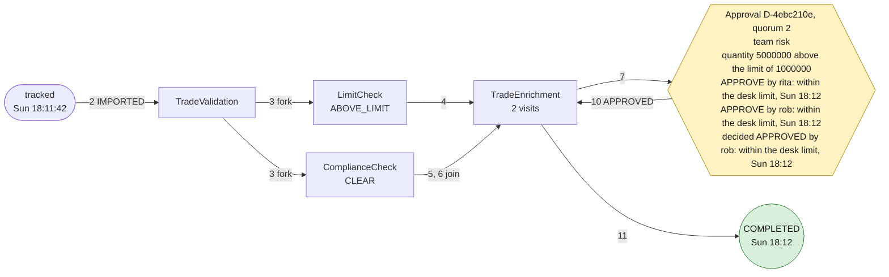

# dtp – First Implementation (Slices 1 to 20)

> **Disclaimer:** like the design, this first implementation was **generated by Claude (AI)** together with the
> initiator of the project. It is a **proof of concept**: work in progress, a detailed review will follow.

Branch `poc-impl` shows that the core ideas of the design ([docs/design](docs/design/README.md)) work at runtime:
several deployments coordinate only via the database, every run executes on exactly one node, crashed nodes are
taken over, and committed effects happen exactly once. Slice 2 adds **flows**: steps report signals, a flow
definition in Java decides where an item goes next, stored as an immutable version in the DB that operators can
switch and overrule without a deployment. Slice 3 adds **decision requests and approvals**: everything that waits for
a person (retries exhausted, loop limit, escalation, typed decisions, four-eyes approvals, abandoned runs) goes
through one mechanism, assigned to responsible teams, and the result comes back to the step that asked. Slice 4 adds
**fork/join on item level**: a flow splits an item into parallel branches, which can run on different nodes, and the
last branch to finish moves the item to the join step, which reads the typed results. Slices 5 to 16 add decision
fallbacks and domain events, flow instances with run joins (an end of day per business date), business calendars
with processing slots, work packages with item and time limits, collectors that hand their packages over to other
jobs, collection windows (a collector runs alone, while the jobs that write its data are paused), the monitoring
read model (a heat map of the flow with jam detection, alerts and a live feed), the journey diagram of a single
item (the steps it passed, its retries, decisions and packages, and where it waits now), telemetry metrics and
traces with OpenTelemetry, acknowledgements of sent work packages, lanes with weights and flow versions per lane, and the
REST adapter with MP OpenAPI and MP JWT roles. Slice 17 runs the tests of the engine on PostgreSQL 17 as well, and
slice 18 continues runs of a flow instance that stopped early with work left. Slice 19 lets job runs ask people
(`JobContext.requestDecision`, `requestApproval`), e.g. a four-eyes sign-off of an end of day. Slice 20 lets
operators cancel a flow instance (an end of day started by mistake) and a run that waits for a decision.

## Modules

| Module | Content |
|--------|---------|
| `dtp-api` | Public API, no dependencies: `JobHandler`, `ItemProcessor`, `@ItemProcessing`, `JobContext`, `TrackedItem`, `Inbox`, `Items`, `ItemType`/`ItemRef`, `RunInfo`, `JobEngine`, typed results; slice 2: `Signal`, `FlowDefinition`, `FlowBuilder`, `FlowEvent`; slice 3: `DecisionOption`, `Approval`, `ApprovalResult`, `Responsibility`; slice 4: `FlowBuilder.Fork`, `BranchResult` |
| `dtp-core` | Framework-free engine on plain JDBC (PostgreSQL, H2): leases and fencing, leader election, planner, claimer, executor, item routing and journey, Flyway schema per dialect, read-only queries; slice 2: flow registration, signal routing, flow admin, Mermaid export and validation; slice 3: decision requests; slice 4: branches of forked items |
| `dtp-telemetry` | Slice 13: `DtpOpenTelemetry`, the telemetry port of the core on the OpenTelemetry API (MicroProfile Telemetry): per-node metrics, the cluster gauges of the projection leader, a span per unit of work linked to the traces that tracked its items. Without CDI dependencies |
| `dtp-rest` | Slice 16: the REST adapter, Jakarta REST resources under `/dtp` (cluster, jobs and runs, packages, flows, decisions, journeys, monitoring), MP OpenAPI annotations, roles `dtp-viewer`, `dtp-operator`, `dtp-business`, `dtp-admin` via the `SecurityContext` (MP JWT groups), CDI beans discovered with the application |
| `dtp-cdi` | Starts the engine with the CDI container, discovers `ProcessStep` and `FlowDefinition` beans, observes `FlowEvent`s, uses JTA if available, `dtp.*` settings via MicroProfile Config. Tested with Weld, used on Quarkus (ArC) |
| `dtp-examples/trade-app` | The trade flow of [07 – Sample application](docs/design/07-sample-app.md) on Quarkus: JPA entity, import with typed parameters, a `TradeFlow` with signals (validation with back-routing, two parallel checks joined by the enrichment, approvals of the risk desk with notifications and a reminder, parallel batches), an end of day per business date (flow instance with a run join, a four-eyes sign-off after corrections), a cron job, settlement files handed over to a sender, a regulatory trade report in a collection window, the heat map with a live feed and alerts for operations, journey diagrams per item, the REST adapter (`dtp-rest`) with MP JWT and OpenAPI, MP Health, cluster scripts |

Slice 1 merges the design's hexagonal modules (`dtp-domain`, `dtp-application`, adapters) into the packages of
`dtp-core` (`domain`, `engine`, `jdbc`, `spi`, `query`). ArchUnit tests enforce the layering in their place.

## Build and Quality Gates

```bash
mvn clean install          # Java 25, Maven 3.9+
```

Every module runs the same gates (root `pom.xml`):

| Gate | Tool |
|------|------|
| Formatting and style | **Checkstyle** (`checkstyle.xml`: Google-based, 4 spaces, 120 chars, import order, no `final` classes/methods for CDI proxies, …), phase `validate` |
| Compiler warnings | `-Xlint:all` with `failOnWarning` |
| License headers | **Apache RAT** (Apache License 2.0 header in every source file) |
| Coverage | **JaCoCo** check, at least 70 % line coverage per module (`quarkus-jacoco` for `@QuarkusTest`) |
| Build hygiene | **Maven Enforcer**: Java 25+, Maven 3.9+, plugin versions pinned, no `javax.*` dependencies at compile or runtime |
| Architecture | **ArchUnit**: framework-free core, API without implementation dependencies, domain without infrastructure, layering of persistence and SPI |

Current figures: 129 tests (101 in the core incl. 5 ArchUnit rules, 9 CDI, 4 telemetry, 2 REST, 13 Quarkus), line
coverage core 91 %, CDI 84 %, telemetry 99 %, REST 90 %, example 94 %. The 107 tests of the core, telemetry and REST
modules also run on PostgreSQL 17:

```bash
tools/postgresql/run.sh                          # builds a local image on first use, 127.0.0.1:5433
mvn test -pl dtp-core,dtp-telemetry,dtp-rest -Ddtp.test.db=postgresql
tools/postgresql/run.sh stop
``` The cluster tests of the core run several nodes in one JVM on a shared H2 database.

## What Slice 1 Covers

| Design | Status |
|--------|--------|
| Lease per job, fencing token, fence check as last statement before the commit (DD-1, DD-12, DD-13) | ✅ |
| DB time as the only clock (DD-2), leader election with role `housekeeping` and local safety deadline (DD-3) | ✅ |
| Polling with jitter and idle backoff, seeded randomness (DD-11, DD-14) | ✅ |
| Definitions as SQL in `db/dtp-definitions`, own Flyway history tables (DD-15), revisions per run (DD-10) | ✅ |
| Triggers: cron (Quartz syntax, zone, misfire grace), ASAP, inbox, external with typed parameters and idempotency key, transitions on outcome or typed result | ✅ |
| Concurrency policies SKIP, QUEUE_ONE, QUEUE_ALL; takeover RERUN and ABANDON | ✅ |
| Items: track, routeTo, routeBack, defer, fail, complete, discard; loop limit; journey; lanes by priority (weights not yet) | ✅ |
| `ItemProcessor` with batches, parallel batches (SKIP LOCKED), `includeDeferred`, poison-item isolation (DD-26, DD-29) | ✅ |
| Business vs. technical failures with retries, then `WAITING_FOR_DECISION` | ✅ (decision requests: slice 3) |
| Soft stop: cancel, drain on shutdown; run outcomes incl. DEFERRED and COMPLETED_WITH_ISSUES | ✅ |
| Node registry, heartbeats, dead nodes | ✅ |
| Flows: signals, Java DSL, immutable versions in the DB, activation, pinning, overrides, migration, Mermaid export (slice 2, see below) | ✅ |
| Decision requests, approvals with quorum, responsible teams, takeover `ABANDON` (slice 3, see below) | ✅ |
| Fork/join on item level: parallel branches, typed branch results, join (DD-22, slice 4, see below) | ✅ |
| Decision fallbacks (D38) and domain events of decisions, published as CDI events after the commit (slice 5, see below) | ✅ (other domain events: later slices) |
| Flow instances (DD-4) and run joins (DD-9): runs of one end-to-end process per business key, a join target runs once per instance, rerun of failed runs (slice 6, see below) | ✅ |
| Business calendars, cron with calendar (skip, next, previous), scheduled flow instances, processing slots with carry-over (slice 7, see below) | ✅ |
| Work packages (create from the inbox or a selection, carry-over, retries, decisions), item limit, time limit (slice 8, see below) | ✅ |
| Packages handed over: a collector creates packages for other jobs, per group (slice 9, see below) | ✅ |
| Collection windows, acknowledgements of sent packages, monitoring projection, telemetry, lane weights and activations per lane (slices 10 to 15) | ✅ |
| REST adapter (slice 16) | ✅ |
| PostgreSQL 17 (slice 17) | ✅ |
| Deferred runs of flow instances are continued (slice 18) | ✅ |
| Decisions and approvals requested by job runs (slice 19) | ✅ |
| Cancelling flow instances and runs that wait for a decision (slice 20) | ✅ |
| Activations per tenant | open |

## Slice 2: Flows

Steps don't name their successors any more, they report what happened. The flow decides where the item goes:

```java
public enum ValidationSignal implements Signal { VALID, MISSING_ISIN }

@ApplicationScoped
public class TradeValidation implements ItemProcessor<Trade, UUID> {
    public void process(TrackedItem<Trade, UUID> item) {
        Trade trade = em.find(Trade.class, item.ref().id());
        if (trade.getIsin() != null) {
            item.signal(ValidationSignal.VALID);
        } else {
            item.signal(ValidationSignal.MISSING_ISIN, "missing ISIN");    // the reason the next step can read
        }
    }
}

@ApplicationScoped
public class TradeFlow implements FlowDefinition {                       // name: trade-flow (from the class)
    public void define(FlowBuilder flow) {
        flow.entry(TradeImport.class)                                    // trigger of the entry: SQL (DD-15)
                .on(ImportSignal.IMPORTED).to(TradeValidation.class)
                .on(ImportSignal.REIMPORTED).to(TradeValidation.class);
        flow.step(TradeValidation.class)
                .on(ValidationSignal.VALID).to(TradeEnrichment.class)
                .on(ValidationSignal.MISSING_ISIN).back(TradeImport.class);
        flow.step(TradeEnrichment.class)
                .on(EnrichmentSignal.ENRICHED).complete();
    }
}
```

| Topic | Behavior |
|-------|----------|
| Targets | `to(step)`, `back(step)` (journey `ROUTED_BACK`), `toFlow(OtherFlow.class)` (entry of the other flow's active version), `complete()`, `discard()`; `onResult(status, step)` plans a run of the next step when a run ends with a typed result |
| Flow version | At startup the definition is compiled, validated (one entry, no duplicate routes) and stored as an immutable version identified by its content hash (`dtp_flow_version`, `dtp_flow_step`, `dtp_flow_route`). Jobs of the steps are generated if missing (item processors with an inbox trigger), the entry keeps its SQL definition |
| Activation | Append-only (`dtp_flow_activation`, who/when/why, optional `active_from`). The first version and every *newly deployed* version are activated automatically, unless an operator activated a version manually: then a new version is only a candidate (log warning). A known version never re-activates itself, so restarts and red/green nodes don't switch back and forth. Activation is refused if no active node can run one of the version's steps (`dtp_node.capabilities`) |
| Pinning | An item is pinned to the version that was active at its first signal (or `FlowEvent.start`): items in flight finish with the routes they started with |
| Overrides | `dtp_route_override` redirects one hop (`from job + signal`) of a flow, for all versions, optionally time-boxed. It wins over the route of the version, ends via `endOverride` |
| Migration | `migrateQueued(flow, from, to)` pins queued items of a version to another one (journey `MIGRATED`), items whose step isn't part of the new version stay |
| Events | `FlowEvent.start(flow, ref, businessKey)` tracks an entity and puts it into the entry inbox, `FlowEvent.signal(item, signal)` is the alternative to `item.signal(…)`. In CDI: `@Inject Event<FlowEvent>`, observed synchronously by `dtp-cdi` (joins the caller's transaction or the run's unit of work); in plain Java: `DtpEngine.fire(event)` |
| Manual routing | `routeTo`/`routeBack` stay available for steps without a flow |
| Diagrams | `FlowQueries.mermaid(flow, version)` generates the diagram **from the DB** (what is executed, incl. overrides): triggers of the entry, `-->` item routes, `-.->` back routes, `==>` run successors, overrides red, overruled routes dashed. `dtp.flows.export=mermaid` writes all flows to `dtp.flows.export-path` (default `target/dtp-flows.md`) after the start |
| Validation | Unrouted enum constants of a signal type, unreachable steps, steps no active node can run, loops through steps without `max_item_visits`, an entry without trigger |

Example REST endpoints of the trade app (no security, demo only): `GET /dtp/flows`, `GET /dtp/flows/validation`,
`GET /dtp/flows/export`, `GET /dtp/flows/{flow}/diagram[?version=]`, `GET|POST /dtp/flows/{flow}/activations`,
`GET|POST /dtp/flows/{flow}/overrides`, `DELETE /dtp/flows/overrides/{id}`, `POST /dtp/flows/{flow}/migrations`.

Tests: `FlowTest` (signals, typed run successor, `FlowEvent.start`, diagram, validation, export),
`FlowSwitchTest` (v1 on node *blue*, v2 with an extra step on node *green*: automatic activation, pinning, switch
back, no re-activation by a restarted green node, override, migration, refused activation), `CdiFlowTest`
(flow beans, CDI events), `TradeFlowTest` (REST).

## Slice 3: Decision Requests and Approvals

One mechanism for human intervention (DD-5). A step hands an item over and gets it back with the result (DD-19):

```java
@ApplicationScoped
@ItemProcessing(batchSize = 25, parallelism = 4)
public class TradeEnrichment implements ItemProcessor<Trade, UUID> {

    public void process(TrackedItem<Trade, UUID> item) {
        Optional<ApprovalResult> approval = item.approval();          // back from the approval?
        if (approval.isPresent()) {
            item.signal(approval.get().approved() ? EnrichmentSignal.ENRICHED : EnrichmentSignal.REJECTED);
            return;
        }
        Trade trade = em.find(Trade.class, item.ref().id());
        marketData.enrich(trade);
        if (trade.getQuantity() > quantityLimit) {
            item.requestApproval(Approval.quorum(2).assignedTo(Desk.RISK), "quantity above the limit");
        } else {
            item.signal(EnrichmentSignal.ENRICHED);
        }
    }
}
```

| Request | Created by | Kind, options | Team |
|---------|------------|---------------|------|
| Typed decision | `item.requestDecision(reason, Options.class[, team])` | `CHOICE`: the enum constants (`DecisionOption`, with labels) + `DISCARD`; read back with `item.decision(Options.class)` | the given team |
| Approval | `item.requestApproval(Approval.quorum(n).assignedTo(team), reason)` | `APPROVAL`: `n` distinct `APPROVE` votes approve, one `REJECT` rejects, one vote per user; read back with `item.approval()` | the given team |
| Escalation | `item.escalate(reason)` | `CHOICE`: `RETRY`, `DISCARD` | any user |
| Retries exhausted | business or technical failure after `retry_max` | `CHOICE`: `RETRY`, `DISCARD` | technical: `dtp-operator` (DD-29), business: any user |
| Loop limit | an item enters an inbox more often than `max_item_visits` | `CHOICE`: `RESET_VISITS`, `RETRY`, `DISCARD` | any user |
| Abandoned run | lease expired, takeover policy `ABANDON` | `CHOICE` about the run: `RETRY` (planned again), `FAIL`, `SKIP` | `dtp-operator` |
| Asked by a job run (slice 19) | `ctx.requestDecision(reason, Options.class[, team])`, `ctx.requestApproval(approval, reason)` | `CHOICE` (the enum constants + `FAIL`) or `APPROVAL` about the run; read back with `ctx.decision(Options.class)`, `ctx.approval()` | the given team |

- `Decisions` (CDI bean, or `DtpEngine.decisions()`): `open(decider)` lists the open requests the user may decide,
  `decide(id, option, decider, comment)`, `vote(id, APPROVE|REJECT, decider, comment)`, `get(id)`, `ofSubject(id)`.
  A `Decider` is the user with their groups; the caller authenticates the user and checks the role (the trade app
  takes them from the headers `X-User` and `X-Groups` as a stand-in for the MP JWT `upn` and `groups`).
- Deciding and applying the decision is one transaction with the request row locked: a second decision, a second vote
  of the same user, an option that wasn't offered or a user outside the team are refused.
- Built-in options are applied by the framework: `DISCARD` ends the journey, `RETRY` re-queues the item at the end of
  the requesting step's inbox (attempts reset), `RESET_VISITS` also resets its visits of that step. All other
  options and approvals re-queue the item with the decision attached, the step decides what happens next. The next
  routing clears the attachment.
- Journey: `ESCALATED` (request created, with the reason), `VOTED`, `DECIDED` (option, user, comment), then the
  requeue or `DISCARDED`. The run that requested a decision ends `COMPLETED_WITH_ISSUES`.
- Requests never expire (D38). Fallback runs (`DecisionFallback`), work packages and window occurrences as subjects
  follow with their slices.

Trade app: trades above `trade.approval.quantity-limit` (every 10th trade of the feed; since slice 4 reported by the
`LimitCheck` branch) need the approval of two members of the risk desk; a rejected trade is discarded by the flow (`EnrichmentSignal.REJECTED`). REST:
`GET /dtp/decisions`, `GET /dtp/decisions/{id}`, `POST /dtp/decisions/{id}/decision`, `POST /dtp/decisions/{id}/votes`.

Tests: `DecisionTest` (typed decision with team, approval with quorum, rejection, escalation, technical failure to
operators, loop limit with `RESET_VISITS`, abandoned run decided by an operator after a node crash),
`TradeFlowTest` (REST, four-eyes approval).

## Slice 4: Fork/Join on Item Level

A flow splits an item into parallel branches (DD-22). Each branch step gets the item into its inbox; the branch
steps run independently, on different nodes if their leases are spread. The signal a branch step reports is its
result. The last branch to finish moves the item into the inbox of the join step, which reads the results:

```java
flow.step(TradeValidation.class)
        .on(ValidationSignal.VALID).fork(LimitCheck.class).and(ComplianceCheck.class)
            .joinAt(TradeEnrichment.class)
        .on(ValidationSignal.MISSING_ISIN).back(TradeImport.class);

// a branch step: an ordinary ItemProcessor, signal() finishes its branch
item.signal(LimitSignal.ABOVE_LIMIT, "quantity 5000000 above the limit of 1000000");

// the join step
BranchResult compliance = item.branchResult(ComplianceCheck.class).orElseThrow();
if (compliance.is(ComplianceSignal.RESTRICTED)) {
    item.signal(EnrichmentSignal.REJECTED, compliance.reason());
    return;
}
```

- **Storage**: one row per branch in `dtp_item_branch`, in the inbox of the branch step (own `inbox_seq` from the
  same sequence, lane priority copied from the item). The item is `FORKED` with `open_branches`. A step reads the
  items routed into its inbox and the branches in its inbox in one batch (two `SKIP LOCKED` queries, merged by
  position).
- **Join exactly once**: finishing a branch locks the item row, sets the branch `FINISHED` with the signal and the
  reason, and decrements `open_branches`; the branch that brings it to 0 routes the item to the join step (`JOINED`).
  The lock serializes branches that finish at the same time on different nodes.
- **What a branch can do**: `signal` (finish with a result), `defer`, `fail` (retries per branch, then a decision),
  `escalate`, `requestDecision`, `requestApproval`. A decision about a branch brings the branch back into the inbox
  of its step with the decision attached; `DISCARD` discards the item and cancels its open branches. `routeTo`,
  `routeBack`, `complete` and `discard` are refused in a branch (`IllegalStateException`, recorded as a technical
  failure). `item.isBranch()` tells a step which case it handles.
- **Join step**: `item.branchResults()` (in the order of the fork definition), `item.branchResult(Step.class)`,
  typed `item.branchResult(Step.class, Signals.class)`; `BranchResult.is(signal)`, `reason()`.
- **Journey**: `FORKED` (branches and join step), `BRANCH_FINISHED` per branch (from the branch step, with signal and
  reason), `JOINED`; failures, retries and decisions of a branch carry the branch step as source.
- **Diagram and validation**: the Mermaid export draws `fork` and `join` nodes between the branch steps; reachability
  and loop detection follow the branches.
- **Queries**: `itemCounts()` shows open branches per branch step (`BRANCH_QUEUED`, `BRANCH_WAITING_FOR_DECISION`);
  `isIdle()` and inbox planning count due branches.

Trade app: a valid trade forks into `LimitCheck` (quantity above `trade.approval.quantity-limit` → `ABOVE_LIMIT`)
and `ComplianceCheck` (ISIN in `trade.compliance.restricted-isins` → `RESTRICTED`). `TradeEnrichment` joins: a
restricted trade is rejected, a trade above the limit needs the approval of two members of the risk desk (slice 3),
the others are enriched. The branch steps only read the trade; the join step writes it, so parallel branches never
conflict on the JPA version.

Tests: `ForkJoinTest` (three branches on three nodes, exactly one join per item, typed results in order; a branch
with a technical failure retried after an operator decision; a typed decision in a branch read back by the branch
step; `DISCARD` in a branch cancels the deferred branch; `complete` in a branch refused; invalid forks rejected at
startup), `TradeFlowTest` (journeys with fork and join, a restricted trade, approval after the join).

## Slice 5: Decision Fallbacks and Domain Events

A decision request never expires (D38). The requesting job can name a **fallback job**: once a request has been open
longer than the fallback delay, the leader plans **one** run of the fallback job for it (run key
`fallback:<request>`). The fallback only reacts, e.g. it reminds the team; the request stays open and nobody decides
automatically.

```sql
-- the requesting job names the fallback job and the delay (ISO-8601, DD-21)
INSERT INTO dtp_job_revision (job_id, revision, handler_class, inbox_min_items, fallback_job_id, fallback_delay, ...)
VALUES ('...-000000000006', 1, 'com.acme.trade.TradeEnrichment', 1, '...-000000000005', '${approval-reminder-after}', ...);
```

```java
// the fallback job: typed parameters, a snapshot of the open request
public class ApprovalReminder implements JobHandler<DecisionRequest, DefaultOutcome> {
    public JobResult<DefaultOutcome> execute(JobContext<DecisionRequest> ctx) {
        DecisionRequest open = ctx.parameters();
        team.send(open.responsibleGroup(), "Reminder: still open for " + open.businessKey(),
                "approvals %d of %d".formatted(open.approvals(), open.requiredApprovals()));
        return JobResult.success();
    }
}

// the framework never notifies people itself: the app observes the domain events
void onDecisionRequested(@ObservesAsync DecisionRequested event) { ... }
```

- **Planning**: the fallback job and the due time are copied to the request when it is created
  (`dtp_decision_request.fallback_job_id`, `fallback_due_at`). The housekeeping leader picks open requests whose
  fallback is due (index `(state, fallback_due_at)`, at most 100 per tick), locks each request, plans the run and
  stores `fallback_run_id`. The lock and the unique run key make it safe against a decision at the same moment and
  against two leaders.
- **Never skipped**: a fallback run belongs to one request, so the concurrency policy of the fallback job doesn't
  apply (it is planned like `QUEUE_ALL`); the job lease runs the fallback runs of a job one after the other.
- **Disabled fallback job**: its requests are left out, their overdue fallbacks are planned when it is enabled again.
- **Domain events** (02 §2.6, the intervention context): `DecisionRequested`, `VoteCast`, `DecisionMade`,
  `DecisionFallbackDue` in `org.os890.dtp.api.event`, each with a `DecisionRequest` snapshot. The engine hands them to
  the port `DomainEventPublisher` **after the commit** (`Transactions.afterCommit`); a rolled back transaction
  publishes nothing. `dtp-cdi` fires them as CDI events, first to `@Observes` (in the committing thread, without a
  transaction), then to `@ObservesAsync`; failing observers are logged. For a JTA transaction of the application
  (e.g. a `@Transactional` REST method that votes), the events follow in `afterCompletion`.
- **Placeholders in job definitions**: `dtp.definitions.placeholders.<name>` become Flyway placeholders `${name}` of
  the application's definition scripts, e.g. a fallback delay of `PT4H` in production and `PT1S` in tests.
- **Queries**: `isIdle()` also waits for due fallbacks.

Trade app: `TradeEnrichment` names the fallback job `approval-reminder` (`V2__approval_reminder.sql`; the job of the
enrichment step is defined in SQL now instead of being generated, to carry the fallback). `ApprovalNotifier`
observes `DecisionRequested` and informs the responsible team, `ApprovalReminder` reminds it after
`approval-reminder-after` (PT4H, PT1S in tests, PT30S in the cluster profile). `TeamNotifications` stands in for mail
or chat (log + `GET /notifications`).

Tests: `DecisionFallbackTest` (two nodes: one fallback run per open request with the typed request, none for a
request decided before, the requests stay open and are decided afterwards; the events of requests, votes, decisions
and fallbacks; a rolled back vote publishes nothing), `JtaTransactionsTest` (actions after the commit for own and
application transactions), `CdiEventPublisherTest` (synchronous and asynchronous observers, failing observers),
`TradeFlowTest` (notification and reminder before the risk desk approves).

## Slice 6: Flow Instances and Run Joins

A **flow instance** groups the runs of one end-to-end process, e.g. the end of day of a business date: the root run
and all its successors (transitions, run joins). A **run join** runs its target **once per instance** when all its
members finished with an accepted outcome (DD-9).

```java
// start the end of day of a business date: idempotent per root job and business key
RunHandle root = jobEngine.startFlowInstance(EndOfDay.class, new EodParams("otto"), "2026-11-20");

// every run of the instance knows its business key
LocalDate date = ctx.flowInstance().map(FlowInstance::businessKey).map(LocalDate::parse).orElseThrow();
```

```sql
-- end-of-day --SUCCEEDED--> position-report --+
--            --SUCCEEDED--> pnl-report      --+--> run join --> eod-sign-off
INSERT INTO dtp_transition (...) VALUES (..., <end-of-day>, 1, 'SUCCEEDED', <position-report>), (... <pnl-report>);
INSERT INTO dtp_join_member (target_job_id, target_revision, member_job_id, accepted_outcomes) VALUES
    (<eod-sign-off>, 1, <position-report>, 'SUCCEEDED'),
    (<eod-sign-off>, 1, <pnl-report>, 'SUCCEEDED');
```

- **Instance**: `dtp_flow_instance` (unique per namespace, flow name and business key; the flow name is the name of
  the root job). Runs carry `flow_instance_id`; transitions and joins pass it on. Runs of an instance are never
  skipped or coalesced (they belong to their business key), whatever the concurrency policy of the job.
- **Join, exactly once**: in the transaction that finishes a member run, the engine locks the instance row, then the
  join row (`dtp_join_instance`, created on the first arrival), records the arrival (`dtp_join_arrival`: the latest
  run of each member counts) and, when all members arrived with accepted outcomes, plans the target with run key
  `join:<target>:<instance>` and marks the join fired. Members that finish at the same time on different nodes wait
  for each other's lock (the READ COMMITTED race of DD-9 can't happen).
- **Completion** (DD-4): in the same transaction, the instance completes when no run of it is pending or active, no
  join waits and no failed run is left without a rerun. The instance lock serializes the finishing runs, so exactly
  one of them completes it. Runs finished by a decision (`FAIL`, `SKIP`) or a cancel are handled the same way.
- **Rerun**: `FlowInstances.rerun(runId, by)` plans a finished run of an open instance again (same job, parameters
  and instance, run key `rerun:<run>`, so once per run). The arrival of the new run replaces the failed one.
- **Read model**: `FlowInstances.latest/get/find` with the runs (job, state, outcome, trigger) and the joins (arrivals,
  accepted or not, `waitingFor`).
- **Domain events**: `FlowInstanceStarted`, `JoinFired`, `FlowInstanceCompleted`.

Trade app: the end of day per business date (`V3__end_of_day.sql`, `POST /eod/{date}`, `GET /eod/{date}`). The
cut-off `EndOfDay` counts the trades of the date, `PositionReport` and `PnlReport` run in parallel, `EodSignOff` is
the run join and informs operations. The P&L report fails while trades of the date wait for their ISIN; after the
next import, an operator runs it again (`POST /dtp/runs/{id}/reruns`) and the sign-off follows. `GET
/dtp/flow-instances` lists the instances.

Tests: `FlowInstanceTest` (3 nodes, 20 business dates: one sign-off per date, the two members of one date forced to
run at the same time on different nodes; idempotent start; events; a failed member and a failed root keep their
instances open, the reruns complete them, a completed instance refuses reruns), `TradeFlowTest` (end of day with a
failed P&L report, rerun via REST, sign-off notification).

## Slice 7: Business Calendars and Processing Slots

A **business calendar** (`dtp_calendar`, `dtp_calendar_exception`) defines business days: weekdays plus exceptions
(holidays, extra business days). Cron triggers and processing slots refer to it, and application code reads it.

```sql
INSERT INTO dtp_calendar (id, namespace, name, zone, business_weekdays)
VALUES (<at-banking>, 'trade-app', 'AT-BANKING', 'Europe/Vienna', 'MON-FRI');
INSERT INTO dtp_calendar_exception (calendar_id, calendar_day, business_day, description)
VALUES (<at-banking>, DATE '2026-12-08', FALSE, 'Immaculate Conception');

-- the end of day at 18:00 on each business day, one flow instance per business date
INSERT INTO dtp_job_revision (job_id, revision, ..., cron_expression, cron_zone, cron_calendar_id, calendar_shift,
                              cron_flow_instance, default_parameters, ...)
VALUES (<end-of-day>, 2, ..., '0 0 18 ? * *', 'Europe/Vienna', <at-banking>, 'SKIP', TRUE,
        '{"requestedBy":"scheduler"}', ...);

-- the enrichment only while the market data is available: business days from 07:00 to 22:00
INSERT INTO dtp_job_slot (id, job_id, revision, calendar_id, from_time, to_time)
VALUES (<id>, <trade-enrichment>, 2, <at-banking>, TIME '07:00:00', TIME '22:00:00');
```

```java
@Inject BusinessCalendars calendars;

if (!calendars.get("AT-BANKING").isBusinessDay(date)) { ... }
LocalDate previous = calendars.get("AT-BANKING").previousBusinessDay(date);
```

- **Cron with a calendar** (§5.1): a slot on a day that isn't a business day (in the zone of the calendar) is
  skipped (`SKIP`) or moved to the same time on the next (`NEXT`) or previous (`PREVIOUS`) business day. The run key
  is the point in time the run is due, so slots moved to the same point collapse into one run (e.g. Saturday,
  Sunday and Monday of a daily cron with `NEXT`). A slot moved to the previous business day is planned ahead; a slot
  moved to the next one is due up to 14 days after the slot itself. `dtp_run.cron_slot` keeps the slot (before the
  shift), so the leader knows where to continue; slots the leader skipped are remembered in memory only, a new leader
  examines them again without effect.
- **Scheduled flow instances**: with `cron_flow_instance`, every cron slot starts the flow instance of its business
  date (the business key), the root run gets the job's default parameters. Further slots of the same date find the
  instance: a cron every minute still gives one end of day per business date, also across leader changes and next
  to a manual start via REST.
- **Processing slots** (§5.7, D33, D39): runs of a job with slots (`dtp_job_slot`) are planned for the next open
  slot (`not_before`, `slot_end`), whatever triggered them (cron, inbox, transition, join, decision, rerun), and are
  only claimed within it. At the end of the slot, the node asks the run to stop softly (`SLOT_END`, noticed within a
  heartbeat); the running batch is finished, the run ends `DEFERRED` and its remaining items wait in the inbox. The
  inbox trigger plans the next run, for the next slot. A pending run that missed its slot (cluster down or busy) is
  moved to the next one by the leader. Slots that overlap or follow each other without a gap form one window, so a
  whole-day slot (`from_time = to_time`) doesn't stop a run at midnight. Without calendar, the zone of a slot is the
  cron zone of the revision.
- **Calendars at runtime**: calendars are definitions in the DB, cached and refreshed with the job definitions, so a
  holiday an operator adds (or removes) applies without a deployment. `BusinessCalendars` (CDI bean, or
  `DtpEngine.calendars()`) reads them.
- **Stop reason**: a run that stopped early keeps its stop reason (`SLOT_END`, `DRAIN`, `CANCEL`) after it finished.

Trade app (`V4__business_calendar.sql`): the calendar `AT-BANKING` with the Austrian bank holidays until the end of
2027 (sample data); revision 2 of `end-of-day` starts the end of day at 18:00 on each business day (placeholder
`eod-cron`, `NONE` in tests, every minute in the cluster demo); `POST /eod/{date}` refuses dates that aren't
business days (409); revision 2 of `trade-enrichment` has the processing slot of the market data (placeholders
`market-data-*`, the whole day without calendar in tests and in the cluster demo).

Tests: `CalendarDefinitionTest`, `CronScheduleTest`, `ProcessingSlotsTest` (weekdays, exceptions, shifts, collapse,
lookahead, misfire, zones, windows across midnight, merged windows), `BusinessCalendarTest` (cron slots on holidays
skipped until an operator removes the holidays; a cron every second starts one flow instance per business date on 3
nodes, also after the leader was killed), `ProcessingSlotTest` (a run waits for its slot, stops at its end with
`SLOT_END`, outcome `DEFERRED`, the rest is planned for the next day's slot; a run that missed its slot is moved to
the next one), `TradeFlowTest` (no end of day on a Saturday or a holiday, enrichment runs within their slot),
`HeartbeatTest` (a failed renewal of a run that finished itself is no lease loss).

## Slice 8: Work Packages, Item and Time Limits

A **work package** groups items that are processed as a whole, e.g. one file per custodian (§4.4, DD-26). A collector
(`JobHandler`) creates packages and processes the pending ones; each package is one fenced unit of work.

```java
@ApplicationScoped
public class SettlementExport implements JobHandler<NoParams, DefaultOutcome> {

    public JobResult<DefaultOutcome> execute(JobContext<NoParams> ctx) {
        WorkPackages<Trade, UUID> packages = ctx.packages(INSTRUCTION);
        // a selection of references, e.g. the released trades of the business date (each reference packaged once)
        packages.createFrom(releasedTrades(date).map(id -> ItemRef.of(INSTRUCTION, id)),
                ref -> gateway.custodianOf(em.find(Trade.class, ref.id())), 500);
        // or: the items routed into this job's inbox
        // packages.createFromInbox(item -> custodianOf(item), 500);
        packages.forEachPending(pkg -> {
            if (!gateway.isAvailable(pkg.groupKey())) {
                pkg.fail(pkg.groupKey() + " rejected the file");     // retried, then a decision
                return;
            }
            pkg.info().put(FILE, gateway.send(pkg.groupKey(), pkg.sequence(), tradeNumbers(pkg.items())));
            pkg.done();                                              // the items that weren't routed are completed
        });
        return JobResult.success();
    }
}
```

- **Creating packages**: `createFromInbox(groupKey, maxSize)` moves the due items of the job's inbox into packages
  (item state `PACKAGED`, `dtp_item.work_package_id`, journal entry `PACKAGED`); `createFrom(refs, groupKey,
  maxSize)` tracks new items directly in packages and skips references that are tracked already, so a second run with
  the same selection doesn't package an item twice. Both work in chunks of 500 items, each its own unit of work.
- **Processing**: `forEachPending` locks the oldest pending, due package (`FOR UPDATE SKIP LOCKED`), hands it over and
  commits it in one transaction: exactly one of `done()` (package `DONE`, unrouted items completed) or `fail(reason)`
  (business failure); an exception or neither call is a technical failure. A package is never left in progress: a
  crash rolls it back to `PENDING`, the takeover processes only the packages that aren't done.
- **Carry-over** (D33): pending packages belong to the job, not to the run. A run that stops at a slot end, its item
  limit or its time limit leaves them `PENDING`; the next run of the job processes them first. The inbox trigger also
  plans a run for due packages, so a collector with `inbox_min_items` continues on its own.
- **Retries and decisions**: a failed package is retried with the job's retry policy (`retry_max`, `retry_backoff`),
  then it waits for a decision (subject `WORK_PACKAGE`, options `RETRY` and `DISCARD`): business failures for the
  business, technical ones for `dtp-operator` (DD-29). `RETRY` makes it pending again (the next run, within its
  slot, D39), `DISCARD` discards it with its items. A run that leaves a package waiting ends
  `COMPLETED_WITH_ISSUES`.
- **Item limit and time limit** (`dtp_job_revision.item_limit`, `time_limit`): a run stops softly after the given
  number of items (inbox batches, items of an `ItemProcessor`, items of packages) or after the given duration (checked
  with the heartbeat), stop reason `LIMIT_REACHED`, outcome `DEFERRED`.
- **Read model**: `DtpQueries.packages(limit)` (job, number, group, state, items, attempts, last error, runs, info);
  runs show their stop reason.

Trade app (`V5__settlement_export.sql`): after the sign-off of an end of day, `SettlementExport` creates one
settlement instruction (item type `settlement-instruction`) per released trade of the business date and sends one file
per custodian (simulated `SettlementGateway`, demo controls `POST`/`DELETE /settlement/custodians/{name}/outage`,
`GET /settlement/files`, `GET /dtp/packages`). Revision 2 of `eod-sign-off` adds the transition (the join members are
copied, DD-10). A rejected file is sent again after the backoff, then an operator decides.

Tests: `WorkPackageTest` (packages per group with a size limit, the first run stops at the item limit and the next one
processes the rest in order; business and technical failures retried, then decided for the business or for
operations, `RETRY` sends, `DISCARD` discards the items; a selection packaged once although selected again; `kill`
of the node during the export: every package and item exactly once; time limit), `TradeFlowTest` (settlement export
after the sign-off, a custodian outage, decision `RETRY` via REST, the file is sent).

## Slice 9: Packages Handed Over to Other Jobs

In slice 8, the job that created a package also processed it. Now a **collector** can collect what is pending right
now (its inbox, or a selection of references) and create the packages **for other jobs**, which process them with
their own runs, retry policy, decisions, processing slots and limits:

```java
// the collector: decides the grouping, then it is done
ctx.packages(INSTRUCTION).forStep(SettlementSender.class)
   .createFrom(releasedTrades(date).map(id -> ItemRef.of(INSTRUCTION, id)), ref -> custodianOf(ref), 500);

// or per group: each group's packages go to the job of the group
ctx.packages(INSTRUCTION).forSteps(custodian -> isDomestic(custodian) ? DomesticSender.class : IcsdSender.class)
   .createFromInbox(item -> custodianOf(item), 500);

// the job that processes them: the same as in slice 8
ctx.packages(INSTRUCTION).forEachPending(pkg -> { ...; pkg.done(); });
```

- **API**: `PackageCollector` (`createFromInbox`, `createFrom`) is the creating part of `WorkPackages`;
  `WorkPackages.forStep(Class<? extends JobHandler>)` and `forSteps(groupKey -> step)` return a collector for other
  jobs. Only a `JobHandler` can be a target (an `ItemProcessor` has no packages to process): the compiler checks it,
  and a raw class is refused at runtime, which rolls back the chunk (no package, the items stay in the collector's
  inbox, the run fails).
- **Ownership**: `dtp_work_package.job_id` is the job that processes a package, the new `created_by_job_id` the
  collector. The items move to the target job with their package (`current_job_id`), and the journal entry
  `PACKAGED` names the collector as `from` and the target as `to`, so the journey shows the handover.
- **Scheduling**: nothing new. The inbox trigger of the target already plans a run when packages are due (slice 8);
  a target without an inbox trigger processes them with its next cron or external run, e.g. in a sending window.
- **Parallelism**: one job still has one run at a time (job lease). Senders of different groups are different jobs,
  so they run in parallel, also on different nodes.
- **Read model**: `PackageView.collector` next to `job`.

Trade app (`V6__settlement_sender.sql`): `SettlementExport` only creates the settlement files and hands them over to
the new job `settlement-sender` (inbox trigger, retry 1 with the backoff of slice 8); revision 2 of the export has no
inbox trigger anymore. The end of day completes once the files are created, sending them is the sender's business.
Files of the export that weren't sent yet are moved to the sender by the migration.

Tests: `PackageHandoverTest` (the collector's packages are processed only by the sender, with the sender's retry
policy and a decision of the sender's job, `RETRY` sends the file, the journey shows `PACKAGED` from the collector to
the sender; groups split between two senders on two nodes, which overlap in time, every item completed once; a
target that isn't a `JobHandler` is refused, nothing is packaged), `TradeFlowTest` (packages of the export processed
by the sender, the end of day without the sender's runs, the journey of an instruction).

## Slice 10: Collection Windows

Some collectors need data that doesn't change while they read it, e.g. a regulatory report of everything released
since the last report. A **collection window** pauses the jobs that write the data, waits until they are idle, takes a
cut-off and runs the collector alone; afterwards the paused jobs continue (design 04 §4.6, 05 §5.6, D35):

```java
// the collector of a window: everything in (from, cutOff] belongs to this occurrence
WindowOccurrence window = ctx.window().orElseThrow();
ctx.packages(REPORTED).createFrom(releasedBetween(window.since(), window.cutOff()), ref -> businessDateOf(ref),
        Integer.MAX_VALUE);
ctx.packages(REPORTED).forEachPending(pkg -> { writeReport(window.sequence(), pkg); pkg.done(); });
```

- **Definition** (SQL, like jobs): `dtp_window` with an optional cron schedule (zone, business calendar, missed slots
  are skipped), the collector job and a quiesce timeout; `dtp_window_paused_job` lists the paused jobs. Without a
  schedule a window is started by operators only (`CollectionWindows.startNow(name, user)`), which returns the active
  occurrence if there is one.
- **Window coordinator** (leader, part of the housekeeping, one transaction per window and cycle): a due slot starts an
  occurrence (`QUIESCING`); running runs of the paused jobs get the stop request `WINDOW` and end `DEFERRED` after their
  current unit of work. Once no paused job holds a lease (at the earliest 1 s after quiescing started), the occurrence
  opens with the DB time as cut-off (`from` = the cut-off of the last closed occurrence) and plans the collector run
  (trigger `WINDOW`, run key `window:<occurrence>:<attempt>`). When the collector run finished, the occurrence is
  `CLOSED`.
- **Claimer**: while an occurrence is `QUIESCING`, `OPEN` or `WAITING_FOR_DECISION`, runs of its paused jobs aren't
  claimed. Their triggers are planned as usual, the runs start after the window.
- **Decisions of operations** (`dtp-operator`, subject `WINDOW_OCCURRENCE`, business key `window <name> #<n>`): a
  quiesce timeout offers `KEEP_WAITING`, `FORCE_OPEN` and `SKIP_OCCURRENCE`; a failed or cancelled collector run
  offers `RETRY` (a new collector run in the same occurrence, same cut-off) and `SKIP_OCCURRENCE`. A skipped
  occurrence's changes fall into the next one.
- **API**: `JobContext.window()` returns the `WindowOccurrence` (`window`, `sequence`, `since()`, `cutOff`) of the
  collector run; packages created by it carry the occurrence (`dtp_work_package.window_occurrence_id`).
- **Read model**: `CollectionWindows.latest(limit)`; `DtpQueries.isIdle()` counts active occurrences as not idle.

Trade app (`V7__trade_reporting.sql`): the window `trade-reporting` pauses `trade-enrichment` (which releases trades,
also after approvals) and runs the new collector `TradeReporting` daily at 17:30 Vienna on the business days of
AT-BANKING (cluster profile: every two minutes, tests: REST only). A trade records its release time (`releasedAt`, the
DB time of the releasing transaction); the report selects the trades released in `(from, cutOff]`, one report file per
business date (`trade-report-<n>-<date>.csv`, an in-memory archive per node). Selecting by time is safe here because
the writer is paused: no releasing transaction can be in flight at the cut-off. REST: `POST /reporting/occurrences`
(header `X-User`), `GET /reporting/files`, `GET /dtp/windows`.

Tests: `WindowTest` (the collector runs only while the paused job is idle, which continues afterwards; the second
occurrence starts at the cut-off of the first; a cron schedule starts occurrences; a quiesce timeout waits for a
decision, `FORCE_OPEN` opens the window; a failed collector waits for a decision, `RETRY` runs it again, then
`SKIP_OCCURRENCE`), `TradeFlowTest` (two reports via REST, the second one contains only the trades released since the
first, `from` of the second equals the cut-off of the first, the journey of a reported trade).

## Slice 11: Monitoring Read Model (Heat Map, Jams, Alerts, Live Feed)

Operators need to see at a glance where items jam and where technical errors pile up, cluster-wide and without load
on the processing tables (design 09, CQRS). The journal already is the event stream; a **projector** derives small
views from it, and clients only read the views:

```java
HeatMap heatmap = monitoring.heatmap(Duration.ofMinutes(15));   // status, queue, jam score, alert per step, edges
String mermaid = monitoring.diagram("trade-flow", Duration.ofMinutes(15));   // the flow colored by its state
List<FailureView> errors = monitoring.failures("trade-enrichment", Duration.ofHours(1));  // per exception class
Subscription live = feed.subscribe(update -> sse.send(update));   // heatmap-update and alert after each cycle

void onJam(@ObservesAsync StepCongested event) { ... }           // also TechnicalFailureSpike, StepRecovered
```

- **Projector** (`MonitoringProjector`): run by the leader of its own role `projection` (DD-30, the leader election
  now takes a role), on its own thread, every `dtp.monitoring.interval` (default 10 s). One transaction per cycle,
  serialized by a lock on `dtp_projection_state`. It recomputes the minute buckets of the last two lease durations
  from the journal (entries can't commit later than one lease after their timestamp, so older buckets are final),
  then the status of every step, and deletes buckets after `dtp.monitoring.retention` (48 h).
- **Views** (`V11__dtp_monitoring.sql`): `dtp_view_step_status` (one row per step), `dtp_view_step_minute` (arrivals,
  departures, back-routes, completions, discards, escalations, business and technical failures, max and sum of the
  time from arrival to departure), `dtp_view_edge_minute` (items per route and minute), `dtp_view_failure_minute`
  (per exception class and stack hash, with a sample message and item), `dtp_projection_state` (version, term).
- **Status reasons** (`StepHealth`): `DISABLED`, `PAUSED_BY_WINDOW`, `NO_CAPABLE_NODE` (items queued, no active node
  has the handler), `PROCESSING`, `SLOT_CLOSED`, `IDLE`, `WAITING_FOR_TRIGGER` (queued for the next run of another
  trigger, e.g. trades routed back to the import, or fewer than the inbox minimum) and `WAITING_FOR_RUN`. Only
  `PROCESSING` and `WAITING_FOR_RUN` can jam; `NO_CAPABLE_NODE` always does.
- **Jam score** (0 to 100): the strongest of the age of the oldest due item relative to `expected_max_queue_age` (per
  job revision, default `dtp.monitoring.expected-max-queue-age`, 10 minutes), a stuck step (no departures within the
  recent window while the oldest item waits longer than the window: 100) and a growing queue (at most 50). An item
  that is due again after a retry or a deferral counts from when it became due.
- **Alert states** with hysteresis: `CONGESTED` after two cycles at or above `dtp.monitoring.jam-threshold` (70),
  back to `OK` after two cycles below; `FAILING` at once when the technical failures within
  `dtp.monitoring.failure-window` (5 minutes) reach `dtp.monitoring.failure-threshold` (10), back to `OK` after a calm
  period of the same window. The state is stored, so every transition fires its domain event exactly once, also
  across a change of the projector leader. While a window pauses a step, its alert is held.
- **Queries and feed**: `MonitoringQueries` (`heatmap`, `series`, `failures`, `diagram`, `changedSince`,
  `projection`) reads only the views; `diagram` decorates the flow diagram of slice 2 with queue, status and counters
  per step and colors it (FAILING red, CONGESTED orange, processing yellow, idle or waiting gray, else green).
  `MonitoringFeed` polls the projection version every `dtp.monitoring.feed-interval` (2 s) only while listeners are
  subscribed, and sends the changed steps (`heatmap-update`) and the steps whose alert state changed (`alert`).

Trade app: `MonitorResource` (`GET /dtp/monitor/heatmap?range=15m`, `/heatmap/diagram?flow=trade-flow`,
`/steps/{step}?range=1h`, `/steps/{step}/failures` for `dtp-operator` only, and the live feed
`/dtp/monitor/stream` as Server-Sent Events), `AlertNotifier` (informs `dtp-operator` about jams, failure spikes and
recoveries), and a simulated outage of the market data service (`POST|DELETE /market-data/outage`) that fails the
enrichment technically.

Tests: `StepHealthTest` (order of the status reasons, jam signals, hysteresis, calm period, hold), `MonitoringTest`
(arrivals, departures, back-routes and edges counted once although the horizon is recomputed every cycle; a slow step
congested once and recovered once; technical failures grouped by exception class with a sample, one spike, one
recovery; deferred items not stuck when they are due again; a step without capable node is a jam, a disabled one and
one waiting for its trigger are not; the projection follows its leader after a kill with a new term, and the feed of
the other node sends the changed steps), `TradeFlowTest` (heat map, diagram, minute series, the SSE stream with
`heatmap-update` and `alert`, an outage of the market data service: operators informed, failures only for
operators, recovery after the retries).

## Slice 12: Journey Diagram per Item

The heat map shows the whole flow; for a single item, users want the opposite: **only the steps this item passed**,
in order, with the reasons (design 09 §9.9). The engine folds the item's journal entries into a graph and returns it
as Mermaid source or as JSON. It needs no projection and adds nothing to the processing path:

```java
Optional<String> mermaid = journeys.diagram("trade", "T-2026-11-16-10", Options.defaults());
Optional<JourneyGraph> graph = journeys.graph(itemId, new Options(Detail.STEPS, false, ZoneId.of("Europe/Vienna")));
```



*A large trade of the 3-node demo, as `GET /dtp/items/trade/T-2026-11-16-10/journey/diagram` returned it (viewer).*

- **Folding** (`JourneyFolder`): every step once, with its visits; repeated edges between the same nodes collapse into
  one edge with all entry numbers (*"3, 5, …, 11 (5×)"*); the branches of a fork leave the forking step and meet at
  the join step, the branch that finished last carries *join*; back-routes are dashed with their reason; failed
  attempts with a retry are a dashed self-loop (*"retry 2×, technical: SocketTimeoutException"*) and the step shows
  *"succeeded on attempt 3"*; decisions and approvals are nodes with team, reason, votes and the decision; work
  packages are nodes with their state, custom information (e.g. the file name) and the job they were handed over to;
  deferrals, reprocessing after a batch rollback, run attempts after a takeover and flow migrations are annotations.
  An unfinished journey ends at the current place, highlighted: the step with *"waiting since 14:12: SLOT_CLOSED"*
  (the status reason of the monitoring read model) or *"next attempt 15:00"*, the open approval with *"waiting: 1 of 2
  approvals"*, the open branches of a forked item, the pending package.
- **Numbers**: the edges carry the numbers of the journal entries; `DtpQueries.JourneyEntry` has the same number
  (`no`), so the diagram and the journey table refer to each other.
- **Links** (`V12__dtp_journey.sql`): journal entries about a decision (`ESCALATED`, `LOOP_LIMIT_EXCEEDED`, `VOTED`,
  `DECIDED`, a `DISCARDED` by a decision) store the decision request, `PACKAGED` stores the work package. The JSON
  format carries these ids and the runs per step, so a UI can link each node.
- **Options**: `Detail.FULL` or `Detail.STEPS` (steps only, without decisions, packages and annotations), the time
  zone of the labels, and `technical` (node names and error messages, for operators only). Business texts are
  escaped with Mermaid entity codes and truncated to 60 characters, so clients can render with the strict security
  level.

Trade app: `JourneyResource` (`GET /dtp/items/{itemType}/{businessKey}/journey` for the table,
`…/journey/diagram?format=mermaid|json&detail=full|steps&zone=Europe/Vienna`, `/dtp/items/by-id/{itemId}/journey/diagram`),
for `dtp-viewer` and `dtp-operator` only, technical details for `dtp-operator`.

Tests: `JourneyFolderTest` (packages with handover and their state, takeovers and rollbacks as annotations, an item
tracked by a collector and sent with its package, loops collapsed into one edge, the loop limit ending in a decision
and a discard, escaping, entries without links, items waiting in a step, open branches), `JourneyTest` (on two nodes:
a fork with a flaky branch that succeeded on its third attempt, an approval with a quorum of two before, between and
after the votes, a back-route that repeats the fork on the same edges, an item that waits for its next attempt, steps
only, technical details), `TradeFlowTest` (the approval of order 3, the back-route of order 1, the retries of the
market data outage, a settlement instruction with its package, JSON, steps only, by id, roles and invalid requests).

## Slice 13: Telemetry Metrics and Traces

The read model gives the cluster-wide picture one projection cycle late; dashboards and alerting in standard tools
(OpenTelemetry collector, Prometheus, Grafana, Tempo) need the real-time signal, percentiles and traces (design 09
§9.8, DD-33). The core reports to a port and stays free of OpenTelemetry; `dtp-telemetry` implements the port with
the OpenTelemetry API, so any MicroProfile Telemetry runtime can export it:

```java
@Produces
@ApplicationScoped
Telemetry telemetry(OpenTelemetry openTelemetry) {      // the runtime's instance (MP Telemetry)
    return new DtpOpenTelemetry(openTelemetry, "trades");
}
// without CDI: DtpEngine.builder()....telemetry(new DtpOpenTelemetry(openTelemetry, "trades"))
```

- **Port** (`spi.Telemetry`, no-op by default): item results, waits, technical failures, units of work, rollbacks,
  run ends, claims and claim conflicts, lease renewals, losses and takeovers, leader elections, decisions, the cluster
  state, and the span of a unit of work. Item results, waits, run ends and decisions are reported **after the commit**
  (the journal entry is written through `EngineContext.journal`, which registers the report with the transaction), so
  a rolled-back batch is never counted; a lost lease is reported once per run (heartbeat or fence).
- **Per-node metrics** (`DtpOpenTelemetry`, scope `org.os890.dtp`, every metric with `dtp.namespace`):
  `dtp.items.processed` (`dtp.step`, `dtp.lane`, `dtp.result`: routed, routed_back, forked, packaged, completed,
  discarded, deferred, escalated, failed, `dtp.failure.kind`), `dtp.item.wait_time` (s, step and lane: from due to the
  start of the processing), `dtp.unit_of_work.duration`, `dtp.unit_of_work.rollbacks` (`exception`, `lease_lost`),
  `dtp.failures.technical` (`error.type`), `dtp.runs.finished` (`dtp.run.outcome`), `dtp.run.duration`,
  `dtp.claim.duration` (due to claimed), `dtp.claim.conflicts`, `dtp.lease.renewals`, `dtp.lease.lost`,
  `dtp.lease.takeovers`, `dtp.leader.elections` (`dtp.leader.role`), `dtp.decisions.created` and `decided`
  (`dtp.decision.kind`, `dtp.responsible.group`). Attributes are bounded: no ids, business keys or messages.
- **Cluster gauges**, read from the views after each projection cycle and reported only by the projection leader:
  `dtp.cluster.queue.depth` (step, lane), `dtp.cluster.queue.oldest_age`, `dtp.cluster.step.jam_score` (with the status
  reason), `dtp.cluster.step.alert_state` (0, 1, 2), `dtp.cluster.items.waiting_for_decision` (step, team),
  `dtp.cluster.decisions.oldest_open_age` (team), `dtp.cluster.nodes` (color, state). A node that loses the leadership
  of the projection, or stops, reports nothing any more at once.
- **Traces**: every unit of work of an item step (batch, isolated item, technical failure) and of a job handler is a
  span `dtp <step>` (kind `CONSUMER`, root, with run id, attempt, batch size, the exception and status `ERROR` on a
  failure). A new item stores the W3C `traceparent` of the span that tracked it (a request, or the unit of work of the
  import); the spans of later steps **link** to it, so a tracing backend follows a trade from the import through all
  steps, across nodes and days. Every journal entry stores the trace id of the unit of work that wrote it; the journey
  table (`traceId`) and the journey diagram (`traceIds` per step node) link to the traces.

Schema `V13__dtp_telemetry.sql`: `dtp_item.trace_parent`, `dtp_item_event.trace_id`.

Trade app: `TelemetrySetup` stands in for the OpenTelemetry SDK of a MicroProfile Telemetry runtime (the Quarkus
extension isn't used): it keeps the metrics of the last collection and the latest 2,000 spans in memory, shown by
`GET /telemetry/metrics?prefix=dtp.` and `GET /telemetry/spans?traceId=…&limit=50`. `run-cluster.sh` takes an optional
`PORT_BASE` (e.g. `PORT_BASE=8090` for ports 8091 to 8093), and the tests use a free port.

Tests: `TelemetryTest` (two nodes with a recording telemetry: each committed result counted once, the failed batch
rolled back and not counted, waits per lane, decisions per team, spans linked to the request that tracked the items,
the journal and the journey diagram naming the traces; the cluster gauges only on the projection leader and on the
other node once it stopped; queues per lane; a takeover counted by the leader, the zombie's lost lease and rolled-back
unit), `DtpOpenTelemetryTest` (every instrument with its attributes on the OpenTelemetry SDK, the gauges only while
leading, span attributes, links, status and the current trace context), `EngineTelemetryTest` (an engine with the SDK:
metrics, spans of both steps linked to the request, journal trace ids), `TradeFlowTest` (the metrics of all orders on
`/telemetry/metrics`, the journey of a trade linking to the spans of its steps).

## Slice 14: Acknowledgements of Sent Work Packages

A file sent to a custodian isn't settled until the custodian accepts it. A job can require that the receiver
acknowledges every package it sent (mission D37, design 04 §4.4): until then the package is `SENT` with its items,
the answer arrives later on any node, and a rejection or a missing answer is a failed attempt:

```java
ctx.packages(SettlementExport.INSTRUCTION).forEachPending(pkg -> {
    String file = gateway.send(pkg.groupKey(), pkg.sequence(), trades);   // deterministic name: the idempotency key
    pkg.sent(file);                       // SENT until the custodian answers (with ack_required, else like done())
});

// the custodian's callback, on any node (REST in the example)
acknowledgements.acknowledge(SettlementSender.class, "settlement-OEKB-CSD-5.xml", "OEKB-CSD");   // DONE
acknowledgements.reject(SettlementSender.class, "settlement-OEKB-CSD-5.xml", "unknown safekeeping account");
```

- **Job setting** (`V14__dtp_acknowledgements.sql`): `ack_required` and `ack_timeout` per job revision. Without
  `ack_required`, `sent(reference)` is `done()` and keeps the reference.
- **Sending**: `WorkPackage.sent(reference)` stores the reference (e.g. the file name), `sent_at` and `ack_due_at`, and
  writes `SENT` for each item; the items stay `PACKAGED`, so a resend contains the same items. Routing items before
  `sent` is a technical failure of the package (they could not be sent again).
- **Answers** (`Acknowledgements`, injectable): `acknowledge`/`reject` by job and reference, or by package id. An
  acknowledgement completes the package (`acknowledged_at`, `acknowledged_by`) and its items (`ACKNOWLEDGED`,
  `COMPLETED`); a rejection writes `REJECTED` and applies the retry policy of the job: `PENDING` after the backoff (the
  next run sends it again), or `WAITING_FOR_DECISION` once the retries are exhausted, then `RETRY` or `DISCARD`. The
  outcome tells the caller whether the answer was applied, the reference is unknown, or the package doesn't wait for
  an answer (answered already, timed out, waiting for a decision), so a duplicate or late callback changes nothing.
- **Timeout**: the housekeeping leader rejects sent packages without an answer at `ack_due_at` as a technical failure
  (*"no acknowledgement within PT20S"*), so it goes to operations once the retries are exhausted, while a rejection by
  the receiver is a business failure. An answer that is lost, e.g. with a crashed node, is thus a timeout.
- **Journey and telemetry**: the package node of the journey diagram shows how often it was sent, each rejection and
  the acknowledgement, and *"waiting for the acknowledgement since 18:00, until 18:20"* while it waits; new metrics
  `dtp.packages.acknowledged`, `dtp.packages.rejected` (`dtp.rejection.reason`: `rejected` or `timeout`) and
  `dtp.package.ack_time` (from sending to the acknowledgement), and `sent` as an item result.

Trade app: revision 2 of `settlement-sender` (`V8__settlement_acknowledgements.sql`) requires acknowledgements
(timeout `dtp.definitions.placeholders.settlement-ack-timeout`, 10 minutes, 1 s in tests, 20 s in the cluster). The
simulated custodians answer after `trade.settlement.ack-delay` through `Acknowledgements` (repeated while the file isn't
committed yet, like a receiver retrying on 404); per node they can accept, reject or stay silent
(`PUT /settlement/custodians/{custodian}/mode` with `ACCEPTING`, `REJECTING` or `SILENT`). The callback
`POST /settlement/acknowledgements` (`{"file", "accepted", "custodian", "reason"}`, 404 for an unknown file, 409 if it
doesn't wait for an answer) works on any node; `GET /settlement/answers` lists the custodians' answers of the node.

Tests: `AcknowledgementTest` (two nodes: acknowledged and rejected on the other node, duplicates and unknown references,
rejected twice and decided `RETRY`, the journal and the journey of every send and answer, the telemetry; a missing
acknowledgement twice, then operations decide, a late answer refused; without `ack_required` a sent package is done,
items routed before `sent` are refused), `JourneyFolderTest` (a package sent twice, rejected once, waiting, then
acknowledged), `TradeFlowTest` (the files of orders 4 and 6 acknowledged; a rejecting and a silent custodian: two
failed attempts each, a business and an operations decision, refused callbacks, `RETRY`, the silent one acknowledged
through the callback, the journal of an instruction, the metrics).

## Slice 15: Lane Weights and Activations per Lane

Lanes are set when an item is tracked (`items.track(ref, key, lane)`) and kept for its whole journey (DD-23). Until
now inboxes served them strictly by priority, so a busy VIP lane could starve the standard lane; and a new flow version
was active for all items or for none. Slice 15 adds both:

```java
public enum TradeLane implements ItemLane {
    INSTITUTIONAL(10, 3),     // priority 10, weight 3: three of four batches while both lanes have trades waiting
    RETAIL(0, 1);
    ...
}

flowAdmin.activateForLane("trade-flow", "INSTITUTIONAL", "4f2a…", null, "ops", "canary");   // other lanes: unchanged
flowAdmin.endLaneActivation("trade-flow", "INSTITUTIONAL", "ops", "canary done");             // back to the default
```

- **Weights** (`V15__dtp_lanes.sql`: `dtp_item.lane_weight`, `dtp_item_branch.lane`, `lane_weight`, copied at the fork):
  before each batch, the run asks which lanes have due items in the inbox. With more than one, `LaneScheduler`
  (smooth weighted round-robin) chooses the lane of the batch: VIP 3 : standard 1 gives *VIP, VIP, standard, VIP*; a
  lane that runs empty gives its share to the others, and one that comes back starts without credit. Priority decides
  between lanes with the same credit, so the lane with the higher priority goes first; equal weights alternate. A
  single lane is read as before. The weight is a batch ratio, as in design 03.
- **One reader per inbox**: the workers of a parallel run (`parallelism`) now lock their batches one after the other,
  each without the items the others are processing (`InboxQuery.excluded`), and the candidates are selected first
  and then locked by id. The demo showed that H2 doesn't skip locked rows reliably with `ORDER BY … LIMIT … FOR UPDATE
  SKIP LOCKED`: a worker found an empty batch and stopped while the inbox was full. This also affected parallel
  batches before; the run of the demo was 2.2 times faster with the fix.
- **Activations per lane** (`dtp_flow_activation.lane`, `version_id` nullable): an activation for a lane wins over the
  activation for all lanes for the items of that lane; a row without version ends it. Items are pinned when their
  flow starts, as before, so items in flight keep their version. A lane activation is refused like any other if no
  active node can run one of the version's steps; `FlowQueries.flows()` reports `laneVersions`, `activations()` the
  lane, and `validate()` also checks the versions active for single lanes.

Trade app: `TradeLane` (`INSTITUTIONAL` from a quantity of 250,000, priority 10, weight 3; `RETAIL` priority 0,
weight 1) when the import tracks a trade; `POST /dtp/flows/{flow}/activations` takes a `lane`,
`DELETE /dtp/flows/{flow}/activations/lanes/{lane}?by=…&reason=…` ends it.

Tests: `LaneSchedulerTest` (3 : 1, equal weights alternate, items without lane, a returning lane, weight below 1),
`LaneTest` (one worker: exactly 15 of the first 20 batches VIP, VIP first, then standard alone; four parallel
workers: about 3 : 1 and no worker lost; branches keep lane, priority and weight; a canary version for VIP only:
VIP trades pinned to version 2 with its extra step, standard trades to version 1, ended, refused once no node can run
the new step), `TradeFlowTest` (lanes of the trades, per-lane telemetry, a lane activation via REST and its end,
refused requests).

## Slice 16: REST Adapter

The REST API of the mission (§12, D22) is now a module of its own: `dtp-rest`, Jakarta REST resources under `/dtp`,
documented with MP OpenAPI and secured with MP JWT roles, discovered as CDI beans. An application adds the dependency;
the resources of the trade app that stood in for it are gone.

| Area | Endpoints | Role |
|------|-----------|------|
| Cluster | `GET /dtp/nodes`, `/dtp/items`, `/dtp/flow-instances`, `/dtp/windows`, `/dtp/calendars`; `POST /dtp/windows/{name}/occurrences` | viewer; operator |
| Jobs and runs | `GET /dtp/jobs`, `/dtp/jobs/{name}/revisions`, `/dtp/runs`, `/dtp/runs/{id}`; `POST /dtp/jobs/{name}/runs` (JSON parameters, `Idempotency-Key`), `/dtp/runs/{id}/cancel`, `/dtp/runs/{id}/reruns`; `POST /dtp/jobs/{name}/enable`, `/disable` | viewer; operator; admin |
| Work packages | `GET /dtp/packages`; `POST /dtp/packages/acknowledgements` (`job`, `reference`, `accepted`, `reason`) | viewer; operator |
| Flows | `GET /dtp/flows`, `/validation`, `/export`, `/{flow}/diagram`, `/{flow}/activations`, `/{flow}/overrides`; `POST /{flow}/activations` (also per lane), `/{flow}/overrides`, `/{flow}/migrations`; `DELETE /{flow}/activations/lanes/{lane}`, `/overrides/{id}` | viewer; admin |
| Decisions | `GET /dtp/decisions` (open requests of the caller's teams), `/dtp/decisions/{id}`; `POST /{id}/decision`, `/{id}/votes` | members of the responsible team |
| Journeys | `GET /dtp/items/{type}/{key}/journey`, `…/journey/diagram`, `/dtp/items/by-id/{id}/journey/diagram` | viewer (technical details: operator) |
| Monitoring | `GET /dtp/monitor/heatmap`, `/heatmap/diagram`, `/steps/{step}`, `/stream`; `/steps/{step}/failures` | viewer; operator |

- **Security** (`DtpAccess`, `dtp.security.mode`): `jwt` (default) takes the user from the principal of the
  `SecurityContext` and checks roles and teams with `isUserInRole`, so MP JWT `groups` work on any MicroProfile
  runtime; `dtp-admin` implies every role; without a token 401, without a role 403. The teams of a JWT can't be listed
  through the security context, so the teams of the open decision requests (`Decisions.openTeams()`) are checked one by
  one. `off`, for development and tests only, checks no roles and takes the user and teams from the principal or the
  headers `X-User` and `X-Groups`, as the demo did before.
- **Jobs** (`JobAdmin`, new in the core): the jobs with their triggers and revisions, enabling and disabling (the
  definitions themselves stay SQL, D1), a trigger by name with JSON parameters that are checked against the
  parameter type of the handler if the node has it (400 otherwise), and the cancel of a run. A trigger with the same
  `Idempotency-Key` plans no second run.
- **Errors**: unknown things 404, refused operations 409, invalid input 400.

Trade app: depends on `dtp-rest`, `quarkus-smallrye-jwt` (3.37.2, the version in the local repository) and
`quarkus-smallrye-openapi` (`/q/openapi`, `/q/swagger-ui`); `dtp.security.mode=jwt` with the issuer
`https://trade-app.example/issuer`, `off` in dev, tests and the cluster demo. In production the public key of the
token issuer has to be configured (`mp.jwt.verify.publickey.location`).

Tests: `RestResourcesTest` (every resource on an engine with H2, with fake security contexts: 401 and 403 per role,
admin implies all, teams, enable and disable, trigger with idempotency and invalid parameters, cancel, decisions,
acknowledgements, activations per lane, overrides, journeys with and without technical details, monitoring; the
`off` mode), `DtpSecurityTest` (the trade app with MP JWT: tokens signed in the test with the in-memory key pair of
Quarkus, roles, a trigger, an approval by two members of the risk desk, journeys and failures per role, the OpenAPI
document), `TradeFlowTest` (all orders against `dtp-rest` in mode `off`).

## Slice 17: PostgreSQL

All slices were developed on H2; PostgreSQL had its own migrations and dialect, but had never run. Slice 17 runs the
engine's tests on PostgreSQL 17.

- **A local PostgreSQL** (`tools/postgresql`): a `Containerfile` that builds `localhost/dtp-postgresql:17` from the Red
  Hat Universal Base Image 10 with the server packages of the PostgreSQL project (PGDG), started by `run.sh` on
  `127.0.0.1:5433` (database, user and password `dtp`, the data goes with the container). The image is built from the
  repository on first use; nothing is pulled from a container registry besides the UBI base image.
- **Tests on PostgreSQL** (`-Ddtp.test.db=postgresql`, optional `dtp.test.db.url`, `.user`, `.password`): each
  `TestCluster` creates a schema of its own (dropped at the end) and a HikariCP pool whose connections start in it
  with `lock_timeout = '5s'`, like `LOCK_TIMEOUT=5000` of the H2 URL. The core, telemetry and REST modules run all
  their cluster tests unchanged on both databases; the CDI tests (Weld) and the Quarkus tests stay on H2.
- **Results**: 98 of 100 core tests passed on the first run on PostgreSQL. The two others (`ProcessingSlotTest`)
  computed their processing slots from the clock of the test, while the engine uses the time of the database (design
  DD-3): the clock of the Podman VM was 13 s behind the host. They take the time of the database now
  (`TestCluster.dbNow()`). With that, the 107 tests passed three times in a row; the cluster tests take 140 s on
  PostgreSQL and 108 s on H2.
- **Lock timeout**: the design treats a lock timeout as a lost race (03 §3.4). PostgreSQL waits for row locks without
  limit by default, so a hanging node with an open transaction would block the others; `LockTimeoutTest` holds the
  lease row of a job in another connection: the claim runs into the timeout, counts as a claim conflict, and the run
  is claimed once the lock is released, on both databases. **In production, set `lock_timeout` (e.g. 5 s) and
  `idle_in_transaction_session_timeout` for the database role of the application** (`ALTER ROLE app SET lock_timeout =
  '5s'`, or `?options=-c%20lock_timeout%3D5s` in the JDBC URL); the local image sets both.
- **The trade app** stays on H2: the Quarkus extension for PostgreSQL (`quarkus-jdbc-postgresql`) isn't in the local
  repository, so the 3-node demo couldn't run on PostgreSQL. The cluster tests run several nodes in one JVM against one
  database and cover claiming, fencing, takeover, leader election, windows and parallel batches; a multi-process run
  on PostgreSQL is still open.

## Slice 18: Deferred Runs in Flow Instances

A run that stops early with work left ends `DEFERRED`: at the end of its processing slot (`SLOT_END`), at its item or
time limit (`LIMIT_REACHED`), when its collection window opens (`WINDOW`) or when its node drains (`DRAIN`). Outside
a flow instance the next trigger continues the work (the next cron slot, the next inbox poll). Inside an instance
nothing did: a successor that was planned by a transition, a join or a rerun has no trigger of its own. Behind a run
join, the join waited forever; without a join, the instance could even complete with the work half done.

- **Continuation**: the transaction that finishes a `DEFERRED` run of an open instance plans a new run of the same job
  with the same parameters in the same instance, trigger `CONTINUATION`, run key `continue:<run>` (once per run),
  `triggered_by` names the run and the stop reason (`continuation of <run> (LIMIT_REACHED)`). A job with processing
  slots continues in its next slot: the planner places the run there, as for every other trigger. The handler resumes
  from its own progress (work packages: the pending ones, §5.6).
- **Joins**: a `DEFERRED` run doesn't arrive at its joins; the run that finishes the work arrives, so the join fires
  once, after all of it. Transitions on `DEFERRED` still fire for the deferred run itself (unchanged).
- **Completion**: an instance completes when no run is pending or active, no join waits, and no `FAILED` or `DEFERRED`
  run is left without a rerun (`rerun:<run>`) or continuation (`continue:<run>`). If the job of a deferred run is
  disabled, no continuation can be planned (logged): the instance stays open until an operator enables the job and
  runs the deferred run again (`POST /dtp/runs/{id}/reruns`); the rerun is continued in turn. `CANCELLED` runs are not
  continued: a cancel is the operator's decision.
- **Tests** (`DeferredFlowRunTest`, on H2 and PostgreSQL): a member of the end-of-day join with a time limit of
  200 ms needs eight steps of 60 ms, so it runs in several chunks on two nodes; every step runs exactly once, each
  chunk is the continuation of the previous one, the sign-off runs once, for the last chunk, and the instance
  completes after it. A root whose job is disabled while it works ends `DEFERRED` without a continuation, the instance
  stays open, a rerun after enabling the job finishes the work with the parameters of the root run.
- A handler that finishes its last step at the moment it is asked to stop still ends `DEFERRED` (the engine can't
  tell); its continuation finds nothing left and succeeds.

## Slice 19: Decisions Requested by Job Runs

Until now only items (and the engine, for abandoned runs, packages and window occurrences) could ask a person. The
API sketch (06 §6.1) also plans `JobContext.requestDecision`: a job run that needs a person, e.g. the sign-off of
an end of day.

```java
public JobResult<DefaultOutcome> execute(JobContext<NoParams> ctx) {
    Optional<ApprovalResult> approval = ctx.approval();          // empty on the first execution
    if (approval.isEmpty() && corrected(date)) {
        ctx.requestApproval(Approval.quorum(2).assignedTo(Desk.PRODUCT_CONTROL), "reports of " + date + " run again");
        return JobResult.success();                              // ignored: the run waits
    }
    if (approval.isPresent() && !approval.get().approved()) {
        throw new IllegalStateException("sign-off rejected by " + approval.get().decidedBy());
    }
    team.send("operations", "EOD " + date + " signed off", "...");
    return JobResult.success();
}
```

- **API** (`JobContext`, like `TrackedItem`): `requestDecision(reason, Options.class[, team])`,
  `requestApproval(Approval, reason)`, `decision(Options.class)`, `approval()`. Once per execution.
- **The run waits** instead of finishing: when `execute` returns, the run goes to `WAITING_FOR_DECISION` (the state
  of abandoned runs), its attempt ends with `DECISION_REQUESTED`, the job lease is released (other runs of the job
  may run meanwhile). The result of that execution is ignored: no transitions, no join arrival; a flow instance stays
  open (a waiting run counts as open).
- **The decision plans the same run again** (`PENDING`, a new attempt): the handler is executed once more and reads
  the latest decided request about the run. A custom option or an approval (approved or rejected) re-queues the run;
  the built-in `FAIL` (offered with every choice unless the enum has its own `FAIL`; a run has no `DISCARD`) finishes
  it as `FAILED` without executing it again. A rerun is a new run without a decision, so it asks again.
- **Unit of work**: the request is inserted in the transaction of `execute`. If the handler throws after asking, the
  request is rolled back with its work and the run fails as usual.
- **Views**: a request about a run of a flow instance shows the instance as business key (`end-of-day 2026-11-20`),
  also for abandoned runs; the REST adapter and the domain events (`DecisionRequested`, `DecisionMade`, `VoteCast`)
  need no change.
- **Trade app**: `EodSignOff` asks two members of product control (`Desk.PRODUCT_CONTROL`, group
  `product_control`) for their approval when a report of the end of day had to be run again; operations get the
  names of the approvers with the sign-off, a rejection fails the sign-off (rerun after the correction).
  `TradeFlowTest` votes via REST.
- **Tests** (`RunDecisionTest`, on H2 and PostgreSQL): a sign-off waits for the choice of product control (no
  transition, the instance open, operators can't decide), `CORRECT` executes it again and it asks again, `RELEASE`
  finishes it, the transition follows, the instance completes; a four-eyes approval (one vote isn't enough), a
  rejection fails the run and a rerun asks again; `FAIL` finishes the waiting run without executing it; a request
  followed by an exception is rolled back.
- Open: a run that waits keeps its processing slot end (`slot_end`) when it's planned again, as an abandoned run
  does. Since slice 20 a waiting run can be cancelled.

## Slice 20: Cancelling Flow Instances

Until now a flow instance ended only by completing: an end of day started for the wrong business date, or one that
is replaced by another process, stayed open with its failed or waiting runs. An operator can now cancel it, with a
reason:

```java
Cancelled done = flowInstances.cancel(instanceId, "otto", "2026-11-19 was closed by the old system");
// REST (operators): POST /dtp/flow-instances/{id}/cancel {"reason": "..."} -> {"runs": 1, "withdrawn": 1}
```

- **Runs**: pending runs and runs that wait for a decision finish as `CANCELLED`; running runs are asked to stop
  softly (`STOPPING`, stop reason `CANCEL`) and end as `CANCELLED` once their handler noticed it. One `UPDATE` with
  `CASE` for all of them: a run that is claimed or starts waiting at the same moment is caught as well, because the
  database checks the condition again on the new row version once the other transaction committed.
- **Decisions**: the open requests about its runs are withdrawn (new state `WITHDRAWN`, `decided_by` = who
  cancelled, the comment names the reason); deciding or voting on them fails ("withdrawn", REST 409); they leave the
  lists of the teams.
- **Nothing is planned in it any more**: a run of the instance that finishes later doesn't fire transitions, doesn't
  arrive at joins and isn't continued; reruns are refused. The instance is final (`CANCELLED`, `cancelled_at`,
  `cancelled_by`, `cancel_reason`, schema `V16__dtp_cancelled_flow_instances.sql`); its business key stays taken, so
  starting it again (or a further cron slot of the date) finds the cancelled instance. A completed instance can't be
  cancelled. Event `FlowInstanceCancelled(instance, by, reason)`.
- **Lock order**: a cancel locks the open requests about the runs first, then the instance, then the runs. A decision
  about a run locks its request first as well, so a cancel and a decision about the same run meet at the request. A
  finishing run now locks its instance before its run row: its transitions see a cancel that committed before, and a
  cancel waits for a finish that started before.
- **Cancelling a single run** (`JobAdmin.cancel(runId, by)`, `POST /dtp/runs/{id}/cancel` records the user): a run
  that waits for a decision is now cancelled too, its open request withdrawn. A run that is cancelled while its
  handler asks (the request isn't committed yet) doesn't start waiting: it finishes as `CANCELLED` and its request
  is withdrawn (`RunStore.waitForDecision` skips runs with stop reason `CANCEL`).
- **Trade app**: `EodCancelNotifier` informs operations and product control about a cancelled end of day.
  `TradeFlowTest` starts the end of day of 2026-11-19, the P&L fails, is corrected and run again, the sign-off waits
  for product control; then operations cancel the date via REST: the sign-off is cancelled, its approval withdrawn
  (votes 409), both teams are informed, rerun and a second cancel are refused (409). `DtpSecurityTest`: only
  operators cancel.
- **Tests** (`FlowInstanceCancelTest`, on H2 and PostgreSQL): an end of day with a running, a waiting and a pending
  run is cancelled: all three end `CANCELLED`, the request is withdrawn, the transition on `CANCELLED` and the join
  aren't planned, rerun, a second cancel and a cancel of a completed instance are refused, starting it again finds it;
  a run that waits for a decision is cancelled; a run cancelled while its handler asks doesn't wait.
- Open: items and work packages created by runs of a cancelled instance aren't touched (they don't belong to the
  instance); a cancelled instance can't be reopened, a new business key is needed (e.g. `2026-11-19-2`); no
  `DecisionWithdrawn` event yet (the trade app derives it from `FlowInstanceCancelled`).

## Decisions Taken During the Implementation

To be confirmed in the review (they are not in the design yet):

- **One routing operation per hand-over:** an `ItemProcessor` that returns without `routeTo`, `routeBack`, `defer`,
  `fail`, `complete` or `discard` causes a technical failure of the item (explicit instead of a silent default).
- **Units of work of a `JobHandler`:** `execute()` is one fenced unit of work. Inbox batches inside it are separate
  units (requires new), so a handler shouldn't change inbox items before iterating its inbox.
- **Fence check:** an `UPDATE` of the lease row with the run's token. It holds the row lock until the commit, so the
  check also covers statements flushed during the commit (e.g. JPA). A lease that expired but wasn't taken over yet
  still commits (same token), as in the lease state diagram (04 §4.3).
- **Cron start:** a new job starts with its first slot after its creation. Missed slots of a known job are planned
  within `dtp.misfire-grace` (default 1 minute).
- **Schema additions** (marked "slice 1" in the migrations): `dtp_run.parameters`, `dtp_node.name`,
  `dtp_item.arrival_reason`, `dtp_item_event.seq`. JSON columns are text in slice 1.
- **REST**: until slice 15 example resources of the trade app stood in for the design's REST adapter; slice 16 moved
  them into `dtp-rest`. The trade app keeps only its own endpoints (`/trades`, `/eod`, `/settlement`, …).
- **Flows (slice 2)**, new compared to the design: signals instead of named successors; the Java definition is the
  source of a version, the DB holds what is executed; version identity = content hash (the same definition on several
  nodes is one version); automatic activation of newly deployed versions unless a manual activation exists; pinning
  per item; overrides per hop for all versions; a signal without route is a technical failure of the item; an item
  whose step is part of several active flows has to be started via `FlowEvent.start`. Activations per lane followed
  in slice 15; activations per tenant are postponed.
- **Schema additions of slice 2** (`V2__dtp_flows.sql`): `dtp_flow`, `dtp_flow_version`, `dtp_flow_step`,
  `dtp_flow_route`, `dtp_flow_activation`, `dtp_route_override`, `dtp_item.flow_version_id`.
- **Decisions (slice 3)**: the creation of a request is journaled as `ESCALATED` for all kinds; a typed decision
  always offers `DISCARD` unless the enum has its own; the item keeps a reference to the decision that brought it
  back (`dtp_item.decision_request_id`) instead of reading it from the journal; the `Decider` (user + groups) is
  passed by the caller, so the core stays free of a security framework. Schema `V3__dtp_decisions.sql`:
  `dtp_decision_request`, `dtp_decision_vote`, `dtp_item.decision_request_id`.
- **Fork/join (slice 4)**: the fork is declared in the flow (`on(signal).fork(A).and(B).joinAt(J)`) instead of a CDI
  injection point (`@ForkTo`, DD-22), consistent with slice 2 where flows replaced named successors; the result of a
  branch is the signal of the branch step; the item stays assigned to the forking step while it is `FORKED`; the
  branch rows of the last fork stay (as results for the join step) until the item forks again; branches count no
  visits, the join counts as a visit of the join step (its `max_item_visits` applies); a decision `DISCARD` about a
  branch discards the item (branches first, then the item row: the lock order of a finishing branch); an override
  can't fork; manual routing has no fork (flows only). Schema `V4__dtp_fork_join.sql`: `dtp_flow_route_branch`,
  `dtp_item_branch`, `dtp_item.open_branches`.
- **Decision fallbacks (slice 5)**: configured on the requesting job in SQL as in the design (03), so a flow step with
  a fallback needs its job in SQL instead of a generated one; the configuration is copied to the request when it is
  created (a later change of the job doesn't move open requests); the fallback applies to all requests of the job,
  also to technical failures for `dtp-operator` (the handler sees `responsibleGroup`); a fallback run is never
  skipped or coalesced; the parameters are a snapshot taken when the run is planned, so the request may be decided
  by the time the run executes. One record `DecisionRequest` serves as fallback parameters and in the events (the
  design names `DecisionReminder` and `DecisionRequestContext`). Schema `V5__dtp_decision_fallbacks.sql`:
  `dtp_job_revision.fallback_job_id`, `fallback_delay`, `dtp_decision_request.fallback_job_id`, `fallback_due_at`,
  `fallback_run_id`.
- **Domain events (slice 5)**: only the events of decisions so far; published after the commit through the port
  `DomainEventPublisher` (dropped without one); CDI: synchronous, then asynchronous observers. Placeholders of the
  definitions apply when a script runs (once); placeholders set as environment variables aren't picked up yet.
- **Flow instances (slice 6)**: started via `JobEngine.startFlowInstance` (the root needs `trigger_external`) or,
  since slice 7, by cron slots; the flow name is the name of the root job;
  the business key is a string; runs of an instance are planned like `QUEUE_ALL`; a failed run keeps its instance
  open until it is run again (the design completes an instance when nothing is pending, which would complete an end
  of day whose cut-off failed); reruns only for finished runs of open instances; since slice 18 a deferred run is
  continued (`CONTINUATION`) and arrives at its joins only with the run that finishes the work; since slice 20 an
  operator can cancel an open instance (`CANCELLED`, final). Joins work only within flow instances, a join is defined per target revision in `dtp_join_member`
  (`accepted_outcomes`, default `SUCCEEDED,COMPLETED_WITH_ISSUES`), a member arriving after the join fired is ignored
  (logged). Schema `V6__dtp_flow_instances.sql`: `dtp_flow_instance`, `dtp_run.flow_instance_id`,
  `dtp_join_member`, `dtp_join_instance`, `dtp_join_arrival`.
- **Calendars and slots (slice 7)**: the business date of a cron slot is its day in the zone of the calendar (the
  cron zone without calendar), moved by the shift; slots moved to the same point in time collapse into one run (run
  key `cron:<job>:<due epoch second>` instead of the slot); no calendar may have a break longer than 14 days (the
  search limit for shifts and slot windows); a cron root with `cron_flow_instance` gets the job's default
  parameters; the zone of a slot without calendar is the cron zone of the revision; `from_time = to_time` is the
  whole day; the end of a slot is checked with the heartbeat (up to one heartbeat interval late); a run that missed
  its slot is moved by the leader instead of being started late; `SLOT_END` applies to all runs of the job, also
  runs of a flow instance. The column of an exception is `calendar_day` (`DAY` is a keyword in H2). Schema
  `V7__dtp_calendars_and_slots.sql`: `dtp_calendar`, `dtp_calendar_exception`, `dtp_job_slot`,
  `dtp_job_revision.cron_calendar_id`, `calendar_shift`, `cron_flow_instance`, `dtp_run.cron_slot`, `slot_end`.
- **Work packages (slice 8)**: typed per item type (`ctx.packages(type)` instead of `packages()`), so a package keeps
  its item type and group key; `IN_PROGRESS` isn't stored (a package is processed in one transaction); sending with
  acknowledgement (`SENT`, `ack_required`) isn't implemented yet; `done()` completes the items the handler didn't
  route, `fail()` isn't allowed once items were routed; `createFrom` uses the reference id as business key and checks
  for existing references before the insert (safe because one run per job holds the lease); the retry policy of the
  job applies (no separate `retry_scope`); `processed_by_run_id` names the run, not the attempt (the journal names the
  node); a branch of a forked item isn't packaged. (Acknowledgements followed in slice 14.) The item limit counts handed-over items: a `JobHandler` that
  reaches it exactly with its last package ends `DEFERRED` although nothing is left (the next run finds nothing). A
  package the zombie of a crashed node still holds locked is skipped by the takeover and sent by a later run. The
  number of a package is called `seq`. Schema `V8__dtp_work_packages.sql`: `dtp_work_package`, `dtp_package_seq`,
  `dtp_item.work_package_id`, `dtp_job_revision.item_limit`, `time_limit`.
- **Packages handed over (slice 9)**: the handover is decided in the code of the collector (`forStep`), like
  `routeTo` of an item, not declared in the flow model, so flow diagrams don't show it yet; the target is
  resolved per group key once per call; the retry policy, decisions and limits of the target apply, the collector's
  item limit doesn't count created packages; the handover doesn't count as a visit of the target (no loop limit);
  packages created inside a flow instance are processed outside it, so the instance doesn't wait for sending (like
  retries in slice 8). Schema `V9__dtp_package_handover.sql`: `dtp_work_package.created_by_job_id` (existing packages:
  their own job).
- **Collection windows (slice 10)**: `SCHEDULED` isn't stored, an occurrence is created when its slot is due (the
  latest due slot wins, older ones collapse into it; slots that pass while an occurrence is active are dropped beyond
  `dtp.misfire-grace`); the calendar shift is always `SKIP`; the schedule has its own zone (the calendar's zone wins);
  `FORCE_OPEN` returns to `QUIESCING` with a force flag and opens in the next cycle (the design goes to `OPEN`
  directly), and it gives up the guarantee: a paused job that is still running may commit after the cut-off; a
  failed collector is decided on the occurrence (subject `WINDOW_OCCURRENCE`, options `RETRY` and `SKIP_OCCURRENCE`),
  not on its run; the coordinator waits at least 1 s after quiescing started before it opens, so a claim that read
  no active occurrence just before it was created has committed its lease by then (an assumption on transaction
  duration, not a lock); windows are loaded in every housekeeping cycle (not cached). Schema
  `V10__dtp_collection_windows.sql`: `dtp_window`, `dtp_window_paused_job`, `dtp_window_occurrence` (the number of an
  occurrence is called `seq`), `dtp_run.window_occurrence_id`, `dtp_work_package.window_occurrence_id`.
- **Monitoring (slice 11)**: the minute buckets are aggregated in Java from the journal entries of the horizon
  (portable, one query) instead of SQL; a cycle replaces the buckets of the horizon (delete and insert) instead of
  upserting; there are no hourly rollups; the time of a departure is measured from the arrival at the step (it
  includes the processing, the design records `wait_ms` until the processing starts), read with a correlated
  subquery instead of a new journal column; the arrivals at branch steps come from `dtp_item_branch`, because the
  journal names only the join step; the queue age is measured from `updated_at` (or `next_attempt_at` after a retry)
  instead of a dedicated column; the recent counters (5 minutes in the design) use the failure window and are read
  from the journal; the status reasons `WAITING_FOR_RUN` and `WAITING_FOR_TRIGGER` are new; a failing step may also
  recover into `CONGESTED`; `StepRecovered` is a new event; the cluster gauges, per-node metrics and traces (§9.8,
  slice 13) and the journey diagram per item (§9.9, slice 12) followed in later slices; the REST endpoints are in the example, roles
  are headers. Schema `V11__dtp_monitoring.sql`: the views, `dtp_projection_state`,
  `dtp_job_revision.expected_max_queue_age`, an index on `dtp_item_event (namespace, occurred_at)`; the minute column
  is called `minute_at` (`MINUTE` is a keyword in H2).
- **Journey diagram (slice 12)**: the graph is folded in Java from the journal on every request (no cache, no
  projection); the steps of a fork are read from the reason of the `FORKED` entry (it names the branch steps), not
  from `dtp_item_branch`, which keeps only the latest fork; the numbers on the edges are the positions in the
  journey (1, 2, …), not the global `seq`; the business key selects the most recent version of the item reference;
  the open decision is looked up by item and step (the item links a request only once it is decided); a step the
  item never arrived at but that wrote an entry (a collector that tracked it, the job that processed its package) is
  connected to where the item was, with the tracking number or without a number; a retried step is highlighted
  only if the retry was scheduled (`RETRY_SCHEDULED`), an attempt that was rolled back with its batch left no entry
  and isn't counted; `dtp-viewer` and `dtp-operator` are headers in the example. Schema `V12__dtp_journey.sql`:
  `dtp_item_event.decision_request_id`, `work_package_id` (older entries have no links: their decisions and packages
  are shown without details). Not implemented yet: package attempts and rejections, the annotation *"after a
  takeover from node A"* names the run attempt but not the previous node. The links to traces followed in slice 13.
- **Telemetry (slice 13)**: the core reports to a port (`spi.Telemetry`) instead of using the MicroProfile Telemetry
  API directly, so it stays framework-free; `dtp-telemetry` is compiled and tested against OpenTelemetry 1.35 (the
  version in the local repository; the API is backwards compatible with the runtimes' newer ones); an item whose
  retries are exhausted counts as `failed` (not also as `escalated`), a decision requested by a step as `escalated`;
  `JOINED`, `RETRY_SCHEDULED`, `REPROCESSED` and entries written outside of runs (decisions, migrations) aren't
  processing results; the wait time is measured from `updated_at` or `next_attempt_at` of the item (or branch), read
  with one extra query per batch only when a telemetry is set; the span of a unit of work is started after its batch
  is locked (the links need the items) and ends before the commit, the unit duration metric includes the commit; spans
  of inbox batches and packages inside a job handler are part of the handler's span; histograms are recorded outside
  of spans, so they carry no exemplars yet; the claim lag is measured from the creation or `not_before` of the run;
  `dtp.claim.conflicts` counts leases taken by another node and lock timeouts; the node color and the app version
  aren't resource attributes (the runtime's resource applies). Schema `V13__dtp_telemetry.sql`: `dtp_item.trace_parent`,
  `dtp_item_event.trace_id`.
- **Acknowledgements (slice 14)**: the receiver's answer is correlated by the job and a reference chosen by the
  handler (`sent(reference)`), not by an id the receiver would have to know; a reused reference matches the most
  recent sent package; until it is acknowledged a package keeps its items (`PACKAGED`), so they can't be routed when
  they are sent (design 08 §8.8.7 routes them at sending) and are completed by the acknowledgement; a rejection by the
  receiver is a business failure, a timeout a technical one; the timeout is checked by the housekeeping leader (up to
  100 packages per tick); there is no `IN_PROGRESS` and no `ACKNOWLEDGED` package state (`DONE` with
  `acknowledged_at`); `REJECTED` is journaled per item, the decision about a package isn't; the rejection numbers in
  the journey count all rejections, also those before a `RETRY` decision reset the attempts. Schema
  `V14__dtp_acknowledgements.sql`: `dtp_job_revision.ack_required`, `ack_timeout`, `dtp_work_package.ack_reference`,
  `sent_at`, `ack_due_at`, `acknowledged_at`, `acknowledged_by`.
- **Lanes (slice 15)**: the weight is a share of the batches, not of the items (a batch of a nearly empty lane may be
  smaller); the lanes with due items are counted with one grouped query per batch; the scheduler lives in the run
  (credits restart with every run); the inbox of a `JobHandler` (`ctx.inbox(type)`) still reads in sequence order
  without weights; an activation per lane takes effect when an item starts its flow (pinning), a running item doesn't
  switch; a manual activation for a lane counts as a manual activation, so newly deployed versions stay candidates;
  tenants don't exist in dtp, a lane is the grouping a deployment defines. Schema `V15__dtp_lanes.sql`:
  `dtp_item.lane_weight`, `dtp_item_branch.lane` (filled for existing branches), `lane_weight`,
  `dtp_flow_activation.lane`, `version_id` nullable.
- **REST adapter (slice 16)**: one module `dtp-rest` instead of `dtp-adapter-rest`; roles are checked in the
  resources (`DtpAccess`) instead of `@RolesAllowed`, so the same code runs with MP JWT, with another security setup
  and without security (`off`); the definitions can't be created or changed via REST (SQL stays the source, D1), only
  enabled and disabled; a trigger by name stores the JSON as it is after checking it; the node drain and the red/green
  activation switch aren't part of it (mission Q-1); the resources whose path starts like another resource's
  (`/dtp/items/...`) share the root path `/dtp`, because Quarkus REST matches the longest class path first; SSE is
  covered by the trade app test only.
- **PostgreSQL (slice 17)**: the engine doesn't set `lock_timeout` itself (it would change the session of the
  application's connections, also within a JTA transaction it joins); it's a setting of the database role or the
  data source, documented and set for the tests; the PostgreSQL driver is 42.7.14 (the version in the local
  repository, instead of 42.7.13).

## Runtime Demo: Three Quarkus Nodes on One Database

```bash
mvn install
dtp-examples/trade-app/run-cluster.sh 3      # H2 server (localhost) + nodes on ports 8081..8083
curl -X POST localhost:8081/trades/imports -H 'Content-Type: application/json' \
     -d '{"businessDate":"2026-11-14","trades":2000}'
curl localhost:8082/dtp/runs                 # which node ran what
curl localhost:8083/dtp/items                # items per job and state
curl localhost:8083/trades/T-2026-11-14-8/journey
curl localhost:8081/dtp/flows/trade-flow/diagram   # Mermaid, generated from the DB
curl -H 'X-User: rita' -H 'X-Groups: risk' localhost:8082/dtp/decisions     # approvals of the risk desk
curl -X POST localhost:8083/dtp/decisions/<id>/votes -H 'Content-Type: application/json' \
     -H 'X-User: rita' -H 'X-Groups: risk' -d '{"vote":"APPROVE"}'
curl localhost:8081/notifications            # notifications and reminders of the node
curl -X POST localhost:8082/eod/2026-11-14     # end of day of a business date (flow instance)
curl localhost:8081/dtp/packages               # settlement files (work packages) after the sign-off
curl localhost:8083/eod/2026-11-14             # its runs and the sign-off join
curl -X POST -H 'X-User: otto' localhost:8081/reporting/occurrences   # trade report now (collection window)
curl localhost:8082/dtp/windows                # occurrences with cut-off; report files: /reporting/files
curl localhost:8083/dtp/monitor/heatmap        # heat map: status, queue, jam score, alert per step
curl localhost:8081/dtp/monitor/heatmap/diagram     # the trade flow colored by its state (Mermaid)
curl -N localhost:8082/dtp/monitor/stream      # live feed (Server-Sent Events)
curl -X POST localhost:8081/market-data/outage # technical failures of the enrichment on this node
curl -H 'X-Groups: dtp-viewer' localhost:8082/dtp/items/trade/T-2026-11-14-20/journey/diagram   # Mermaid
curl -H 'X-Groups: dtp-operator' 'localhost:8083/dtp/items/trade/T-2026-11-14-20/journey/diagram?format=json'
curl localhost:8081/telemetry/metrics          # what OpenTelemetry collected on this node (dtp.*)
curl 'localhost:8081/telemetry/spans?traceId=<trace id from the journey>'
PORT_BASE=8090 dtp-examples/trade-app/run-cluster.sh 3   # ports 8091..8093, if 8081 is taken
curl -X PUT localhost:8091/settlement/custodians/OEKB-CSD/mode -H 'Content-Type: text/plain' -d REJECTING
curl -X POST localhost:8092/settlement/acknowledgements -H 'Content-Type: application/json' \
     -d '{"file":"settlement-OEKB-CSD-5.xml","accepted":true,"custodian":"OEKB-CSD"}'
curl -X POST localhost:8091/dtp/flows/trade-flow/activations -H 'Content-Type: application/json' \
     -d '{"version":"<hash>","by":"ops","reason":"canary","lane":"INSTITUTIONAL"}'
dtp-examples/trade-app/stop-cluster.sh --wipe
# processing slot of the enrichment for the demo (placeholders apply to a new DB): 21:31 to 21:32 Vienna
JAVA_OPTS="-Ddtp.definitions.placeholders.market-data-from=21:31:00 \
           -Ddtp.definitions.placeholders.market-data-to=21:32:00" dtp-examples/trade-app/run-cluster.sh 3
```

The definitions of the trade app changed in slice 2 (the step jobs are generated now): wipe `cluster-data` of an
earlier run (`stop-cluster.sh --wipe`) before starting the cluster again.

Result of the first run (2026-11-14, slice 1):

| Scenario | Observation |
|----------|-------------|
| Import of 400 trades | import → validation (transition) → enrichment (inbox trigger), 300 completed, 100 routed back with "missing ISIN" |
| `kill -9` of the node running the enrichment of 2,000 trades | Its lease expired, the leader took it over (RERUN), attempt 2 on another node finished the run. Attempt 1 had committed 50 items, attempt 2 the remaining 1,550; in-flight batches of the dead node were rolled back by the DB |
| `kill -9` of the leader | Another node was elected after about 3 s (term 2), planning and takeover continued |
| A new node joins | It picked up runs at once; the journey of one trade spans three nodes |
| Re-import | The import first re-imported the routed-back trades from its inbox |
| End state | 2,400 of 2,400 items completed, exactly one `COMPLETED` journal entry per item, 2,400 enriched trades, cron job once per minute (3 runs for 3 slots) on varying nodes, graceful drain on shutdown |

Slice 3 on three nodes (200 trades): 10 approvals for the risk desk, the two votes of each approval sent to
different nodes; 8 approved trades completed, 2 rejected ones discarded, the journey of an approved trade spans all
three nodes.

Slice 4 on three nodes: 400 trades, then 400 more (with the re-import of the first 100 routed back), then 3,000. Both
branch jobs ran at the same time, a wave on node-1, the next one on node-3. Trade 7 of each business date (restricted
ISIN) was discarded at the join; approvals came up after the join (two votes on node-1 and node-3 → completed, one
rejection on node-2 → discarded). During the import of 3,000 trades, the node running `limit-check` was killed with
`kill -9`: its lease expired, attempt 2 of both branch runs finished on node-3. End state: 3,050 `FORKED`, 6,100
`BRANCH_FINISHED`, 3,050 `JOINED`, no item joined twice, no open branch left.

Slice 5 on three nodes (reminder after 30 s): an import of 1,100 trades put 125 approvals on the risk desk; the
domain event informed the desk once per request (node-3, which ran the enrichment). Three approvals were decided at
once and got no reminder. The leader (node-1) planned the first reminders and was then killed with `kill -9`; node-2
took over the leadership and planned the rest. End state: 122 open requests, 122 fallback runs (122 distinct run
keys, all succeeded, on node-1, node-2 and node-3), no request without its fallback, no fallback twice. An approval
after its reminder completed the trade.

Slice 6 on three nodes (reports take 3 s in the cluster profile): 600 trades for three business dates, then the end
of day of six dates, each started on two nodes at the same time: six instances, the second start returned the same
root run. Node-3 ran the reports and was killed with `kill -9` during the reports of the sixth date; both runs were
taken over (attempt 2 on node-2), and node-2 ran the sign-off. The three dates with trades still waiting for their
ISIN stopped at the join (`pnl-report` FAILED); after the next import, the three P&L reports were run again via
REST on node-1 and node-2. End state: six instances `COMPLETED`, exactly one sign-off per date.

Slice 7 on three nodes (2026-11-14, a Saturday), started with a processing slot of the enrichment a few minutes
ahead (`JAVA_OPTS="-Ddtp.definitions.placeholders.market-data-from=21:31:00
-Ddtp.definitions.placeholders.market-data-to=21:32:00" run-cluster.sh 3`):

| Scenario | Observation |
|----------|-------------|
| End of day every minute (cluster profile) on a Saturday | No instance for two slots, `POST /eod/2026-11-14` refused with 409 |
| An operator marks the day as an extra business day (`INSERT INTO dtp_calendar_exception ... TRUE`) | The next slot (21:30:00) started the end of day of 2026-11-14 on node-2, sign-off 16 s later |
| `kill -9` of the leader (node-1) right after | node-3 took over the leadership; five more slots, still one instance, one root run, one sign-off |
| 3,000 trades imported before the slot | 2,250 trades waited in the inbox of the enrichment, its run planned for 21:31:00 with slot end 21:32:00; the run started at 21:31:00.3 and was done after 44 s |
| An operator adds revision 3 of the enrichment with the slot 21:34 to 21:35, then 10,000 trades | The run started at 21:34:00.3, the end of the slot was noticed at 21:35:00.5, the last trade was enriched at 21:35:00.5, the run ended `DEFERRED` with stop reason `SLOT_END`; 4,675 trades wait, the next run is planned for the slot of the next day (2026-11-15 21:34) |

The logs of this run showed two `run ... lost its lease` warnings without a takeover: a heartbeat had renewed the
lease of a run that had just finished (and released it). The heartbeat now checks whether the attempt finished the
run itself before it reports a lease loss (`HeartbeatTest`); the race exists since slice 1 and never affected a
result, it only logged a misleading warning.

Slice 8 on three nodes (settlement files of 100 instructions, sending a file takes 1 s in the cluster profile): 1,200
trades for 2026-11-13, outage of EUROCLEAR on all nodes, then the end of day (P&L failed, re-import, rerun). After the
sign-off, the export created 899 settlement instructions in 9 packages (3 per custodian). Node-2 ran the export and
was killed with `kill -9` after two files; attempt 2 on node-3 sent the remaining CLEARSTREAM and OEKB-CSD files.
The three EUROCLEAR packages were rejected twice each (in three later runs of the inbox trigger) and waited for a
decision; after the outage ended, three `RETRY` decisions via REST sent them. End state: 9 packages `DONE`, 899
instructions, exactly one `COMPLETED` journal entry each (packages 1 and 2 by node-2, the others by node-3), the end
of day `COMPLETED` with the export as its last run; no warnings besides the expected P&L failure.

Slice 9 on three nodes (same settings): 1,200 trades each for 2026-11-13, 2026-11-12 and 2026-11-11 (re-import of
the trades routed back), outage of EUROCLEAR on all nodes, then the end of day of each date. Each end of day completed
right after its export had created the files (9 per date, 100 instructions each); the sender sent them afterwards, up
to 3 minutes after the end of day of 2026-11-13 had completed. During the sending of the files of 2026-11-11, node-3 ran
the sender and was killed with `kill -9` after two files; its lease expired, attempt 2 on node-1 sent the remaining
CLEARSTREAM and OEKB-CSD files. The nine EUROCLEAR files were rejected twice each (the sender's retry policy) and
waited for decisions of the sender's job; after the outage ended, nine `RETRY` decisions via REST (alternating between
node-1 and node-2) sent them. End state: 27 packages `DONE`, all created by `settlement-export` and processed by
`settlement-sender`, 2,697 instructions with exactly one `COMPLETED` journal entry each (1,898 on node-1, 599 on
node-2, 200 on node-3) and one `PACKAGED` entry from the export to the sender each; no warnings besides Flyway's H2
version notice.

Slice 10 on three nodes (window every two minutes, quiesce timeout 1 minute, enrichment 50 ms per trade): 1,200 trades
each for 2026-11-16, 2026-11-17 and 2026-11-18.

| Scenario | Observation |
|----------|-------------|
| Quiesce timeout lowered to 0.5 s via SQL before the slot 23:42 | The occurrence started on the leader (node-1), the running enrichment was asked to stop; 0.5 s later the operators got the decision "the paused jobs didn't stop within PT0.5S" |
| `KEEP_WAITING` via REST (node-2), timeout set back to 1 minute | The enrichment had ended `DEFERRED` (stop reason `WINDOW`); the occurrence opened, the report of the 419 trades released so far was written 1 s later |
| Occurrence 2 started by an operator via REST, the node holding the enrichment lease killed with `kill -9` right after | That node (node-1) was also the leader: node-2 was elected after 3 s, asked for the stop again, took over the expired lease of the enrichment (RERUN) and opened the occurrence only after that; the report contained 364 trades, none was released while it was open |
| Scheduled occurrences 23:44 and 23:46, a re-import of the trades routed back, 5 approvals (2 votes each), node-1 restarted | Occurrence 3: 1,514 trades of three business dates, occurrence 4: 405 trades, among them the 5 approved ones |
| End state | 2,702 released trades, each in exactly one report (2,702 `trade-report` items, 9 packages `DONE`), every one released in `(from, cutOff]` of its occurrence, no trade released between the cut-off and the close of any occurrence, 4 collector runs (trigger `WINDOW`), no errors in the logs |

Slice 11 on three nodes (projection every 2 s, a queue age of 30 s counts as a jam, failure window 1 minute,
enrichment 50 ms per trade, trade report window every two minutes), a client on the live feed of node-2:

| Scenario | Observation |
|----------|-------------|
| 1,200 trades each for three business dates | The enrichment fell behind: `CONGESTED` at jam score 76 (the oldest of 1,925 queued trades waited about 23 s of the 30 s), operations informed once. The import showed its trades routed back (missing ISIN) as `WAITING_FOR_TRIGGER`, jam score 0 |
| `kill -9` of the projection leader (node-1) during the jam | node-3 was elected leader of the projection (term 2), housekeeping moved to another node independently; the step stayed `CONGESTED` without a second event, and recovered once when the queue was empty |
| A second jam, then the trade report window started by an operator and a scheduled one right after | The enrichment was `PAUSED_BY_WINDOW` twice, its alert was held (no recovery, no second jam) and it continued afterwards |
| Outage of the market data service on all nodes, 400 more trades (with the re-import) | 874 technical failures, one error type with a sample message, `FAILING` within 4 s, operations informed once; after the outage the retries (10 s backoff) completed the trades, `OK` after the failures left the window and the calm period passed |
| End state | 6 alert transitions, 6 notifications (2 jams, 1 failure spike, 3 recoveries), each once across the leader change; the live feed of node-2 received 160 `heatmap-update` and all 6 `alert` events; no warnings besides the expected P&L failure |

The demo found two issues that are fixed: the import was first reported as jammed (its queue only waits for the next
import, hence `WAITING_FOR_TRIGGER`), and a window that paused a jammed step ended the jam and started a new one a few
seconds later (hence the hold).

Slice 12 on three nodes (enrichment 50 ms per trade): 600 trades for 2026-11-16, `kill -9` of the node running the
enrichment, a short outage of the market data service on the other two nodes, two votes for one large trade, the
re-import of the trades routed back, the end of day with the settlement files:

| Item | Journey diagram |
|------|-----------------|
| A trade processed after the takeover | The enrichment on node-3 with *"processed in run attempt 2, after a takeover"* |
| A trade enriched during the outage | A dashed self-loop *"retry 1×, technical: IllegalStateException"* (for operators with the message), the enrichment *"succeeded on attempt 2"*, on node-3 and node-2 |
| The approved large trade | `LimitCheck` *ABOVE_LIMIT*, the approval node with team, reason, both votes and the decision, the enrichment with 2 visits (the diagram above) |
| A large trade without votes | Ends at its approval, highlighted, *"waiting: 0 of 2 approvals"* |
| A trade without ISIN | The dashed back-route *"missing ISIN"* to the import, *"re-imported"*, then the fork |
| A settlement instruction | Tracked by the export, its work package (*DONE*, file name, handed over to the sender), completed by the sender |
| End state | Every escalation, vote and decision (63 entries) linked to its decision request, every `PACKAGED` entry (1,080) to its package; each diagram in 5 to 33 ms on a node that hadn't served it before |

The demo found two issues that are fixed: an item tracked by a collector and the job that processed its package
weren't connected to the rest of the diagram, and `end` is a keyword of Mermaid (the end node is called `finish`).

Slice 13 on three nodes (ports 8091 to 8093): 600 trades, `kill -9` of the node running the enrichment (node-2), an
outage of the market data service on the other two nodes (by mistake about four minutes instead of a few seconds,
so most trades exhausted their retries and went to operations), then `kill -9` of the projection leader:

| Check | Observation |
|-------|-------------|
| Per-node metrics against the journal | node-1: 23 completed, 2 escalated, 317 technical failures; node-3: 951 technical failures; exactly the journal entries each node wrote. Node-3's 317 escalations after exhausted retries count as `failed`, and as 317 `dtp.decisions.created` for `dtp-operator`. Node-2's figures died with its process |
| Rollbacks | 330 and 1,913 rolled-back batches (`exception`): each failure rolls back its batch before the item is isolated |
| Takeover | `dtp.lease.takeovers` 1 on the leader (node-1), renewals on the nodes that ran steps |
| Cluster gauges | 49 points on node-1 (projection leader), none on node-3: 317 items waiting for `dtp-operator`, 10 for `risk`, the oldest open decisions 292 s and 219 s, 2 nodes `ACTIVE`, 1 `DEAD`. 4 s after the `kill -9` of node-1, node-3 reported them |
| Traces | All 6,185 journal entries written by runs carry a trace id, all 600 trades a `traceparent` (of the import's unit of work). The span of the last failed attempt of T-2026-11-16-111 (`dtp trade-enrichment`, `ERROR`, batch size 1) links to the import's trace, like 1,925 other enrichment spans in the buffer; the import span itself had left the 2,000 spans of the demo buffer |
| Logs | No warnings besides the market data failures |

Slice 14 on three nodes (custodians answer after 2 s, timeout 20 s, retry backoff 10 s, one retry): 400 trades for
2026-11-16, re-import, end of day; EUROCLEAR accepting, OEKB-CSD rejecting, CLEARSTREAM silent on all nodes:

| Scenario | Observation |
|----------|-------------|
| Six settlement files | EUROCLEAR's two files acknowledged; OEKB-CSD's rejected twice (business decision, no team), CLEARSTREAM's not answered twice within 20 s (decision for `dtp-operator`), each after one resend 10 s later |
| CLEARSTREAM accepting again, `RETRY` by an operator, `kill -9` of node-3 one second after it sent `settlement-CLEARSTREAM-1.xml` | The custodian's answer died with node-3: 20 s later the leader (node-1) recorded the timeout, after the backoff node-2 sent the file again and it was acknowledged, 35 s after the kill. The other file was sent by node-2 and acknowledged |
| OEKB-CSD silent, `RETRY`, the answers through the callback of node-2 for files sent by node-1 | Both acknowledged; the same callback on node-1 afterwards: 409 |
| End state | 6 files `DONE` with 359 instructions, all `COMPLETED`, 359 `ACKNOWLEDGED` entries (one per instruction), 937 `SENT` and 578 `REJECTED`; metrics: 5 timeouts on the leader, the rejections and acknowledgements on the nodes that received them, about 2.8 s from sending to the acknowledgement; no warnings in the logs |

Slice 15 on three nodes: 1,200 trades for 2026-11-16 (975 institutional, 225 retail) into the enrichment (50 ms per
trade, batches of 25, four workers), all queued within 1.3 s. The first run of the demo found that parallel workers on
H2 got empty batches and stopped early (the batches came out as 3 : 2 instead of 3 : 1, and the run took 40 s); with
one reader per inbox the batches were *institutional ×3, retail* throughout: 78 % institutional while both lanes had
trades (626 of 801), the run took 18 s, average waits 5.6 s in both lanes (retail longest 9.8 s, institutional
11.0 s), no warnings in the logs.

Slice 16 on three nodes (mode `off`): the jobs with their triggers on node-1; the enrichment disabled via node-3, an
import of 800 trades triggered via node-2 (the same `Idempotency-Key` a second time returned the same run, wrong
parameters 400); 600 trades queued in the enrichment, the heat map showed it `DISABLED` (jam score 0); enabled via
node-1, the running enrichment run (on node-1) cancelled via node-2: `CANCELLED` with stop reason `CANCEL`, a new inbox
run on node-2 processed the rest; `/q/openapi` listed 38 paths under `/dtp` in 7 tags; no warnings in the logs.

The demos ran on H2. The engine's tests also run on PostgreSQL 17 (slice 17); a demo of the trade app on PostgreSQL
needs the Quarkus extension `quarkus-jdbc-postgresql`. A PostgreSQL run is the next check.
