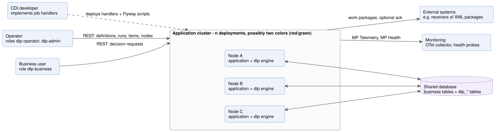
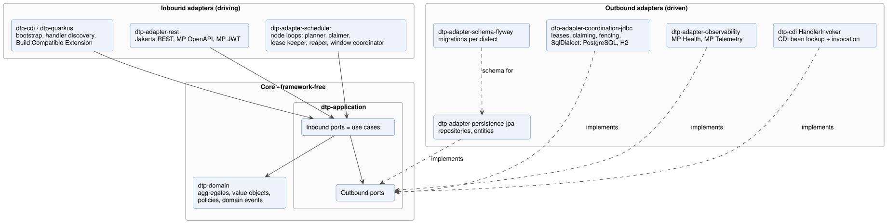
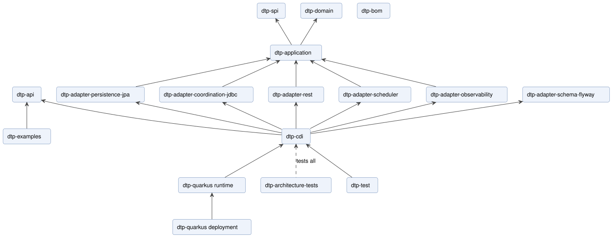
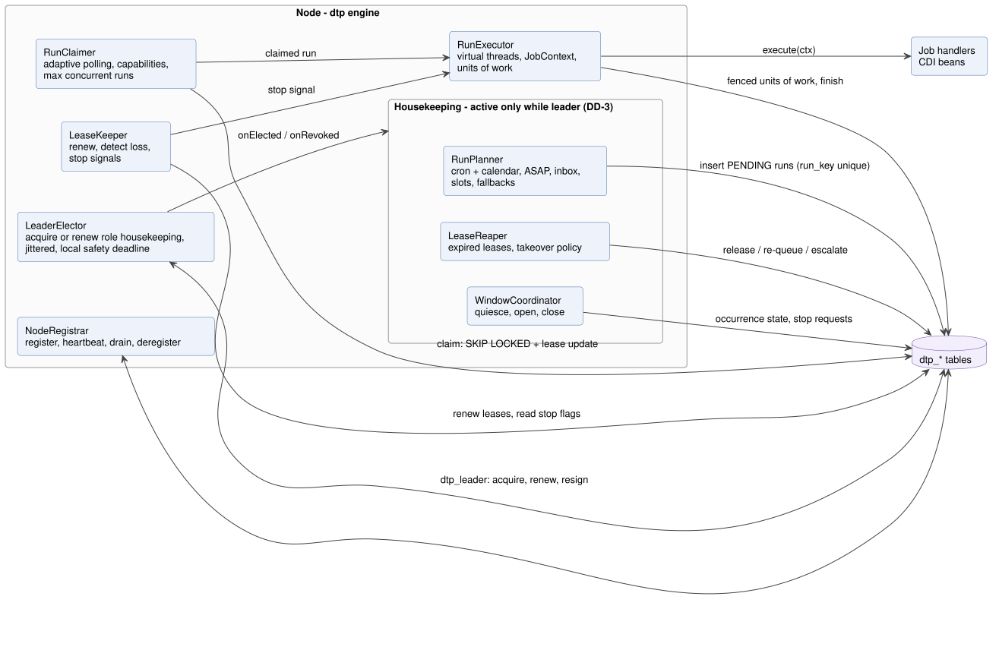

# 1. Architecture

> **Draft (WIP):** first draft generated by Claude (AI). A detailed review will follow soon. See the [README](../../README.md).

## 1.1 System Context

Every deployment of the application embeds the engine. There is no separate server: the nodes coordinate solely
through the shared database (G2).

PlantUML source: [diagrams/01-01.puml](diagrams/01-01.puml)

## 1.2 Hexagonal Architecture

PlantUML source: [diagrams/01-02.puml](diagrams/01-02.puml)

### 1.2.1 Ports

| Inbound port (use case) | Purpose |
|-------------------------|---------|
| `PlanRuns` | Materialize due runs: cron, ASAP, inbox, slots, window occurrences, decision fallbacks (housekeeping leader only) |
| `ClaimRuns` | Acquire job leases for pending runs this node can execute |
| `ExecuteRun` | Invoke the handler with a `JobContext`, process cycles/batches/packages |
| `RenewLeases` | Extend the leases of owned runs, and detect lease loss |
| `RecoverExpiredLeases` | Apply the takeover policy to runs whose owner is gone (housekeeping leader only) |
| `FinishRun` | Fenced finish: outcome, transitions, join arrivals, lease release (DD-4) |
| `RouteItems` | Track, route, route back, escalate, complete, discard (batched, fenced) |
| `TriggerJob` / `StartFlowInstance` | External triggers (REST, programmatic) |
| `RequestStop` | Soft stop of a run: cancel, drain, slot end, window |
| `DecideRequest` | Business decision on a decision request |
| `ManageDefinitions` | Jobs, transitions, joins, slots, calendars, windows (REST admin, builder) |
| `CoordinateWindow` | Window occurrence lifecycle (housekeeping leader only) |
| `Query*` | Read models for runs, items + journeys, packages, decisions, nodes, flow instances |

| Outbound port | Default adapter |
|---------------|-----------------|
| `JobRepository`, `RunRepository`, `FlowInstanceRepository`, `PackageRepository`, `DecisionRepository`, `WindowRepository`, `CalendarRepository` | JPA |
| `ItemStore` (current state), `ItemJournal` (append-only) | JDBC batch (performance-critical, see 03) |
| `LeaseManager` (claim, renew, release, fence, takeover) | JDBC + `SqlDialect` |
| `LeaderElection` (roles, terms, listeners, DD-3) | JDBC (`dtp_leader`). Later e.g. a Kubernetes `Lease` |
| `NodeRegistry` | JDBC |
| `RandomSource` (seedable, DD-14) | `SplittableRandom` seeded from `SecureRandom`, or `dtp.random.seed` |
| `DbClock` (DB time, DD-2) | JDBC |
| `HandlerInvoker` | CDI |
| `TransactionRunner` | JTA (`UserTransaction`/`TransactionManager`) |
| `IdGenerator`, `IdCodec` | UUIDv7 (default), Long sequence |
| `DomainEventPublisher` | CDI events (sync + async) |
| `EngineMetrics`, `EngineTracing` | MP Telemetry |

## 1.3 Maven Modules

PlantUML source: [diagrams/01-03.puml](diagrams/01-03.puml)

- `dtp-domain` depends **only on the JDK**. `dtp-api` depends only on the JDK and the CDI API (annotations).
- `dtp-application` does **not** depend on `dtp-api`. Handler-facing types are mapped in `dtp-cdi`, so the domain stays
  independent of the public API and the API can evolve separately. `dtp-spi` is therefore JDK-only as well. This
  deviates from mission §9.2, where `dtp-spi` depends on `dtp-api`.
- `dtp-bom` aligns versions for users. Users add `dtp-cdi` (MicroProfile runtimes) or `dtp-quarkus` (Quarkus) and code against `dtp-api`.

## 1.4 Node Runtime

Each node runs the same components. The **housekeeping** components are only active while the node is the elected
leader of the role `housekeeping` (DD-3). The `LeaderElector` starts and stops them through
`onElected`/`onRevoked` callbacks.

PlantUML source: [diagrams/01-04.puml](diagrams/01-04.puml)

Configuration (MP Config, typed via `@ConfigProperties(prefix = "dtp")`), with defaults:

| Property | Default | Meaning |
|----------|---------|---------|
| `dtp.enabled` | `true` | Engine active by default (G5) |
| `dtp.namespace` | application name | Namespace of this node (D18) |
| `dtp.node.color` | `default` | Deployment color for red/green (D21) |
| `dtp.node.max-concurrent-runs` | `64` | Upper bound of runs executed in parallel by this node (virtual threads). A continuous step keeps its long-lived run, and with it a slot, so the default is sized for many steps |
| `dtp.poll.min-interval` / `dtp.poll.max-interval` | `500ms` / `10s` | Adaptive polling (DD-11) |
| `dtp.poll.jitter` | `0.25` | ±25% random jitter on every poll and leader attempt (DD-14) |
| `dtp.poll.initial-delay` | random in `[0, max-interval)` | Random start offset per node, so restarted clusters don't poll in lockstep |
| `dtp.claim.conflict-backoff` | `250ms`, capped at `max-interval` | Exponential backoff with full jitter after claim conflicts |
| `dtp.leader.lease-duration` / `dtp.leader.renew-interval` / `dtp.leader.safety-margin` | `30s` / `10s` / `5s` | Leader election (DD-3). The leader stops acting `safety-margin` before its lease could expire |
| `dtp.random.seed` | none (random) | Fixed seed for reproducible tests (DD-14) |
| `dtp.monitoring.enabled` / `dtp.monitoring.projection-interval` | `true` / `10s` | Monitoring read model and live feed (09, DD-30) |
| `dtp.lease.duration` / `dtp.lease.renew-interval` | `60s` / `20s` | Default lease, overridable per job |
| `dtp.node.heartbeat-interval` / `dtp.node.dead-after` | `10s` / `60s` | Node liveness |
| `dtp.datasource` | default datasource | Optional separate datasource (D20) |
| `dtp.schema.migrate` | `true` | Run Flyway on startup (can be disabled for DBA-managed schemas) |
| `dtp.security.enabled` | `true` | `@RolesAllowed` on REST (D22) |

## 1.5 Quality Gates

### ArchUnit rules (`dtp-architecture-tests`)

| Rule | Description |
|------|-------------|
| A1 | `..domain..` depends only on `java..` (and `..domain..`) |
| A2 | `..application..` depends only on `..domain..`, `..spi..`, `java..` |
| A3 | Adapters don't depend on each other (`..adapter.persistence..` ↛ `..adapter.rest..` etc.) |
| A4 | Only `dtp-cdi` / `dtp-quarkus` wire adapters together |
| A5 | `dtp-api` exposes no types from `..domain..`, `..application..` or `..adapter..` |
| A6 | No package cycles (`slices().matching("..dtp.(*)..").should().beFreeOfCycles()`) |
| A7 | Aggregates are only modified through their aggregate root (no public setters on entities in `..domain..`) |
| A8 | JPA entities live only in `..adapter.persistence..`, and domain objects carry no JPA annotations |
| A9 | Naming: `*UseCase`/ports are interfaces in `..application.port..`, `*Adapter` implements a port |
| A10 | No `java.util.Date`, `System.currentTimeMillis()` or `Instant.now()` in domain/application (use `DbClock`/`Clock`, DD-2) |

### Further gates
- **Checkstyle** with a shared ruleset in `build-tools/` that fails the build.
- **Unit tests** for the domain (state machines, policies). **Integration tests** with Testcontainers PostgreSQL and H2.
- **Cluster tests**: N engines in one JVM (separate node ids) plus a multi-process variant, with chaos (kill, freeze/`SIGSTOP`, DB connection loss).
- **Load tests**: 1M items through a multi-stage flow incl. back-routing (D15).
