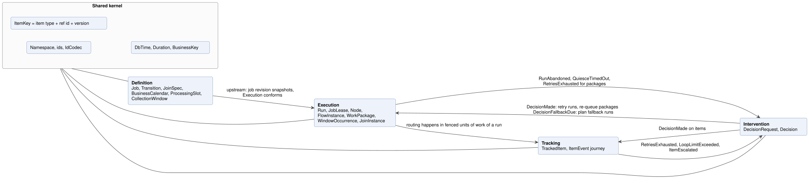
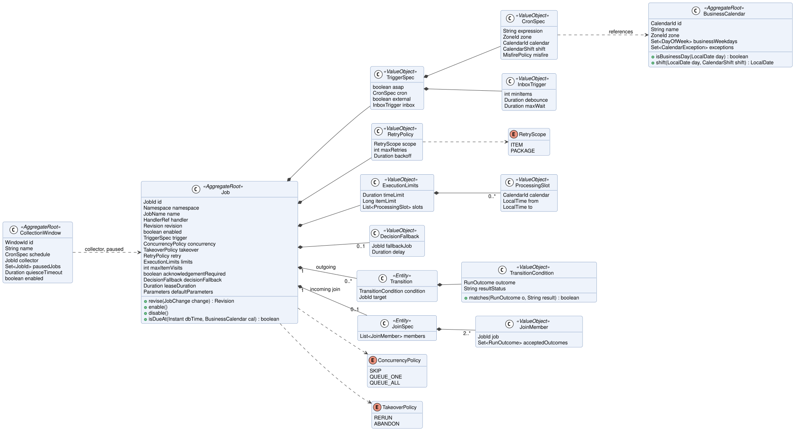
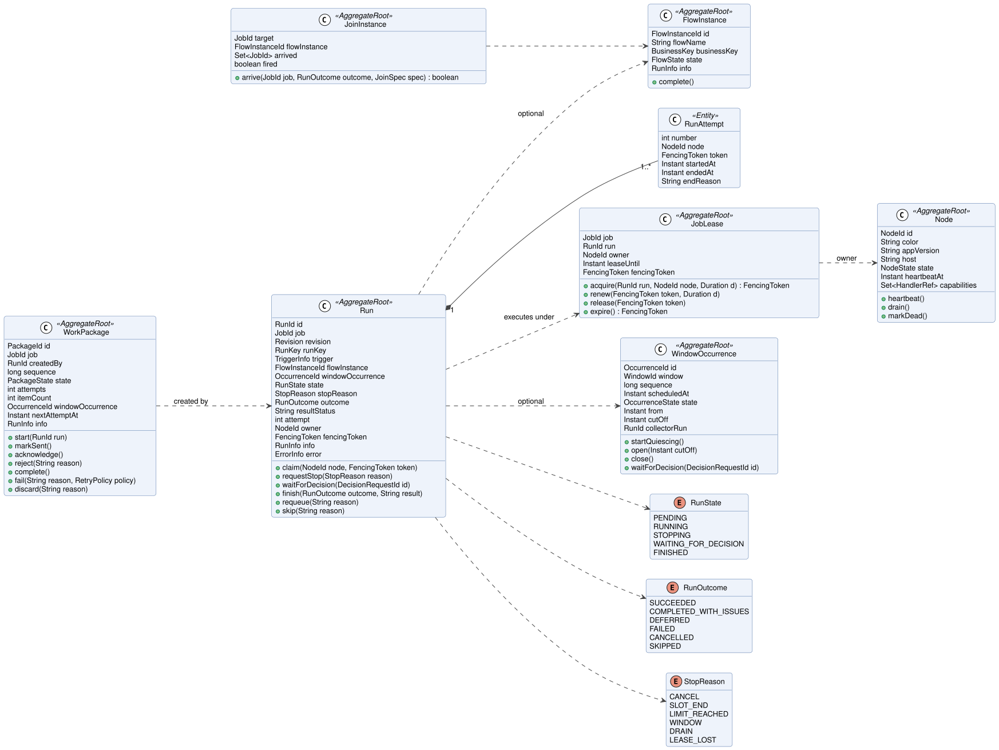
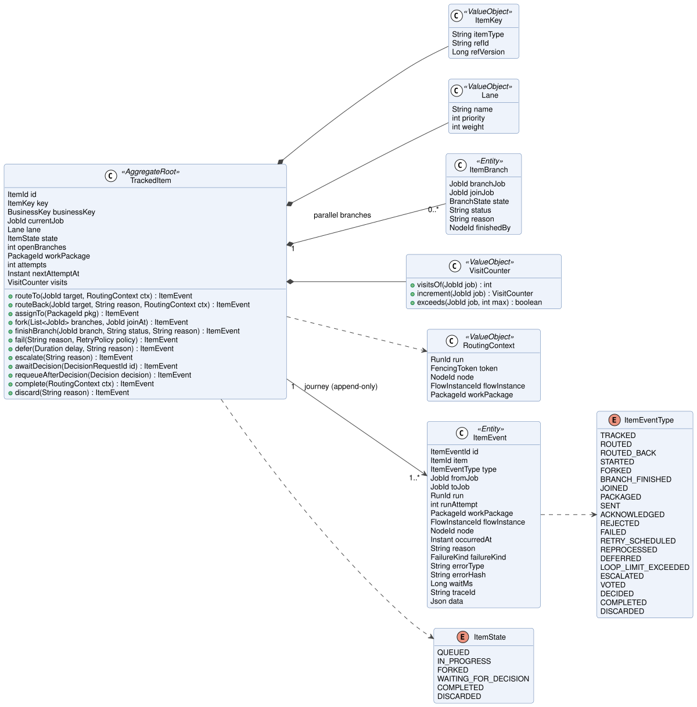
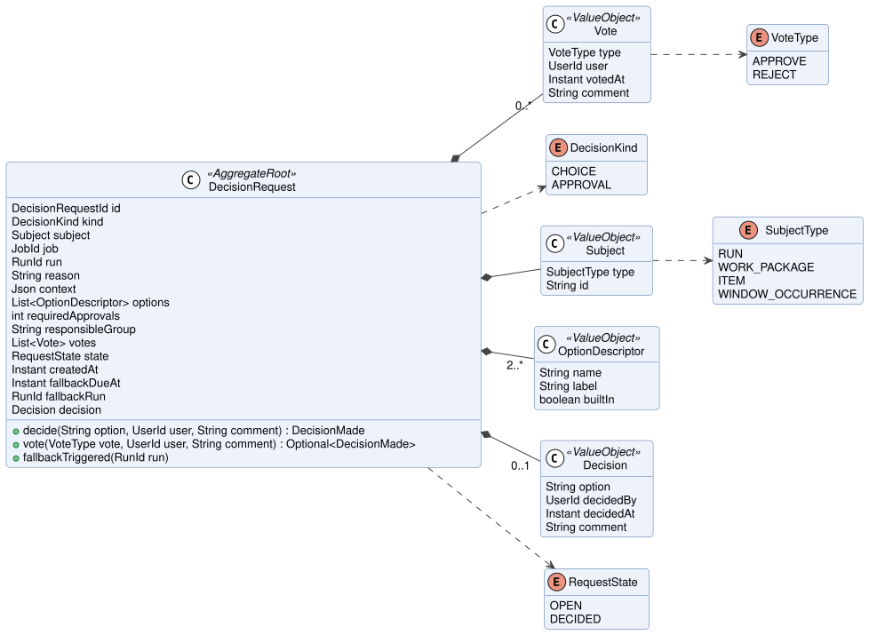

# 2. Domain Model

> **Draft (WIP):** first draft generated by Claude (AI). A detailed review will follow soon. See the [README](../../README.md).

## 2.1 Bounded Contexts & Context Map

The domain is split into four bounded contexts plus a small shared kernel. In the PoC they are **packages inside
`dtp-domain` / `dtp-application`** (not separate modules). ArchUnit enforces their dependency directions.

PlantUML source: [diagrams/02-01.puml](diagrams/02-01.puml)

Rules:
- **Definition** knows nothing about the other contexts.
- **Execution** reads definitions only as immutable **revisions** (DD-10).
- **Intervention** is decoupled through **domain events**. Decisions are applied by the owning context
  (Execution or Tracking), never by Intervention itself.

## 2.2 Definition Context

PlantUML source: [diagrams/02-02.puml](diagrams/02-02.puml)

Notes
- **Transitions** belong to the *source* job. A **join** belongs to the *target* job, because the target owns the rule
  "start me when all of A, B are done".
- `TransitionCondition` matches **exactly one** of: the framework outcome (`RunOutcome`) or the typed result status
  (stored by name). Decisions are not transitions: decided items go back to the requesting step (DD-19).
- `Job.revise(...)` creates a new immutable revision (DD-10). Runs reference `(JobId, Revision)`.

## 2.3 Execution Context

PlantUML source: [diagrams/02-03.puml](diagrams/02-03.puml)

Notes
- **`RunKey`** makes planning idempotent: `cron:<job>:<slot instant>`, `asap:<job>:<previous run>`,
  `next:<target job>:<source run>:<source attempt>` (transitions, inside or outside a flow instance; a retried source
  run can trigger again), `join:<target job>:<flow instance>`, `window:<occurrence>`, `fallback:<decision>`,
  `ext:<idempotency key or request id>`.
- **`JobLease`** is a separate aggregate (DD-1). A `Run` in state `RUNNING`/`STOPPING` always corresponds to the lease of its job.
- `FencingToken` is a monotonically increasing `long` per job. Every acquisition and every expiry increments it.

## 2.4 Tracking Context

PlantUML source: [diagrams/02-04.puml](diagrams/02-04.puml)

Invariants
- Every state change of a `TrackedItem` produces **exactly one** `ItemEvent` (CQRS-lite, DD-8). Both are written in the
  same fenced unit of work.
- `routeTo`/`routeBack` increment the visit counter of the target job. If `maxItemVisits` of the target would be
  exceeded, the item becomes `WAITING_FOR_DECISION` (`LOOP_LIMIT_EXCEEDED` + `ESCALATED`) instead (D25, DD-5).
- `fail` within the retry budget → `QUEUED` with `nextAttemptAt` (`RETRY_SCHEDULED`). When the budget is exhausted →
  `WAITING_FOR_DECISION` (D36).
- **Business vs. technical failures (DD-29)**: `fail(reason)` is a *business* failure. An exception thrown by the
  step is a *technical* failure (exception class and stack hash in the journal). The batch is rolled back, and its
  items are processed one by one, so only the poison item fails. Exhausted technical retries go to operations, not to
  the business team (09 §9.5).
- `defer` → `QUEUED` in the **same** inbox with `nextAttemptAt` (`DEFERRED`). It is not a failure, so no retry is counted
  (DD-18). Example: waiting for a supplier delivery.
- After a decision, the item is re-queued in the inbox of the **job that requested it**, with the decision attached.
  The handler reads it type-safely and routes the item (DD-19).
- **Fork/join (DD-22)**: `fork` puts the item into state `FORKED` and creates one `ItemBranch` per branch job. Branch
  rows appear in the branch jobs' inboxes, so the branches run in parallel, on different nodes if the leases are
  spread. `finishBranch` locks the item row (serializing concurrent completions). The completion that brings
  `openBranches` to 0 queues the item in the join job's inbox (`JOINED`). A branch can only finish, fail or escalate.
- **Lane (DD-23)**: set once when the item is tracked and kept for its whole journey. Inboxes serve lanes by priority,
  with weights against starvation.
- Final states are `COMPLETED` and `DISCARDED`. Everything else stays in an inbox until a final state is reached (D30).

## 2.5 Intervention Context

PlantUML source: [diagrams/02-05.puml](diagrams/02-05.puml)

Two kinds of decision requests:
- **`CHOICE`** – one user picks one of the offered options (built-in or custom, typed).
- **`APPROVAL`** (DD-16) – four-eyes and more: `requiredApprovals` **distinct** users must vote `APPROVE`, and a single
  `REJECT` decides the request as rejected. Each user votes at most once (a second vote is refused), and every vote is
  audited as an `ItemEvent` (`VOTED`). There is no segregation-of-duties rule for now. Example: large orders in
  [08](08-sample-order-flow.md).
- **Responsible team (DD-24)**: both kinds can be assigned to a team (`responsibleGroup`, matched against the MP JWT
  `groups` claim). Only members see the request in the REST API and can vote or decide. Without a team, every user
  with the role `dtp-business` can.

Built-in options per subject (handlers can add custom, typed options, D27):

| Subject | Built-in options |
|---------|------------------|
| `RUN` (takeover `ABANDON`, collector failure) | `RETRY`, `FAIL`, `SKIP` |
| `WORK_PACKAGE` | `RETRY`, `DISCARD` |
| `ITEM` | `RETRY`, `DISCARD`, `RESET_VISITS` |
| `WINDOW_OCCURRENCE` (quiesce timeout) | `KEEP_WAITING`, `FORCE_OPEN`, `SKIP_OCCURRENCE` |
| any subject, kind `APPROVAL` | votes `APPROVE`, `REJECT` (quorum `requiredApprovals`) |

- A request never expires (D38). If a `DecisionFallback` is configured, the planner creates **one** fallback run
  (`run_key = fallback:<request>`) once `fallbackDueAt` has passed. The request stays `OPEN`.
- Work resulting from a decision respects the job's processing slots (D39).

## 2.6 Domain Events

Published via the `DomainEventPublisher` port (CDI events, sync **after commit** + async). They are also the basis for
metrics and traces.

| Context | Events |
|---------|--------|
| Definition | `JobDefined`, `JobRevised`, `JobEnabled`, `JobDisabled`, `WindowDefined` |
| Execution | `RunPlanned`, `RunSkipped`, `RunStarted`, `RunStopRequested`, `RunFinished`, `RunRequeued`, `LeaseLost`, `LeaseExpired`, `NodeJoined`, `NodeDrained`, `NodeLost`, `FlowInstanceStarted`, `FlowInstanceCompleted`, `PackageCompleted`, `PackageRejected`, `WindowQuiescing`, `WindowOpened`, `WindowClosed`, `JoinFired` |
| Tracking | `ItemTracked`, `ItemRouted`, `ItemRoutedBack`, `ItemDeferred`, `ItemForked`, `BranchFinished`, `ItemJoined`, `ItemFailed`, `LoopLimitExceeded`, `ItemCompleted`, `ItemDiscarded` |
| Intervention | `DecisionRequested`, `VoteCast`, `DecisionMade`, `DecisionFallbackDue` |
