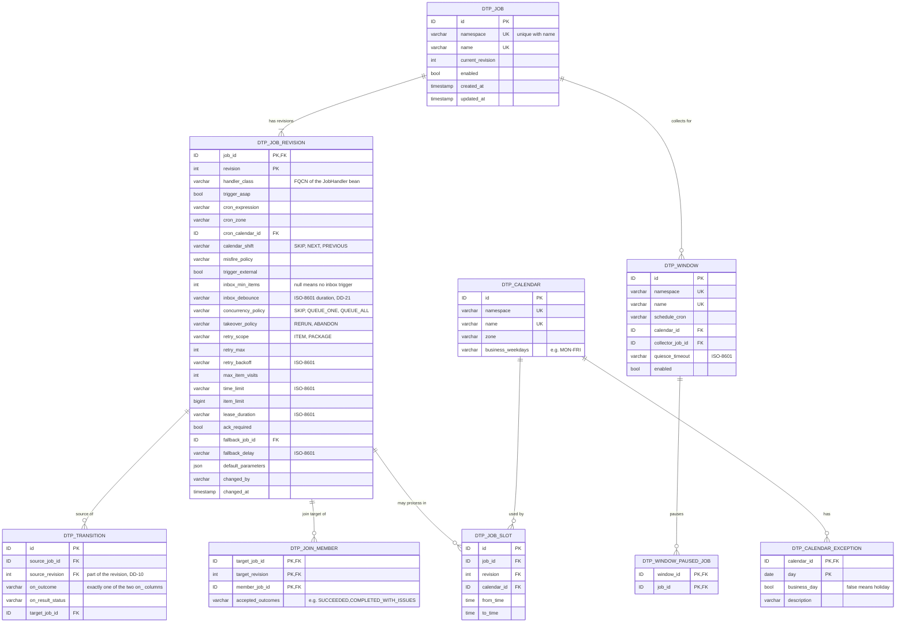
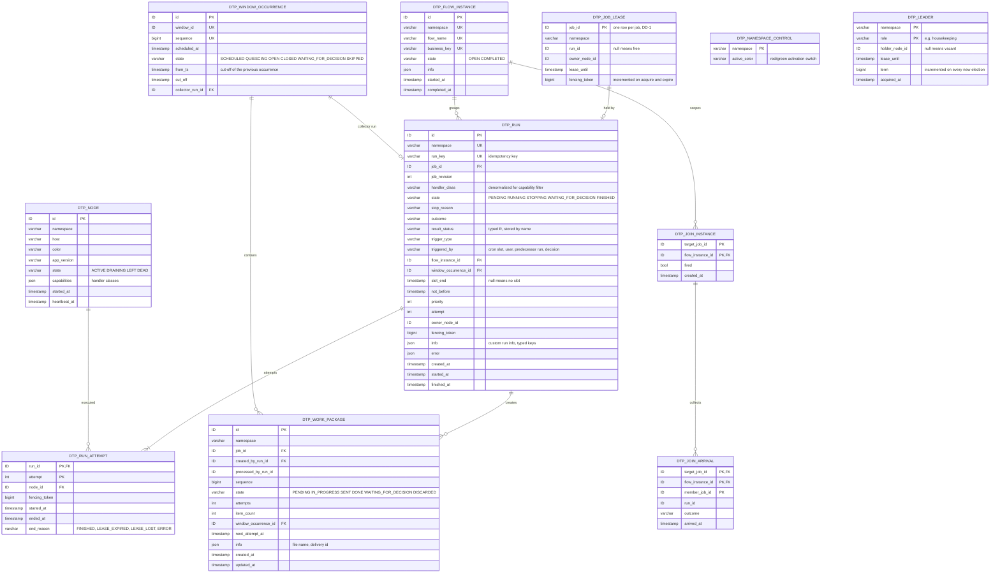
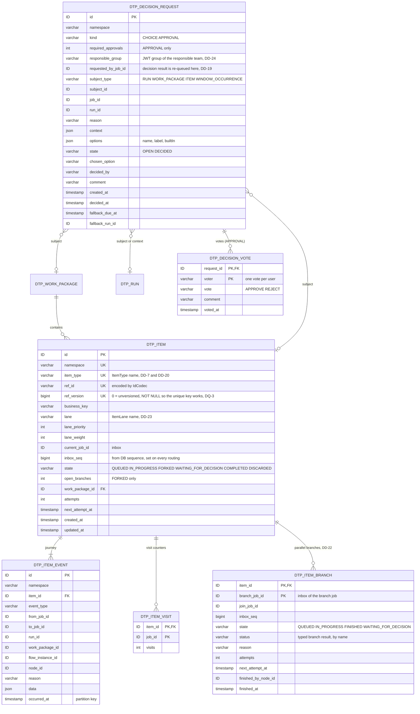

# 3. Persistence

> **Draft (WIP):** first draft generated by Claude (AI). A detailed review will follow soon. See the [README](../../README.md).

All tables are prefixed `dtp_` and carry `namespace` (D18). `ID` stands for the pluggable id type (default UUIDv7,
alternatively `bigint`, D5). Time columns are always written with **DB time** (DD-2). Durations are ISO-8601 strings
(DD-21). Flyway migrations are provided per dialect: `db/migration/dtp/{postgresql,h2}` (D16).

> **Time in the SQL below.** `CURRENT_TIMESTAMP` stands for the value of the `DbClock` port, bound as a parameter
> (`:now`). In production, `DbClock` reads the DB time (`clock_timestamp()` on PostgreSQL, because `CURRENT_TIMESTAMP`
> is the start time of the transaction there). In tests, it is a controllable clock, which makes `advanceTo(...)` possible.

## 3.1 Definition Tables



## 3.2 Execution Tables

`dtp_job_lease` has exactly one row per job. Definitions come from SQL, REST or the builder, so the engine creates
missing lease rows itself (insert-or-ignore) when it validates the definitions at startup and when the REST API
creates a job. Definition scripts don't need to know about leases.



## 3.3 Tracking & Intervention Tables



## 3.4 Key SQL (PostgreSQL dialect; H2 variants live in `SqlDialect`)

### Claim (RunClaimer, every node, DD-13)
The claim locks **job-lease rows** (one per job), not run rows. Two nodes therefore never compete for the same row:
with `SKIP LOCKED` the second one simply skips it. All steps happen in **one short transaction**.
```sql
-- (1) lock free job leases that have a claimable pending run – at most one candidate per job
SELECT l.job_id, r.id AS run_id
  FROM dtp_job_lease l
  JOIN LATERAL (SELECT r.id, r.priority, r.created_at
                  FROM dtp_run r
                 WHERE r.job_id = l.job_id
                   AND r.state = 'PENDING'
                   AND r.not_before <= CURRENT_TIMESTAMP
                   AND r.handler_class = ANY(:capabilities)        -- red/green + heterogeneous nodes
                 ORDER BY r.priority DESC, r.created_at
                 LIMIT 1) r ON true
 WHERE l.namespace = :ns
   AND l.run_id IS NULL                                            -- job is free
 ORDER BY r.priority DESC, r.created_at
 LIMIT :freeSlots
   FOR UPDATE OF l SKIP LOCKED;
-- red/green: a node whose color is not dtp_namespace_control.active_color (null = all colors)
--            skips the claim entirely, i.e. it only finishes what it already owns

-- (2) acquire the job lease – conditional, so it stays correct on dialects without SKIP LOCKED
UPDATE dtp_job_lease
   SET run_id = :runId, owner_node_id = :nodeId,
       lease_until = CURRENT_TIMESTAMP + :leaseDuration,
       fencing_token = fencing_token + 1
 WHERE job_id = :jobId AND run_id IS NULL
RETURNING fencing_token;                       -- 0 rows → another node won → next candidate

-- (3) start the run – conditional, because the run may have been cancelled meanwhile
UPDATE dtp_run SET state = 'RUNNING', owner_node_id = :nodeId, fencing_token = :token,
                  attempt = attempt + 1, started_at = COALESCE(started_at, CURRENT_TIMESTAMP)
 WHERE id = :runId AND state = 'PENDING';      -- 0 rows → ROLLBACK (lease untouched)
INSERT INTO dtp_run_attempt (run_id, attempt, node_id, fencing_token, started_at) VALUES (...);
COMMIT;
```

Losing a race is a normal outcome and is never reported as an error:

| Situation | Database behaviour | Claimer action |
|-----------|--------------------|----------------|
| Same job targeted by two nodes, `SKIP LOCKED` | The second node skips the locked lease row and gets the next free job or nothing. It never waits | none |
| Dialect without `SKIP LOCKED` (step 1 without locking) | The second `UPDATE` in step 2 waits until the first commits (ms), re-evaluates `run_id IS NULL` → 0 rows | Roll back, try the next candidate (candidates are shuffled per node, DD-14) |
| Lock timeout, deadlock, serialization failure (`SqlDialect.isConflict(SQLException)`, e.g. SQLState `40001`, `40P01`, `55P03`, or H2 lock timeout) | Exception | Roll back, increment `dtp.claim.conflicts`, back off with full jitter, next poll |
| Run cancelled between steps 1 and 3 | 0 rows in step 3 | Roll back. The lease stays free |

Deadlocks cannot form between claimers. With `SKIP LOCKED` nobody waits. Without it, each transaction claims exactly
one job, so it waits for at most one lock and no cycle is possible.

### Leader election (LeaderElector, every node, DD-3)
```sql
-- bootstrap (Flyway / first start): one row per namespace and role
INSERT INTO dtp_leader (namespace, role, term) VALUES (:ns, 'housekeeping', 0) ON CONFLICT DO NOTHING;

-- acquire – tried by non-leaders every renew-interval ± jitter
UPDATE dtp_leader
   SET holder_node_id = :me, term = term + 1, acquired_at = CURRENT_TIMESTAMP,
       lease_until = CURRENT_TIMESTAMP + :leaderLease
 WHERE namespace = :ns AND role = :role
   AND (holder_node_id IS NULL OR lease_until < CURRENT_TIMESTAMP)
RETURNING term;                                -- 1 row → elected with this term, 0 rows → follower

-- renew – by the leader
UPDATE dtp_leader SET lease_until = CURRENT_TIMESTAMP + :leaderLease
 WHERE namespace = :ns AND role = :role AND holder_node_id = :me AND term = :myTerm;
-- 0 rows → onRevoked immediately

-- resign – graceful shutdown or drain, allows instant takeover
UPDATE dtp_leader SET holder_node_id = NULL, lease_until = CURRENT_TIMESTAMP
 WHERE namespace = :ns AND role = :role AND holder_node_id = :me AND term = :myTerm;
```
- The leader acts only until a **local monotonic deadline**: `System.nanoTime()` at the start of the last successful
  renew + `leaderLease` − `safetyMargin`. If renewals fail (DB unreachable, GC pause), it revokes itself *before*
  another node can be elected.
- Even if two nodes act as leader at the same time (e.g. a long GC pause beyond the safety margin), nothing breaks.
  Planning inserts are idempotent (`run_key`), takeovers are conditional (`lease_until < CURRENT_TIMESTAMP`), and window
  transitions are conditional on the expected state. The current `term` is logged and exposed via health and metrics.

### Fenced unit of work (inbox batch / work package, DD-12)
```sql
BEGIN;                                                         -- JTA, joined by the handler's JPA work
-- … business changes of the handler (same transaction, D20) …
-- batched routing:
UPDATE dtp_item SET current_job_id = :target, state = 'QUEUED', inbox_seq = nextval('dtp_inbox_seq'),
                   updated_at = CURRENT_TIMESTAMP
 WHERE id = :itemId AND current_job_id = :myJob;               -- JDBC batch
INSERT INTO dtp_item_visit (item_id, job_id, visits) VALUES (:itemId, :target, 1)
    ON CONFLICT (item_id, job_id) DO UPDATE SET visits = dtp_item_visit.visits + 1;
INSERT INTO dtp_item_event (...) VALUES (...);                  -- JDBC batch, append-only
-- fence check as the LAST statement: locks the lease row only for the commit itself
UPDATE dtp_job_lease SET fencing_token = fencing_token
 WHERE job_id = :jobId AND fencing_token = :myToken;           -- 0 rows → ROLLBACK, signal LEASE_LOST, stop
COMMIT;
```
The check comes last, so the lease row is locked only for the moment of the commit. Renewals and the reaper are not
blocked during the business work, and parallel batches (DD-25) don't serialize on the lease row. A takeover that
commits first makes the check fail (0 rows), and one that comes later waits for the commit, after which the old
token no longer matches. A batch must take clearly less time than the lease duration. Calls to external systems
inside a batch are not rolled back, which is why they need idempotency keys (see the README).

### Lease renewal (LeaseKeeper)
```sql
UPDATE dtp_job_lease SET lease_until = CURRENT_TIMESTAMP + :leaseDuration
 WHERE job_id = :jobId AND run_id = :runId AND fencing_token = :token;
-- 0 rows → lease lost → stop signal LEASE_LOST to the executor
```

### Takeover (LeaseReaper, housekeeping leader)
```sql
UPDATE dtp_job_lease
   SET run_id = NULL, owner_node_id = NULL, fencing_token = fencing_token + 1
 WHERE namespace = :ns AND run_id IS NOT NULL AND lease_until < CURRENT_TIMESTAMP
RETURNING job_id, run_id;
-- per returned run, same transaction:
--   RERUN   → UPDATE dtp_run SET state='PENDING', owner_node_id=NULL, not_before=CURRENT_TIMESTAMP …
--   ABANDON → UPDATE dtp_run SET state='WAITING_FOR_DECISION' + INSERT dtp_decision_request
--   UPDATE dtp_run_attempt SET ended_at=CURRENT_TIMESTAMP, end_reason='LEASE_EXPIRED'
```

### Join (inside the fenced finish transaction of a member run, DD-4/DD-9)
```sql
INSERT INTO dtp_join_instance (target_job_id, flow_instance_id, fired, created_at)
VALUES (:target, :flow, false, CURRENT_TIMESTAMP) ON CONFLICT DO NOTHING;      -- H2: MERGE
SELECT fired FROM dtp_join_instance
 WHERE target_job_id = :target AND flow_instance_id = :flow FOR UPDATE;         -- serializes arrivals
INSERT INTO dtp_join_arrival (...) VALUES (:target, :flow, :memberJob, :runId, :outcome, CURRENT_TIMESTAMP)
    ON CONFLICT (target_job_id, flow_instance_id, member_job_id)
    DO UPDATE SET run_id = :runId, outcome = :outcome;          -- a retried member run: the latest outcome counts
-- all members arrived with accepted outcomes and not fired?
INSERT INTO dtp_run (..., run_key, ...) VALUES (..., 'join:' || :target || ':' || :flow, ...)
    ON CONFLICT (namespace, run_key) DO NOTHING;
UPDATE dtp_join_instance SET fired = true WHERE target_job_id = :target AND flow_instance_id = :flow;
```

### Planning (RunPlanner, housekeeping leader) – idempotent
```sql
INSERT INTO dtp_run (id, namespace, run_key, job_id, job_revision, handler_class, state, not_before, …)
VALUES (…, 'cron:' || :jobId || ':' || :slotInstant, …, 'PENDING', :slotInstant, …)
ON CONFLICT (namespace, run_key) DO NOTHING;
```

### Inbox read (owner run only – no row locks needed)
```sql
-- one query per lane, the executor interleaves the lanes by weight (DD-23)
SELECT id, item_type, ref_id, ref_version, inbox_seq
  FROM dtp_item
 WHERE namespace = :ns AND current_job_id = :myJob AND state = 'QUEUED' AND lane = :lane
   AND (next_attempt_at IS NULL OR next_attempt_at <= CURRENT_TIMESTAMP)
   AND inbox_seq > :lastSeenSeqOfLane                           -- keyset pagination, no OFFSET
 ORDER BY inbox_seq
 LIMIT :batchSize;
```
Because only one run per job is active (DD-1), the inbox of a job has exactly one reader: with parallel batches
(DD-25), this reader hands the batches to worker threads. `inbox_seq` is reassigned on every routing, retry and
defer, so items routed back later are still picked up (an item's own id is older). Sequence values can commit out of
order, so the cursor **restarts at the beginning** whenever it reaches the end of the inbox: an item that committed
late is picked up in the next pass. Lanes are
served by `lane_priority`, and `lane_weight` gives the batch ratio while several lanes have queued items. A branch
job reads its branch rows (`dtp_item_branch`, joined with `dtp_item` for reference and lane) the same way.

### Finishing a branch (fork/join, DD-22)
```sql
-- inside the fenced unit of work of the branch job
SELECT open_branches FROM dtp_item WHERE id = :itemId FOR UPDATE;      -- serializes concurrent completions
UPDATE dtp_item_branch SET state = 'FINISHED', status = :status, reason = :reason,
                          finished_by_node_id = :node, finished_at = CURRENT_TIMESTAMP
 WHERE item_id = :itemId AND branch_job_id = :myJob AND state = 'IN_PROGRESS';
UPDATE dtp_item SET open_branches = open_branches - 1 WHERE id = :itemId;
-- open_branches reached 0 → queue the item at the join job:
UPDATE dtp_item SET state = 'QUEUED', current_job_id = :joinJob, inbox_seq = nextval('dtp_inbox_seq')
 WHERE id = :itemId AND open_branches = 0;
INSERT INTO dtp_item_event (...) VALUES (... 'BRANCH_FINISHED' ...), (... 'JOINED' ...);
```

## 3.5 Indexes & Volume (D15, D26)

| Table | Index | Purpose |
|-------|-------|---------|
| `dtp_job_lease` | `(namespace, run_id)` | free jobs in the claim query, reaper |
| `dtp_run` | `(job_id, state, priority, created_at)` | oldest claimable run per job (lateral subquery) |
| `dtp_run` | unique `(namespace, run_key)` | idempotent planning |
| `dtp_run` | `(flow_instance_id)`, `(job_id, created_at)` | queries |
| `dtp_item` | `(namespace, current_job_id, state, lane, inbox_seq)` | inbox read per lane |
| `dtp_item_branch` | `(branch_job_id, state, inbox_seq)` | inbox read of branch jobs |
| `dtp_item` | unique `(namespace, item_type, ref_id, ref_version)` | lookup by `ItemRef` |
| `dtp_item` | `(namespace, business_key)`, `(work_package_id)` | lookups |
| `dtp_item_event` | `(item_id, occurred_at)` | journey |
| `dtp_item_event` | `(run_id)`, `(work_package_id)` | "what happened in run/package X" |
| `dtp_work_package` | `(job_id, state, next_attempt_at, sequence)` | pending packages |
| `dtp_decision_request` | `(namespace, state, created_at)`, `(state, fallback_due_at)` | business inbox, fallback planning |

- `dtp_item_event` is the largest table (≈ 1–2 events per item and stage, ≈ 5–10 per item in total). PostgreSQL: **range-partitioned by
  `occurred_at`** (monthly) from the start. H2: unpartitioned. No cleanup for now (D26), but dropping a partition later is cheap.
- Routing writes go through **JDBC batching** (`reWriteBatchedInserts=true` for PostgreSQL). JPA is used for aggregates
  with low volume (jobs, runs, decisions, windows). Items and events use plain JDBC behind the `ItemStore`/`ItemJournal` ports.
- Rough budget for 1M items × 4 stages: about 4M item updates, 4M visit upserts and 6–8M events per EOD. With
  1,000-row batches that is about 15,000 round trips.
