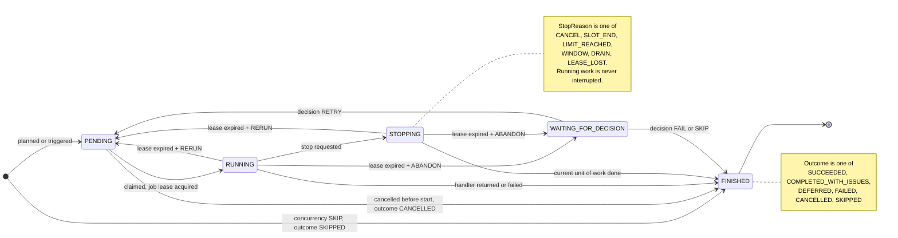
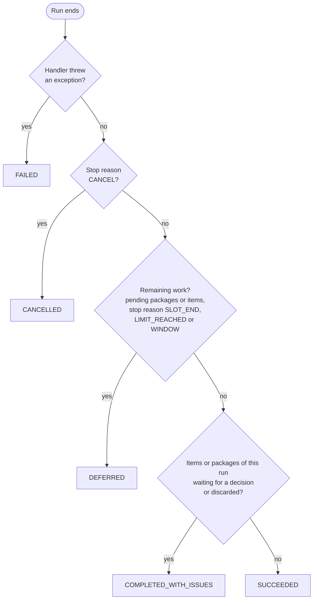
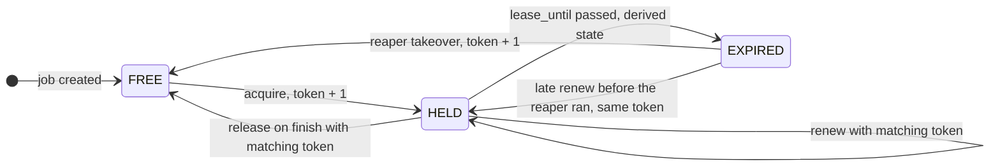
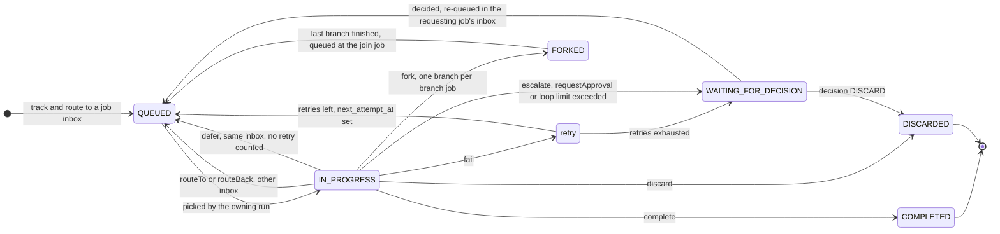
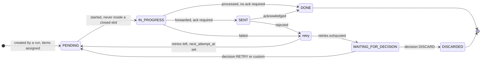
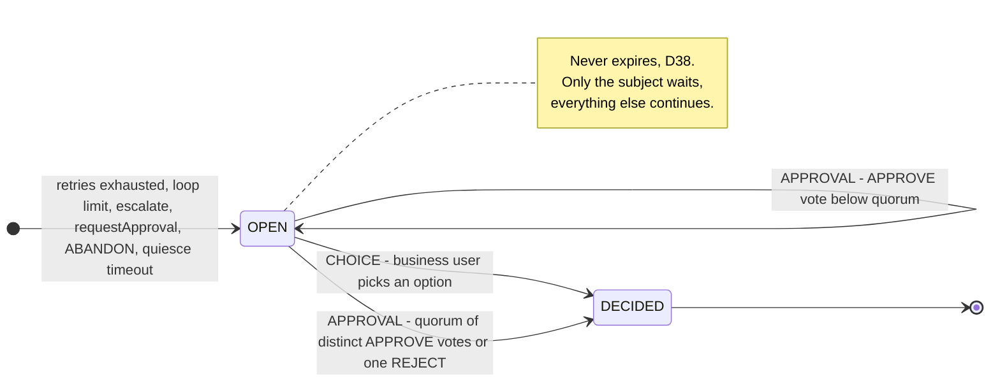
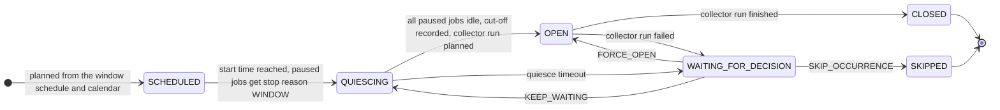
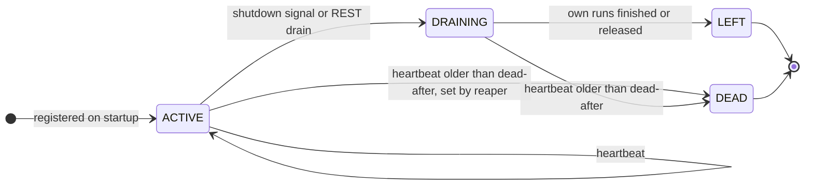
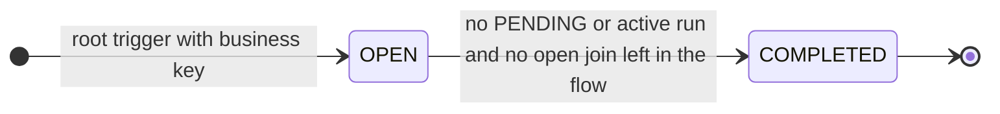

# 4. Lifecycles

> **Draft (WIP):** first draft generated by Claude (AI). A detailed review will follow soon. See the [README](../../README.md).

Each state machine is implemented **inside its aggregate** (`dtp-domain`). An illegal transition throws a domain
exception, and every transition is covered by a unit test.

## 4.1 Run

How the outcome is derived when a run finishes:

The typed `resultStatus` (`R`) returned by the handler is stored **in addition** to the outcome. Transitions can match on either.

## 4.2 Job Lease

`EXPIRED` is not stored. It is `run_id IS NOT NULL AND lease_until < CURRENT_TIMESTAMP`. A late renew by the owner
still succeeds as long as the reaper hasn't taken over yet (the token still matches). This is intended: the owner was
only slow. After the takeover, the token is incremented and every renew or fenced write of the old owner fails.

## 4.3 Tracked Item

- Items survive runs, slots, days and flow instances until `COMPLETED`/`DISCARDED` (D30).
- While `FORKED`, the item's branches have their own small lifecycle in `dtp_item_branch`:
  `QUEUED → IN_PROGRESS → FINISHED`, with retries and `WAITING_FOR_DECISION` like a normal item (DD-22).
- If the owning run loses its lease, `IN_PROGRESS` items of uncommitted units of work roll back to `QUEUED`
  automatically, because the routing is part of the same transaction.
- Every arrow writes an `ItemEvent` (DD-8).

## 4.4 Work Package

- `PENDING` packages are **carried over**. At a slot end, limit or window they simply stay `PENDING` and are processed
  by the job's next run (D33). A decision made outside the slot also results in `PENDING` (D39).
- A package is the unit of work: it is processed in one fenced transaction, or it fails as a whole.
  `RERUN` after a takeover only processes `PENDING` packages, never `DONE` ones.

## 4.5 Decision Request

## 4.6 Window Occurrence

While an occurrence is `QUIESCING`, `OPEN` or `WAITING_FOR_DECISION`, the claimer does **not** start runs of the
paused jobs (D35). Triggers that occur meanwhile are planned as usual, and their runs are claimed after
`CLOSED`/`SKIPPED`. The guarantee comes from pausing the writers, not from timestamps: selecting changes only by a
timestamp would miss long transactions that commit after the cut-off with an earlier timestamp. A skipped
occurrence's changes fall into the next occurrence, because `from_ts` is the cut-off of the last **closed** occurrence.

## 4.7 Node

Node liveness is used for monitoring and fast takeover. **Correctness relies only on leases and fencing tokens.** A node
wrongly marked `DEAD` cannot cause damage.

## 4.8 Flow Instance

Completion is checked in the finish transaction of each run of the flow (DD-4). Items are not part of the completion
criterion, because they may outlive the flow instance (D30).
