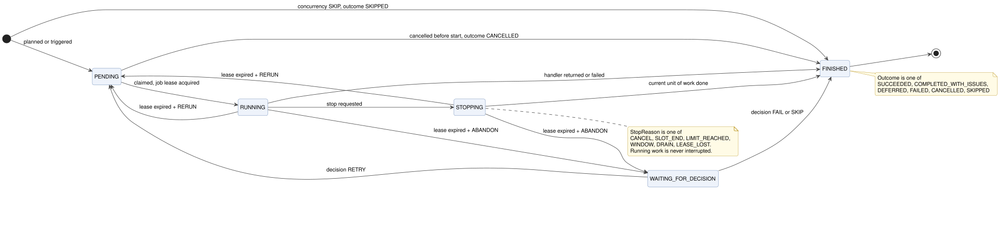
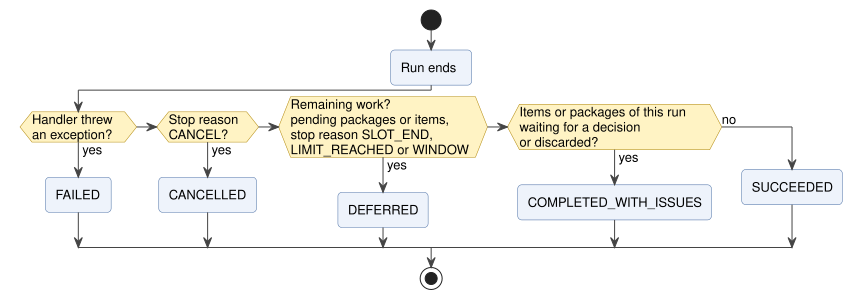
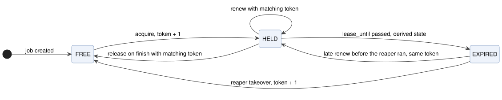
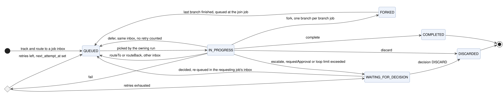
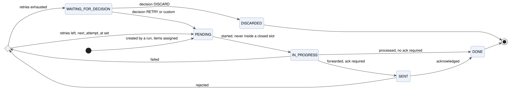
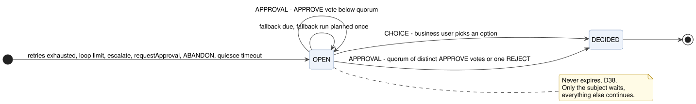
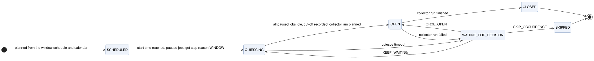
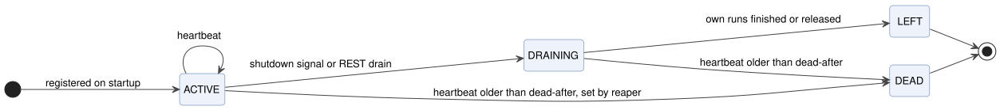

# 4. Lifecycles

> **Draft (WIP):** first draft generated by Claude (AI). A detailed review will follow soon. See the [README](../../README.md).

Each state machine is implemented **inside its aggregate** (`dtp-domain`). An illegal transition throws a domain
exception, and every transition is covered by a unit test.

## 4.1 Run

PlantUML source: [diagrams/04-01.puml](diagrams/04-01.puml)

How the outcome is derived when a run finishes:

PlantUML source: [diagrams/04-02.puml](diagrams/04-02.puml)

The typed `resultStatus` (`R`) returned by the handler is stored **in addition** to the outcome. Transitions can match on either.

## 4.2 Job Lease

PlantUML source: [diagrams/04-03.puml](diagrams/04-03.puml)

`EXPIRED` is not stored. It is `run_id IS NOT NULL AND lease_until < CURRENT_TIMESTAMP`. A late renew by the owner
still succeeds as long as the reaper hasn't taken over yet (the token still matches). This is intended: the owner was
only slow. After the takeover, the token is incremented and every renew or fenced write of the old owner fails.

## 4.3 Tracked Item

PlantUML source: [diagrams/04-04.puml](diagrams/04-04.puml)

- Items survive runs, slots, days and flow instances until `COMPLETED`/`DISCARDED` (D30).
- `fail` covers both kinds of failures (DD-29): business failures via `item.fail(reason)`, and technical failures
  when the step throws. Technical ones are isolated per item (the batch is retried item by item) and, once the
  retries are exhausted, go to operations (09 §9.5).
- While `FORKED`, the item's branches have their own small lifecycle in `dtp_item_branch`:
  `QUEUED → IN_PROGRESS → FINISHED`, with retries and `WAITING_FOR_DECISION` like a normal item (DD-22).
- If the owning run loses its lease, `IN_PROGRESS` items of uncommitted units of work roll back to `QUEUED`
  automatically, because the routing is part of the same transaction.
- Every arrow writes an `ItemEvent` (DD-8).

## 4.4 Work Package

PlantUML source: [diagrams/04-05.puml](diagrams/04-05.puml)

- `PENDING` packages are **carried over**. At a slot end, limit or window they simply stay `PENDING` and are processed
  by the job's next run (D33). A decision made outside the slot also results in `PENDING` (D39).
- A package is the unit of work: it is processed in one fenced transaction, or it fails as a whole.
  `RERUN` after a takeover only processes `PENDING` packages, never `DONE` ones.

## 4.5 Decision Request

PlantUML source: [diagrams/04-06.puml](diagrams/04-06.puml)

## 4.6 Window Occurrence

PlantUML source: [diagrams/04-07.puml](diagrams/04-07.puml)

While an occurrence is `QUIESCING`, `OPEN` or `WAITING_FOR_DECISION`, the claimer does **not** start runs of the
paused jobs (D35). Triggers that occur meanwhile are planned as usual, and their runs are claimed after
`CLOSED`/`SKIPPED`. The guarantee comes from pausing the writers, not from timestamps: selecting changes only by a
timestamp would miss long transactions that commit after the cut-off with an earlier timestamp. A skipped
occurrence's changes fall into the next occurrence, because `from_ts` is the cut-off of the last **closed** occurrence.

## 4.7 Node

PlantUML source: [diagrams/04-08.puml](diagrams/04-08.puml)

Node liveness is used for monitoring and fast takeover. **Correctness relies only on leases and fencing tokens.** A node
wrongly marked `DEAD` cannot cause damage.

## 4.8 Flow Instance

PlantUML source: [diagrams/04-09.puml](diagrams/04-09.puml)

Completion is checked in the finish transaction of each run of the flow (DD-4). Items are not part of the completion
criterion, because they may outlive the flow instance (D30).
