# 5. Coordination Flows

> **Draft (WIP):** first draft generated by Claude (AI). A detailed review will follow soon. See the [README](../../README.md).

## 5.1 Planning a Run (housekeeping leader)

How a trigger becomes a run, depending on the concurrency policy (D8), slots, windows and the calendar.

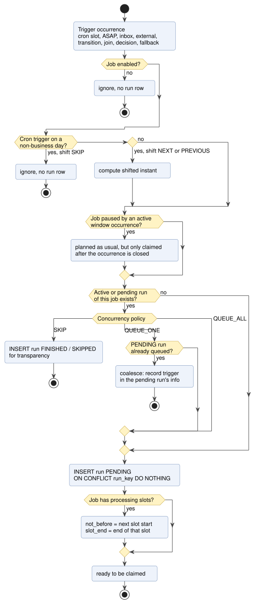

PlantUML source: [diagrams/05-01.puml](diagrams/05-01.puml)

Inbox triggers are special: while a run of the job is active, it picks up newly queued items itself, so an inbox
trigger never creates a `SKIPPED` run. It only plans a run when none is active.

## 5.2 Claim Race between Nodes (DD-13, DD-14)

Polls are desynchronized by a random start offset and ±25% jitter. If two nodes still poll at the same moment:

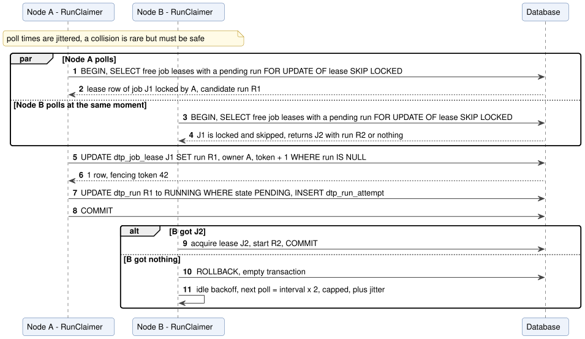

PlantUML source: [diagrams/05-02.puml](diagrams/05-02.puml)

On dialects **without `SKIP LOCKED`**, the conditional lease update is the arbiter:

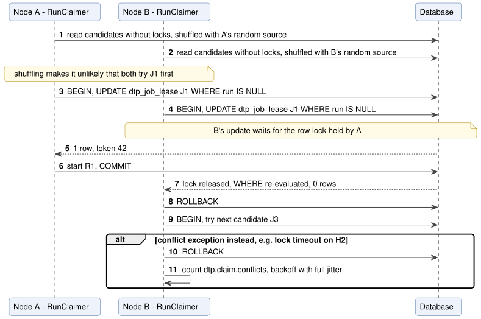

PlantUML source: [diagrams/05-03.puml](diagrams/05-03.puml)

## 5.3 Executing a Run with Items (fenced units of work)

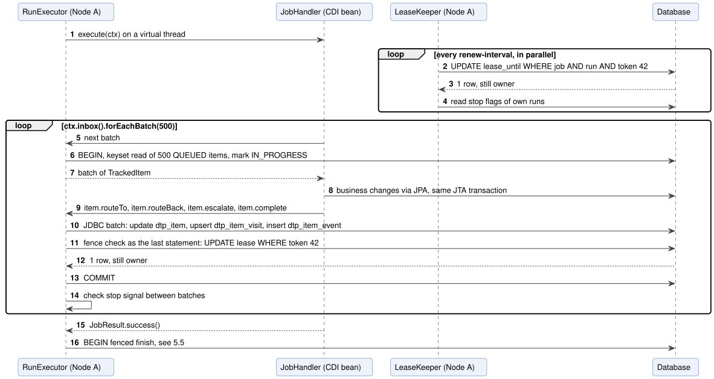

PlantUML source: [diagrams/05-04.puml](diagrams/05-04.puml)

## 5.4 Node Failure, Takeover and Fencing

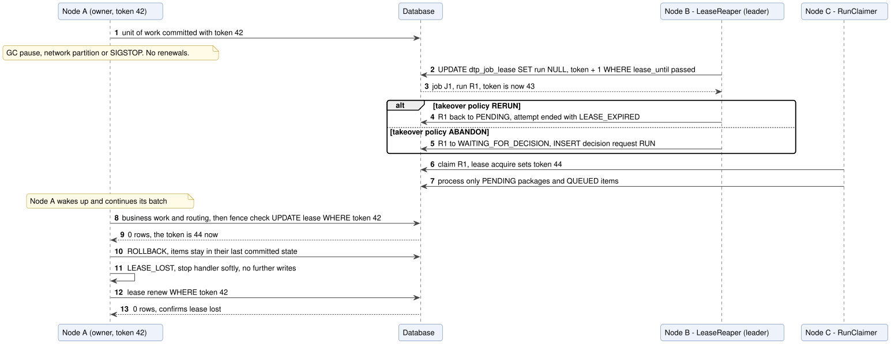

PlantUML source: [diagrams/05-05.puml](diagrams/05-05.puml)

## 5.5 Finishing a Run, Transitions and Join

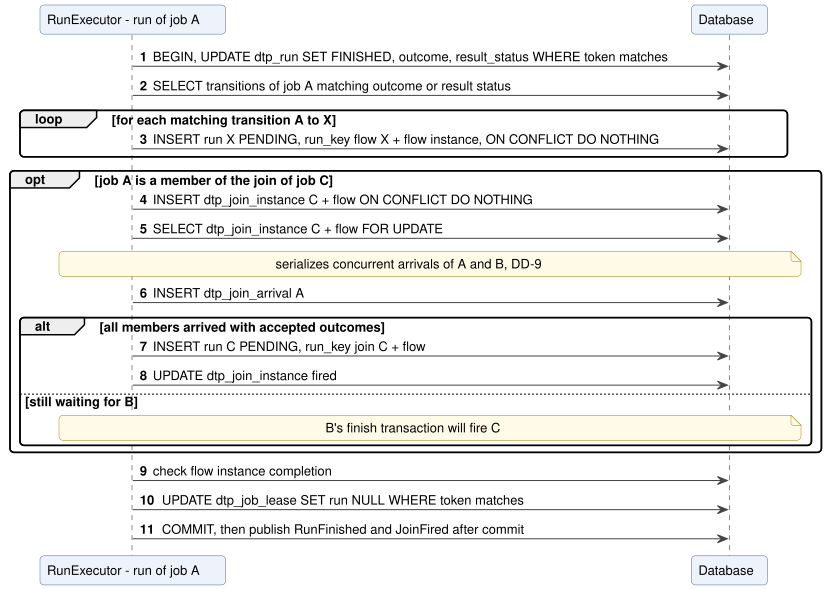

PlantUML source: [diagrams/05-06.puml](diagrams/05-06.puml)

## 5.6 Collection Window (exclusive data collection)

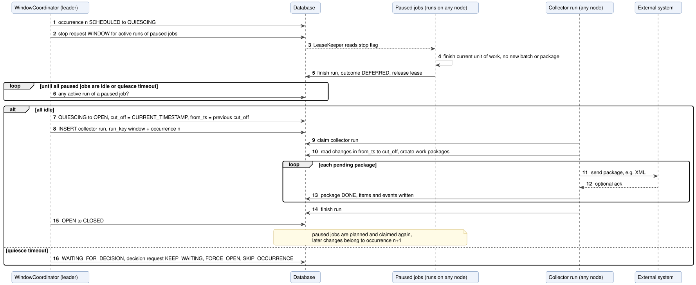

PlantUML source: [diagrams/05-07.puml](diagrams/05-07.puml)

## 5.7 Slot End and Item Limit (carry-over)

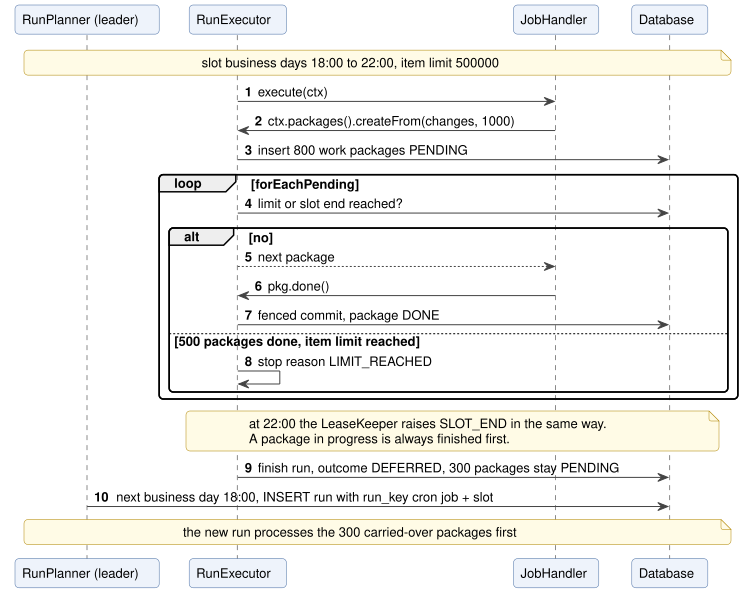

PlantUML source: [diagrams/05-08.puml](diagrams/05-08.puml)

## 5.8 Decision Request with Fallback

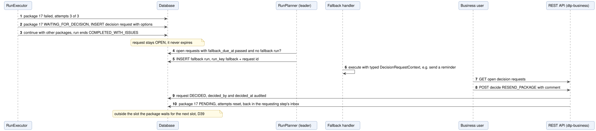

PlantUML source: [diagrams/05-09.puml](diagrams/05-09.puml)

## 5.9 Red/Green Deployment

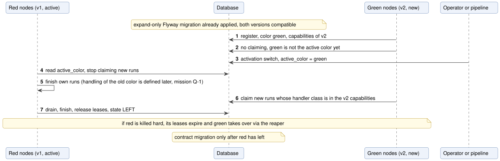

PlantUML source: [diagrams/05-10.puml](diagrams/05-10.puml)

## 5.10 Leader Election (DD-3)

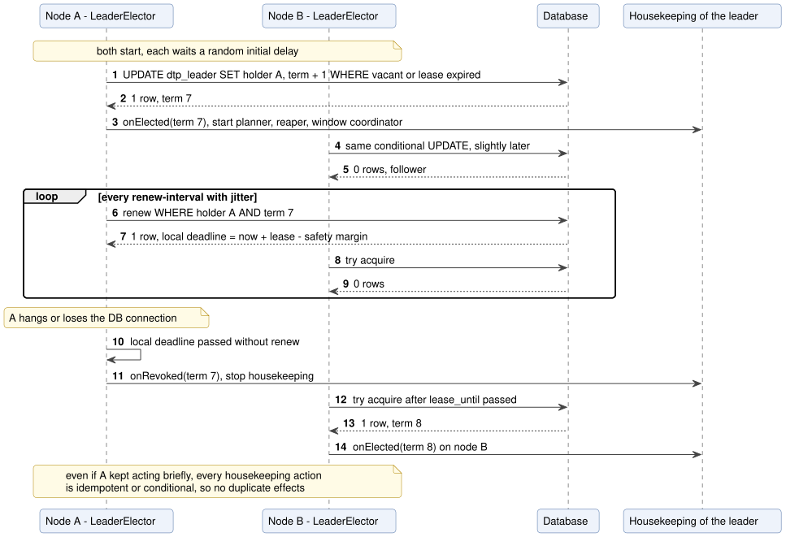

PlantUML source: [diagrams/05-11.puml](diagrams/05-11.puml)

On graceful shutdown or drain, the leader **resigns** (`holder_node_id = NULL`). The next jittered attempt of another
node takes over immediately, without waiting for the lease to expire.
