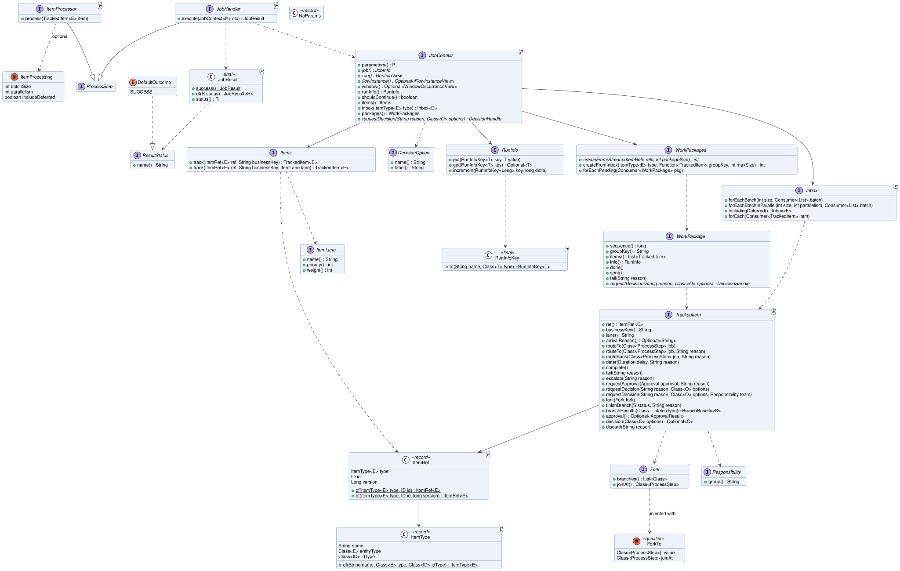
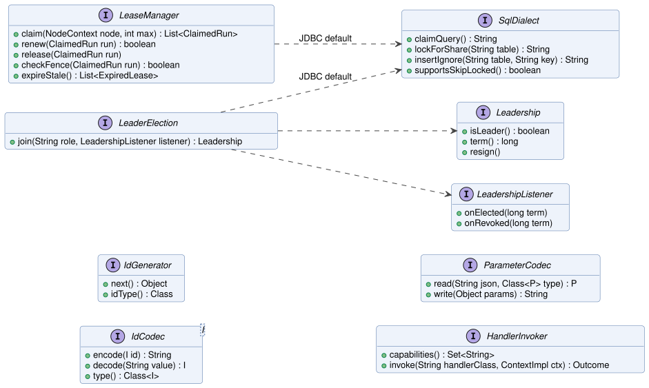

# 6. Developer API (`dtp-api`) and SPIs (`dtp-spi`)

> **Draft (WIP):** first draft generated by Claude (AI). A detailed review will follow soon. See the [README](../../README.md).

Design goals: **type-safe** (D11), **minimal at level 1**, and opt-in methods for levels 2–3 (mission §4.3). Only
JDK and CDI types appear in signatures. The API exists as a **compile-checked sketch**, and the demo app of
[08](08-sample-order-flow.md) compiles against it (both are not published yet). The diagram below is an overview.
Members marked `*` are planned but not yet in the sketch.

## 6.1 Public API



<sub>PlantUML source: [diagrams/06-01.puml](diagrams/06-01.puml)</sub>

Notes
- The full signatures are generic in two parameters: `JobHandler<P, R extends ResultStatus>`,
  `JobResult<R extends ResultStatus>`, `ItemRef<E, ID>`, `TrackedItem<E, ID>`, `Inbox<E, ID>`.
- **Exceptions** (DD-29): an exception thrown by `process(item)` is a *technical* failure of that item. The framework
  rolls the batch back and retries its items one by one, so other items aren't blocked. `item.fail(reason)` is a
  *business* failure. Both use the step's retry policy, but exhausted technical failures go to operations.
- **Two ways to write a process step** (DD-26): `ItemProcessor<E, ID>` for the common case (one method per item,
  the framework does iteration, batches, transactions, soft stops and the outcome), and `JobHandler<P, R>` for full
  control (collectors with packages, typed parameters, jobs without items). Both are `ProcessStep`s.
- Steps are referenced by **class literals** (`routeTo(TradeEnrichment.class)`). The engine resolves the class to the
  job in the current namespace whose revision has this `handler_class`. Unknown or ambiguous references are reported
  at startup validation in logs and MP Health (mission §7). On Quarkus, the extension marks process step beans as
  unremovable, so ArC's removal of unused beans doesn't drop them. This relates to DQ-5.
- **Naming** (DD-28): process steps are named after the business activity (`CreditCheck`, `StockReservation`), not
  as commands (`CheckCredit`). The job name in the DB follows the class name (`credit-check`).
- **`ItemType<E, ID>`** is declared once per entity as a constant, e.g.
  `public static final ItemType<Order, UUID> ITEM = ItemType.of("order", Order.class, UUID.class)` (DD-20). Its
  name is what gets persisted (refactoring-safe, DD-7), and `item.ref().id()` is typed, so no cast is needed.
- **Fork/join** (DD-22): the fork is declared at a CDI injection point, `@Inject @ForkTo(value = {A.class, B.class},
  joinAt = J.class) Fork screening;`, and used with `item.fork(screening)`. A framework producer creates it, and the
  extension validates the referenced steps at bootstrap. In the branch steps: `item.finishBranch(status, reason)`.
  In the join step: `item.branchResults(Status.class)`.
- **Run info** is injectable (`@Inject RunInfo`) and always refers to the current run, so `ItemProcessor`s don't need a
  context parameter. **`includeDeferred`** (DD-27) lets a step look at deferred items before they are due.
- **Lanes** (DD-23): `items.track(ref, key, CustomerTier.VIP)`. **Responsible teams** (DD-24):
  `Approval.quorum(2).assignedTo(Department.X)`, `item.requestDecision(reason, Options.class, Department.Y)`.
- `Items` is also an **injectable CDI bean** (DD-17). Application code, e.g. a JAX-RS resource receiving orders, can
  track incoming data and route it into a job's inbox in its own transaction, outside any run.
- `Approval.quorum(n)` creates an approval request with `n` distinct approvers (DD-16). `item.approval()` returns the
  result once the item is back in the requesting job's inbox (DD-19).
- The decided item comes back into the inbox of the requesting step, which reads `item.approval()` /
  `item.decision(Options.class)` (DD-19). There is no separate decision callback. `onStop(StopReason)` is an optional
  default method on `JobHandler`.

## 6.2 SPIs



<sub>PlantUML source: [diagrams/06-02.puml](diagrams/06-02.puml)</sub>

| SPI | Default | Purpose |
|-----|---------|---------|
| `LeaseManager` | JDBC (`dtp-adapter-coordination-jdbc`) | Pluggable coordination (G3), e.g. a future K8s Lease or Redis implementation |
| `LeaderElection` | JDBC (`dtp_leader`) | Leader per role (DD-3). Later e.g. a Kubernetes `Lease` implementation. Exposing it to applications (e.g. "run this bean on one node only") is possible later, but jobs usually cover that need |
| `SqlDialect` | PostgreSQL, H2 | Further databases as separate adapters (D12). Also classifies conflict exceptions (`isConflict`, DD-13) |
| `IdGenerator` | UUIDv7 | Framework ids, alternatively a `Long` sequence (D5) |
| `IdCodec` | UUID, Long, String | Encoding of business entity ids in `ItemRef` |
| `ParameterCodec`, `RunInfoCodec` | JSON-B | Typed parameters and run info |
| `HandlerInvoker` | CDI | Discovery (Build Compatible Extension) and invocation of handler beans |

Implementations are selected via CDI (`@Alternative @Priority`) or MP Config (`dtp.coordination.provider`).

## 6.3 Usage by Level

**Level 1**: a handler plus one row (Flyway script or REST).
```java
@ApplicationScoped
public class TempFileCleanup implements JobHandler<NoParams, DefaultOutcome> {
    @Override
    public JobResult<DefaultOutcome> execute(JobContext<NoParams> ctx) {
        // …
        return JobResult.success();
    }
}
```
```sql
-- db/dtp-definitions/V1__jobs.sql (definition scripts of the app, DD-15)
INSERT INTO dtp_job (id, namespace, name, current_revision, enabled, created_at, updated_at)
VALUES ('0193…', 'my-app', 'temp-file-cleanup', 1, true, now(), now());
INSERT INTO dtp_job_revision (job_id, revision, handler_class, cron_expression, cron_zone, concurrency_policy, takeover_policy, …)
VALUES ('0193…', 1, 'com.acme.TempFileCleanup', '0 0 3 * * ?', 'Europe/Vienna', 'SKIP', 'RERUN', …);
```
A small helper (`dtp_define_job(...)` SQL function or a Flyway Java migration from `dtp-spi`) will hide the
revision table from the user.

**Level 2**: items and back-routing with `ItemProcessor`s. See [07 §7.5](07-sample-app.md) (`TradeValidation`, `TradeEnrichment`).

**Level 3**: fork/join, approvals, a collection window with packages, decisions. See [08 §8.8](08-sample-order-flow.md) (`OrderValidation`, `Procurement`, `SupplierExport`).

## 6.4 Testing Support (`dtp-test`, proposal)

- `@DtpTest` JUnit 5 extension: H2 in-memory, an engine with **N simulated nodes** in one JVM, and a controllable `DbClock`.
- `engine.advanceTo(Instant)`, `engine.awaitIdle()`, `engine.killNode(nodeId)`, `engine.freezeNode(nodeId)`
- Assertions: `assertThat(engine.journey(Order.ITEM, number)).hasPath(OrderValidation.class, …).isCompleted()`
