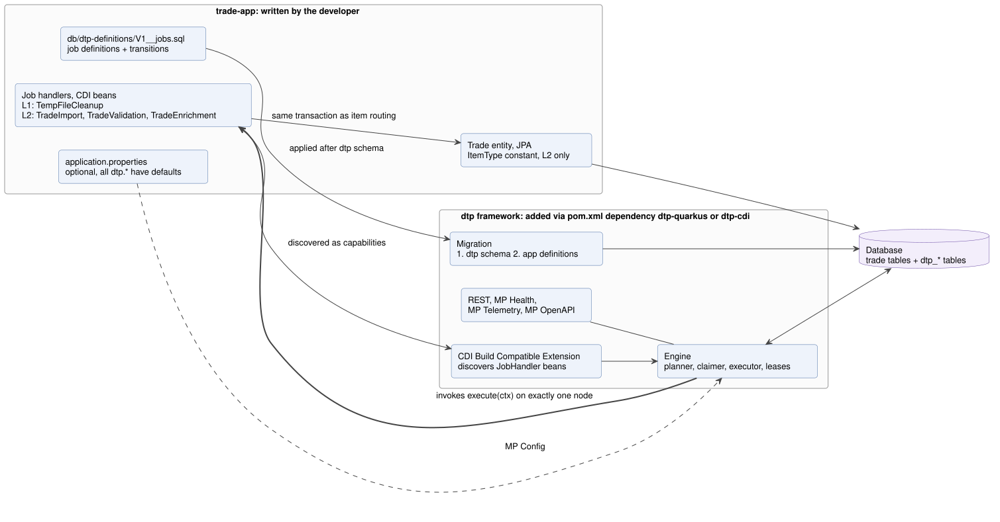
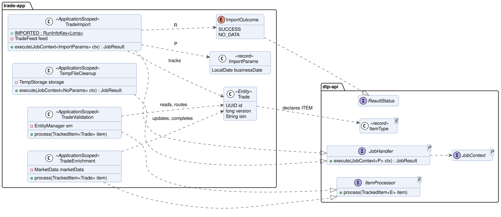
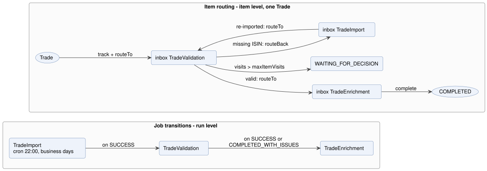
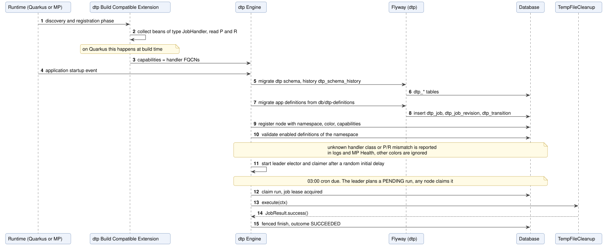

# 7. Sample Application – Using the Framework

> **Draft (WIP):** first draft generated by Claude (AI). A detailed review will follow soon. See the [README](../../README.md).

This chapter shows the framework from the **application developer's** point of view: what a sample app (`trade-app`)
has to provide, and how the framework discovers and runs it. The simplest case (level 1) needs exactly **three
things**: a dependency, a handler bean and a job definition.

## 7.1 What the Application Provides



<sub>PlantUML source: [diagrams/07-01.puml](diagrams/07-01.puml)</sub>

> This diagram uses the ELK layout for readability. Renderers without ELK support fall back to the default layout.

| | Level 1 (minimal) | Level 2 (items) |
|---|---|---|
| Dependency | `dtp-quarkus` or `dtp-cdi` | same |
| Code | one `@ApplicationScoped` class implementing `JobHandler` | handlers + one `ItemType` constant per tracked entity |
| Definition | 2 inserts in `db/dtp-definitions` | + transitions |
| Config | none (defaults: active, namespace = application name) | none |

**[DD-15]** The app's definition scripts live in a **separate Flyway location** (`db/dtp-definitions`, with its own history
table `dtp_definition_history`). The engine applies them **after** its own schema migration. This solves the ordering
problem: definitions need the `dtp_*` tables. It also keeps definitions SQL-based and red/green-safe (D23).

## 7.2 Sample Classes and the API They Use



<sub>PlantUML source: [diagrams/07-02.puml](diagrams/07-02.puml)</sub>

`TempFileCleanup` and `TradeImport` are `JobHandler`s (no items, or typed parameters and their own tracking).
`TradeValidation` and `TradeEnrichment` are `ItemProcessor<Trade, UUID>`s: the common case of handling inbox items
one by one (DD-26). The full generic signatures are `JobHandler<NoParams, DefaultOutcome>` and
`JobHandler<ImportParams, ImportOutcome>`. At startup the engine reads `P` and `R` reflectively. It uses them to deserialize parameters and to validate the result
statuses referenced by transitions.

## 7.3 Sample Flow (level 2)

Job transitions (run level) and item routing (item level) are two different layers:



<sub>PlantUML source: [diagrams/07-03.puml](diagrams/07-03.puml)</sub>

## 7.4 Startup: from Deployment to the First Run



<sub>PlantUML source: [diagrams/07-04.puml](diagrams/07-04.puml)</sub>

## 7.5 The Code

### Level 1 – the minimal setup

`pom.xml`
```xml
<dependency>
    <groupId>org.os890.dtp</groupId>          <!-- placeholder coordinates -->
    <artifactId>dtp-quarkus</artifactId>      <!-- or dtp-cdi on other MicroProfile runtimes -->
</dependency>
```

`TempFileCleanup.java`
```java
@ApplicationScoped
public class TempFileCleanup implements JobHandler<NoParams, DefaultOutcome> {

    @Inject
    TempStorage storage;

    @Override
    public JobResult<DefaultOutcome> execute(JobContext<NoParams> ctx) {
        storage.deleteOlderThan(Duration.ofDays(7));
        return JobResult.success();
    }
}
```

`src/main/resources/db/dtp-definitions/V1__jobs.sql`
```sql
INSERT INTO dtp_job (id, namespace, name, current_revision, enabled, created_at, updated_at)
VALUES ('0193a5c0-0000-7000-8000-000000000001', 'trade-app', 'temp-file-cleanup', 1, true,
        CURRENT_TIMESTAMP, CURRENT_TIMESTAMP);
INSERT INTO dtp_job_revision (job_id, revision, handler_class, cron_expression, cron_zone,
                             concurrency_policy, takeover_policy, changed_by, changed_at)
VALUES ('0193a5c0-0000-7000-8000-000000000001', 1, 'com.acme.trade.TempFileCleanup',
        '0 0 3 * * ?', 'Europe/Vienna', 'SKIP', 'RERUN', 'flyway', CURRENT_TIMESTAMP);
```
Nothing else is required: the engine is active by default, the namespace defaults to the application name, and the job
runs every night at 03:00 on exactly one node of the cluster.

### Level 2 – items with back-routing

```java
@Entity
public class Trade {

    public static final ItemType<Trade, UUID> ITEM = ItemType.of("trade", Trade.class, UUID.class);

    @Id
    private UUID id;

    @Version
    private long version;

    private String tradeNumber;

    private String isin;

    // getters …
}

public record ImportParams(LocalDate businessDate) {
}

public enum ImportOutcome implements ResultStatus {
    SUCCESS,
    NO_DATA
}

@ApplicationScoped
public class TradeImport implements JobHandler<ImportParams, ImportOutcome> {

    public static final RunInfoKey<Long> IMPORTED = RunInfoKey.of("importedTrades", Long.class);

    @Inject
    TradeFeed feed;

    @Override
    public JobResult<ImportOutcome> execute(JobContext<ImportParams> ctx) {
        // items routed back by TradeValidation are in this job's inbox, re-import them first
        ctx.inbox(Trade.ITEM).forEach(item -> {
            feed.reimport(item.ref().id());
            item.routeTo(TradeValidation.class);
        });

        List<Trade> trades = feed.importFor(ctx.parameters().businessDate());
        for (Trade trade : trades) {
            ctx.items()
               .track(ItemRef.of(Trade.ITEM, trade.getId(), trade.getVersion()), trade.getTradeNumber())
               .routeTo(TradeValidation.class);
        }
        ctx.runInfo().put(IMPORTED, (long) trades.size());
        return JobResult.of(trades.isEmpty() ? ImportOutcome.NO_DATA : ImportOutcome.SUCCESS);
    }
}

@ApplicationScoped
public class TradeValidation implements ItemProcessor<Trade, UUID> {

    @Inject
    EntityManager em;

    @Override
    public void process(TrackedItem<Trade, UUID> item) {
        Trade trade = em.find(Trade.class, item.ref().id());

        if (trade.getIsin() != null) {
            item.routeTo(TradeEnrichment.class);
        } else {
            item.routeBack(TradeImport.class, "missing ISIN");
        }
    }
}

@ApplicationScoped
@ItemProcessing(batchSize = 500)
public class TradeEnrichment implements ItemProcessor<Trade, UUID> {

    @Inject
    MarketData marketData;

    @Inject
    EntityManager em;

    @Override
    public void process(TrackedItem<Trade, UUID> item) {
        Trade trade = em.find(Trade.class, item.ref().id());
        marketData.enrich(trade);              // same transaction as the routing
        item.complete();
    }
}
```

`V2__trade_flow.sql` (abbreviated): jobs `trade-import` (cron 22:00 + calendar `AT-BANKING`, `max_item_visits = 3`),
`trade-validation` and `trade-enrichment`, plus the transitions `trade-import --SUCCESS--> trade-validation` and
`trade-validation --SUCCEEDED--> trade-enrichment`.

### Tests – builder API instead of SQL (small apps and tests only, D23)
```java
@DtpTest(nodes = 3)
class TradeFlowTest {

    @Inject
    JobDefinitions definitions;

    @Inject
    DtpTestEngine engine;

    @Test
    void invalidTradeIsRoutedBackWhileValidTradeCompletes() {
        definitions.define(TradeImport.class)
                   .external()
                   .maxItemVisits(3)
                   .on(ImportOutcome.SUCCESS).trigger(TradeValidation.class)
                   .save();
        definitions.define(TradeValidation.class)
                   .on(RunOutcome.SUCCEEDED).trigger(TradeEnrichment.class)
                   .save();
        definitions.define(TradeEnrichment.class)
                   .save();

        engine.trigger(TradeImport.class, new ImportParams(LocalDate.of(2026, 11, 13)));
        engine.awaitIdle();

        // the test feed delivers trade T-1 with an ISIN and trade T-2 without one
        assertThat(engine.journey(Trade.ITEM, "T-1"))
                .hasPath(TradeImport.class, TradeValidation.class, TradeEnrichment.class)
                .isCompleted();
        assertThat(engine.journey(Trade.ITEM, "T-2"))
                .hasPath(TradeImport.class, TradeValidation.class, TradeImport.class)
                .isQueuedIn(TradeImport.class);     // waits for the next import run
    }
}
```
