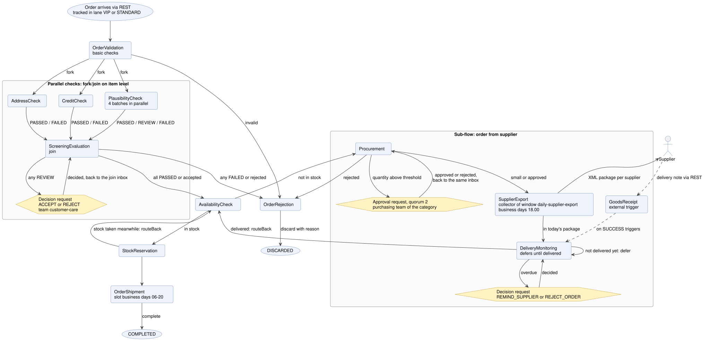
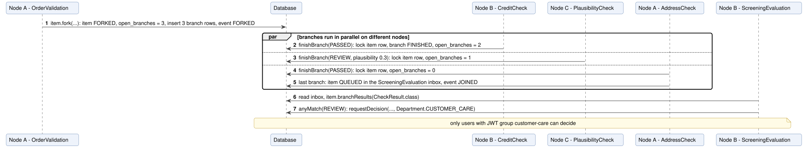
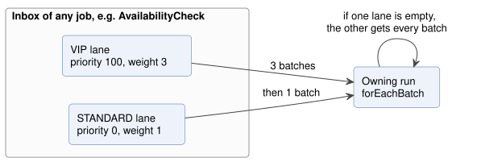
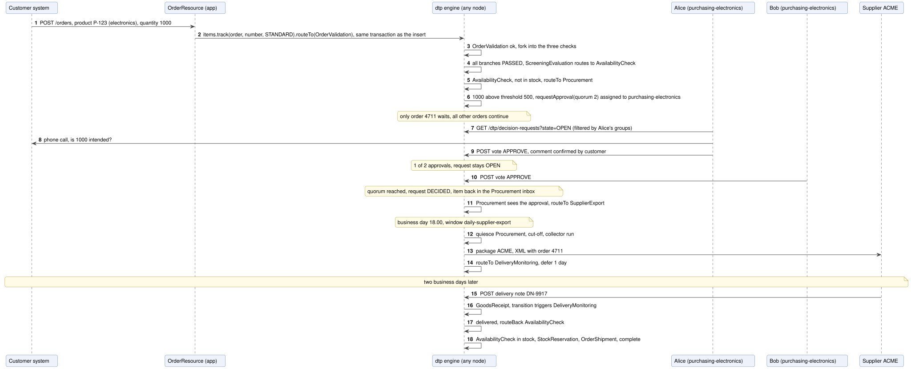
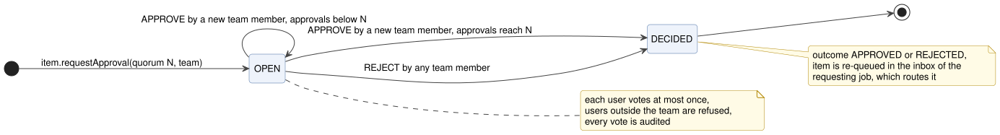

# 8. Sample Flow – Order Processing

> **Draft (WIP):** first draft generated by Claude (AI). A detailed review will follow soon. See the [README](../../README.md).

A level-3 showcase. It combines item routing and back-routing, **parallel checks (fork/join)**, **lanes** (VIP vs.
standard customers), a sub-flow, **approval requests with quorum assigned to the responsible department**, a
**collection window**, work packages and the item journey. The key classes of the demo app are shown in §8.8.
The process steps are named after the business activity (DDD), e.g. `CreditCheck`, `StockReservation`,
`OrderShipment`, and the job names in the DB follow them (`credit-check`, …).

**Business story.** Customers place orders for products. After a fast basic validation, three independent checks run
**in parallel**: credit limit, plausibility (does the order fit the customer's usual orders?) and delivery address. **VIP customers** are served first in every step.
In-stock orders are reserved and shipped. Orders that can't be served from stock go through a **sub-flow "order from
supplier"**, and supplier requests are forwarded **once per business day** as one package per supplier.
**Unusually large single orders** are the exception: the process **stops** for them until **two different members of
the purchasing department responsible for the product category** approve. In the meantime, a team member can contact
the customer to check that the quantity was intended (e.g. 1000 instead of 100). Unusual orders go to
**customer care**, who can simply check with the customer. When the supplier delivers, the waiting orders are routed **back** to the availability check.

## 8.1 Process Overview

Solid arrows are **item routing** (one order). Dotted arrows are **run-level triggers** between jobs.



<sub>PlantUML source: [diagrams/08-01.puml](diagrams/08-01.puml)</sub>

## 8.2 Job Definitions

All inbox steps are continuous (ASAP + inbox trigger, DD-6). An excerpt of the SQL is in §8.8.11. Steps marked
**JobHandler** need full control, and all others are `ItemProcessor`s (DD-26).

| Process step | Trigger | Notable settings | Routes items to |
|---------------|---------|------------------|-----------------|
| `OrderValidation` | continuous | – | **fork** → `CreditCheck`, `PlausibilityCheck`, `AddressCheck`, join at `ScreeningEvaluation`, or `OrderRejection` |
| `CreditCheck` | continuous | branch step | finishes its branch: `PASSED` / `FAILED` |
| `PlausibilityCheck` | continuous | branch step, `@ItemProcessing(batchSize = 50, parallelism = 4)`, retry max 5 | finishes its branch: `PASSED` / `REVIEW` / `FAILED` |
| `AddressCheck` | continuous | branch step | finishes its branch: `PASSED` / `FAILED` |
| `ScreeningEvaluation` | continuous | join step, decisions assigned to `customer-care` | `AvailabilityCheck`, `OrderRejection` |
| `AvailabilityCheck` | continuous | `max_item_visits = 5` | `StockReservation`, `Procurement` |
| `Procurement` | continuous | **paused** by window `daily-supplier-export`. Approvals assigned to the category's purchasing team. Fallback step `ApprovalReminder` after 4 h | `SupplierExport`, `OrderRejection` |
| `SupplierExport` (**JobHandler**) | **collector** of window `daily-supplier-export` (business days 18:00) | one package per supplier, max 1000 orders, retry scope `PACKAGE` | `DeliveryMonitoring` |
| `GoodsReceipt` (**JobHandler**) | EXTERNAL, typed `DeliveryNote`, idempotent per note number | – | – (transition `SUCCEEDED → DeliveryMonitoring`) |
| `DeliveryMonitoring` | SUCCESSOR + CRON 08:00 business days | `defer`, `includeDeferred = true` (looks at waiting orders after every goods receipt), overdue after 10 days → decision | `AvailabilityCheck` (**back-route**), `OrderRejection` |
| `StockReservation` | continuous | – | `OrderShipment`, `AvailabilityCheck` (**back-route**) |
| `OrderShipment` | continuous | processing slot business days 06:00–20:00 | – (`complete`) |
| `OrderRejection` | continuous | – | – (`discard` with reason) |
| `ApprovalReminder` (**JobHandler**) | decision fallback only | typed `DecisionReminder` parameters | – |

## 8.3 Parallel Checks (fork/join on item level, DD-22)

The three check jobs have **their own leases**, so they can run on different nodes at the same time. Each branch is a
row in `dtp_item_branch`. The **item row lock** serializes concurrent branch completions, so exactly one of them
queues the item at the join step.



<sub>PlantUML source: [diagrams/08-02.puml](diagrams/08-02.puml)</sub>

A branch can only finish, fail (retry policy of the branch step) or escalate. It can't be routed elsewhere. The item
itself stays `FORKED` until the join. Its journey shows the branches with their results and the node that processed them.

## 8.4 Lanes and Responsible Teams (DD-23, DD-24)

Two different kinds of grouping:

| | Lane (`ItemLane`) | Responsible team (`Responsibility`) |
|---|---|---|
| Sample | `CustomerTier.VIP` / `STANDARD` | `Department.PURCHASING_ELECTRONICS`, `PURCHASING_FURNITURE`, `CUSTOMER_CARE` |
| Set by | `items.track(ref, key, lane)` once, kept for the whole journey | `Approval.quorum(2).assignedTo(team)`, `requestDecision(reason, options, team)` per request |
| Effect | Every inbox serves lanes **by priority**, and **weights** (VIP 3 : standard 1) prevent starvation. Metrics and the journey per lane | Only members of the team (MP JWT `groups`) see the request and can vote or decide. Notifications go to the team |



<sub>PlantUML source: [diagrams/08-03.puml](diagrams/08-03.puml)</sub>

## 8.5 Large Order, Not in Stock – End to End



<sub>PlantUML source: [diagrams/08-04.puml](diagrams/08-04.puml)</sub>

## 8.6 Approval Request with Quorum



<sub>PlantUML source: [diagrams/08-05.puml](diagrams/08-05.puml)</sub>

## 8.7 Journey of Order 4711

What `GET /dtp/items/order/O-4711/journey` returns (abbreviated). This is the transparency the mission asks for (G8).
The same journey as a diagram is shown in [09 §9.9](09-monitoring-heatmap.md).

| # | Time | Event | From → To | Node / run | Details |
|---|------|-------|-----------|------------|---------|
| 1 | Fri 10:00:02 | `TRACKED` + `ROUTED` | – → `OrderValidation` | – (REST, user `shop-api`) | lane `STANDARD`, quantity 1000 |
| 2 | Fri 10:00:03 | `FORKED` | `OrderValidation` → 3 branches | A / R-17 | |
| 3 | Fri 10:00:04 | `BRANCH_FINISHED` | `CreditCheck` | B / R-18 | `PASSED` |
| 4 | Fri 10:00:04 | `BRANCH_FINISHED` | `AddressCheck` | A / R-19 | `PASSED` |
| 5 | Fri 10:00:06 | `BRANCH_FINISHED` + `JOINED` | `PlausibilityCheck` → `ScreeningEvaluation` | C / R-20 | `PASSED`, plausibility 0.92 |
| 6 | Fri 10:00:07 | `ROUTED` | `ScreeningEvaluation` → `AvailabilityCheck` | B / R-21 | |
| 7 | Fri 10:00:08 | `ROUTED` | `AvailabilityCheck` → `Procurement` | A / R-22 | not in stock |
| 8 | Fri 10:00:09 | `ESCALATED` | `Procurement` | C / R-23 | approval D-88, quorum 2, team `purchasing-electronics` |
| 9 | Fri 11:42:10 | `VOTED` | | D-88 | alice: APPROVE "confirmed by customer" |
| 10 | Fri 14:05:33 | `VOTED` + `DECIDED` | | D-88 | bob: APPROVE → APPROVED |
| 11 | Fri 14:05:34 | `ROUTED` | `Procurement` → `SupplierExport` | C / R-31 | |
| 12 | Fri 18:00:41 | `PACKAGED` + `SENT` | `SupplierExport` | A / R-40, package ACME-312-1 | window occurrence 312 |
| 13 | Fri 18:01:02 | `ROUTED` | `SupplierExport` → `DeliveryMonitoring` | A / R-40 | |
| 14 | Mon 08:00:05 | `DEFERRED` | `DeliveryMonitoring` | B / R-52 | not delivered yet |
| 15 | Tue 09:12:40 | `ROUTED_BACK` | `DeliveryMonitoring` → `AvailabilityCheck` | B / R-63 | delivered with DN-9917 |
| 16 | Tue 09:12:41 | `ROUTED` | `AvailabilityCheck` → `StockReservation` | A / R-64 | visit 2 of max 5 |
| 17 | Tue 09:12:43 | `ROUTED` | `StockReservation` → `OrderShipment` | C / R-65 | |
| 18 | Tue 09:30:12 | `COMPLETED` | `OrderShipment` | B / R-70 | shipment SH-5521 |

## 8.8 Sample Code

The key classes of the demo app, taken unchanged from its sources (package and import lines omitted). All of them compile against the API sketch (both are not published yet). Application services such as `Inventory` or `SupplierGateway` are plain interfaces that are not shown.

### 8.8.1 Typed item descriptor and order intake

The entity declares its `ItemType` once. The REST resource tracks the order in the customer's lane, in the same transaction as the insert (DD-17, DD-20, DD-23).

`Order.java`
```java
/** A customer order. Tracked by the framework as item type "order" (only the reference is stored by dtp). */
@Entity
@Table(name = "shop_order")
public class Order {

    /** Declared once, used everywhere: inbox access, item references, packages. */
    public static final ItemType<Order, UUID> ITEM = ItemType.of("order", Order.class, UUID.class);

    @Id
    private UUID id;

    @Version
    private long version;

    private String number;
    private String customerId;
    private String sku;
    private String category;
    private int quantity;

    protected Order() {
    }

    public Order(UUID id, String number, String customerId, String sku, String category, int quantity) {
        this.id = id;
        this.number = number;
        this.customerId = customerId;
        this.sku = sku;
        this.category = category;
        this.quantity = quantity;
    }

    public UUID getId() {
        return id;
    }

    public long getVersion() {
        return version;
    }

    public String getNumber() {
        return number;
    }

    public String getCustomerId() {
        return customerId;
    }

    public String getSku() {
        return sku;
    }

    public String getCategory() {
        return category;
    }

    public int getQuantity() {
        return quantity;
    }
}
```

`OrderResource.java`
```java
/**
 * Entry point of the order flow. Tracking the order happens in the same transaction as persisting it:
 * either both are committed, or neither is. The customer's tier decides the lane for the whole journey.
 */
@Path("/orders")
public class OrderResource {

    @Inject
    OrderRepository orders;

    @Inject
    Catalog catalog;

    @Inject
    Customers customers;

    @Inject
    Items items;

    @POST
    @Transactional
    public Response place(PlaceOrderRequest request) {
        UUID id = UUID.randomUUID();
        String number = "O-" + id.toString().substring(0, 8);
        Order order = orders.persist(new Order(id, number, request.customerId(), request.sku(),
                catalog.categoryOf(request.sku()), request.quantity()));
        CustomerTier lane = customers.tierOf(request.customerId());

        items.track(ItemRef.of(Order.ITEM, order.getId(), order.getVersion()), order.getNumber(), lane)
             .routeTo(OrderValidation.class);

        return Response.accepted(order.getNumber()).build();
    }
}
```

### 8.8.2 Lanes and responsible departments

Plain enums implement the framework's `ItemLane` and `Responsibility` interfaces.

`CustomerTier.java`
```java
/** Lanes of the order flow: VIP orders are served first in every inbox, standard orders still get every 4th batch. */
public enum CustomerTier implements ItemLane {
    VIP(100, 3),
    STANDARD(0, 1);

    private final int priority;
    private final int weight;

    CustomerTier(int priority, int weight) {
        this.priority = priority;
        this.weight = weight;
    }

    @Override
    public int priority() {
        return priority;
    }

    @Override
    public int weight() {
        return weight;
    }
}
```

`Department.java`
```java
/** Departments that are responsible for decisions. The group names match the JWT groups claim. */
public enum Department implements Responsibility {
    PURCHASING_ELECTRONICS("purchasing-electronics"),
    PURCHASING_FURNITURE("purchasing-furniture"),
    CUSTOMER_CARE("customer-care");

    private final String group;

    Department(String group) {
        this.group = group;
    }

    @Override
    public String group() {
        return group;
    }

    /** Large orders are approved by the purchasing department of the product category. */
    public static Department purchasingFor(String productCategory) {
        return switch (productCategory) {
            case "electronics" -> PURCHASING_ELECTRONICS;
            case "furniture" -> PURCHASING_FURNITURE;
            default -> throw new IllegalArgumentException("no purchasing team for " + productCategory);
        };
    }
}
```

### 8.8.3 A process step and the order screening fork

The common case is an `ItemProcessor`: one method per item, the framework does iteration, batches, transactions and soft stops. The fork is declared at a CDI injection point and validated at bootstrap (DD-22).

`OrderValidation.java`
```java
/**
 * Fast basic validation. Valid orders go to the order screening: three independent checks that run in parallel
 * (each check is its own step with its own lease, so they can run on different nodes at the same time).
 */
@ApplicationScoped
public class OrderValidation implements ItemProcessor<Order, UUID> {

    @Inject
    @ForkTo(value = {CreditCheck.class, PlausibilityCheck.class, AddressCheck.class},
            joinAt = ScreeningEvaluation.class)
    Fork orderScreening;

    @Inject
    OrderRepository orders;

    @Inject
    Catalog catalog;

    @Override
    public void process(TrackedItem<Order, UUID> item) {
        Order order = orders.find(item.ref().id());

        if (order.getQuantity() <= 0) {
            item.routeTo(OrderRejection.class, "invalid quantity " + order.getQuantity());
        } else if (!catalog.exists(order.getSku())) {
            item.routeTo(OrderRejection.class, "unknown product " + order.getSku());
        } else {
            item.fork(orderScreening);
        }
    }
}
```

### 8.8.4 A branch step with parallel batches

Each branch finishes with a typed result. `@ItemProcessing` lets four batches run in parallel (DD-25).

`CheckResult.java`
```java
/** Typed result of each parallel check branch. */
public enum CheckResult implements ResultStatus {
    PASSED,
    FAILED,
    REVIEW
}
```

`PlausibilityCheck.java`
```java
/**
 * Branch of the order screening: does the order fit the customer's usual ordering behaviour? Unusual orders are not
 * rejected automatically: customer care takes a look and can simply check with the customer. Scoring is the slowest
 * check, so four batches are scored at the same time (virtual threads, one transaction per batch).
 */
@ApplicationScoped
@ItemProcessing(batchSize = 50, parallelism = 4)
public class PlausibilityCheck implements ItemProcessor<Order, UUID> {

    private static final double TYPICAL = 0.4;
    private static final double UNUSUAL = 0.1;

    @Inject
    OrderRepository orders;

    @Inject
    PlausibilityScoring scoring;

    @Override
    public void process(TrackedItem<Order, UUID> item) {
        Order order = orders.find(item.ref().id());
        double score = scoring.score(order.getCustomerId(), order.getSku(), order.getQuantity());

        if (score >= TYPICAL) {
            item.finishBranch(CheckResult.PASSED);
        } else if (score >= UNUSUAL) {
            item.finishBranch(CheckResult.REVIEW, "unusual for this customer, plausibility " + score);
        } else {
            item.finishBranch(CheckResult.FAILED, "not plausible, plausibility " + score);
        }
    }
}
```

### 8.8.5 Join and a decision assigned to a department

The join step sees the order once, with all branch results. Unusual orders go to customer care (DD-19, DD-24).

`ScreeningEvaluation.java`
```java
/**
 * Join of the order screening. An order arrives here once, after all three checks finished. Any failure rejects it,
 * an unusual order goes to customer care, otherwise it continues.
 */
@ApplicationScoped
public class ScreeningEvaluation implements ItemProcessor<Order, UUID> {

    @Override
    public void process(TrackedItem<Order, UUID> item) {
        Optional<ReviewDecision> review = item.decision(ReviewDecision.class);
        if (review.isPresent()) {
            if (review.get() == ReviewDecision.ACCEPT) {
                item.routeTo(AvailabilityCheck.class, "accepted after review");
            } else {
                item.routeTo(OrderRejection.class, "rejected after review");
            }
            return;
        }

        BranchResults<CheckResult> checks = item.branchResults(CheckResult.class);
        if (checks.anyMatch(CheckResult.FAILED)) {
            item.routeTo(OrderRejection.class, String.join(", ", checks.reasons(CheckResult.FAILED)));
        } else if (checks.anyMatch(CheckResult.REVIEW)) {
            item.requestDecision("Review needed: " + String.join(", ", checks.reasons(CheckResult.REVIEW)),
                    ReviewDecision.class, Department.CUSTOMER_CARE);
        } else {
            item.routeTo(AvailabilityCheck.class);
        }
    }
}
```

`ReviewDecision.java`
```java
/** Options for customer care when a check asks for a manual review. */
public enum ReviewDecision implements DecisionOption {
    ACCEPT,
    REJECT
}
```

### 8.8.6 Four-eyes approval by the responsible department

Only large orders stop. The decided order comes back into the same inbox (DD-16, DD-19).

`Procurement.java`
```java
/**
 * Procurement from the supplier. Unusually large orders stop here until two different members of the purchasing
 * department responsible for the product category approved them (four-eyes principle). In the meantime a team member
 * can call the customer to check that the quantity is intended. All other orders continue without delay.
 *
 * <p>The decided order comes back into this inbox, so the routing after the decision stays in this step.
 * This step is paused while the window {@code daily-supplier-export} is open.
 */
@ApplicationScoped
@ItemProcessing(batchSize = 200)
public class Procurement implements ItemProcessor<Order, UUID> {

    @Inject
    @ConfigProperty(name = "order.approval-threshold", defaultValue = "500")
    int approvalThreshold;

    @Inject
    OrderRepository orders;

    @Inject
    SupplierRequests supplierRequests;

    @Override
    public void process(TrackedItem<Order, UUID> item) {
        Order order = orders.find(item.ref().id());
        Optional<ApprovalResult> approval = item.approval();

        if (approval.isPresent() && approval.get().isRejected()) {
            item.routeTo(OrderRejection.class, "large order rejected by " + approval.get().deciders());
        } else if (order.getQuantity() > approvalThreshold && approval.isEmpty()) {
            item.requestApproval(Approval.quorum(2).assignedTo(Department.purchasingFor(order.getCategory())),
                    "Large order %s: %d x %s".formatted(order.getNumber(), order.getQuantity(), order.getSku()));
        } else {
            supplierRequests.createFor(order);              // same transaction as the routing
            item.routeTo(SupplierExport.class);
        }
    }
}
```

### 8.8.7 Collector of the window: one package per supplier

A full `JobHandler`, because it works with the window and work packages. It runs once per business day at the window's cut-off. The deterministic file name is the idempotency key of the external call.

`SupplierExport.java`
```java
/**
 * Collector of the window {@code daily-supplier-export} (business days 18:00). While the window is open,
 * {@link Procurement} is paused, so no supplier request is created or approved during the export. The export covers
 * everything up to the cut-off, one package per supplier. Packages that can't be sent today (e.g. slot end) stay
 * pending and go out first in the next window.
 *
 * <p>A full {@link JobHandler} instead of an {@code ItemProcessor}: it works with packages and the window.
 */
@ApplicationScoped
public class SupplierExport implements JobHandler<NoParams, DefaultOutcome> {

    public static final RunInfoKey<Long> PACKAGES_SENT = RunInfoKey.of("packagesSent", Long.class);

    @Inject
    SupplierRequests supplierRequests;

    @Inject
    SupplierGateway gateway;

    @Override
    public JobResult<DefaultOutcome> execute(JobContext<NoParams> ctx) {
        WindowOccurrence window = ctx.window().orElseThrow();

        ctx.packages().createFromInbox(Order.ITEM, item -> supplierRequests.supplierOf(item.ref().id()), 1000);

        ctx.packages().forEachPending(Order.ITEM, pkg -> {
            List<UUID> orderIds = pkg.items().stream().map(item -> item.ref().id()).toList();
            // deterministic file name = idempotency key: a resend after a takeover replaces the same file
            String fileName = "%s-%d-%d.xml".formatted(pkg.groupKey(), window.sequence(), pkg.sequence());

            gateway.send(pkg.groupKey(), fileName, supplierRequests.toXml(pkg.groupKey(), window.cutOff(), orderIds));
            pkg.sent();                                      // acknowledgement is optional (step setting)
            pkg.items().forEach(item -> item.routeTo(DeliveryMonitoring.class));
            ctx.runInfo().increment(PACKAGES_SENT, 1);
        });
        return JobResult.success();
    }
}
```

### 8.8.8 External trigger with typed parameters

The compiler checks that `DeliveryNote` matches the step's parameter type. The note number makes the trigger idempotent.

`SupplierCallbackResource.java`
```java
/**
 * The supplier posts its delivery notes here. The resource only triggers the job: the compiler checks that
 * {@link DeliveryNote} matches the handler's parameter type, and the note number makes the trigger idempotent
 * (a delivery note that is posted twice leads to one run).
 */
@Path("/supplier/delivery-notes")
public class SupplierCallbackResource {

    @Inject
    JobEngine engine;

    @POST
    @Transactional
    public Response deliveryNote(DeliveryNote note) {
        RunHandle run = engine.trigger(GoodsReceipt.class, note, note.number());
        return Response.accepted(run.runId()).build();
    }
}
```

`GoodsReceipt.java`
```java
/**
 * Goods receipt: externally triggered with the supplier's delivery note as typed parameters (see
 * {@code SupplierCallbackResource}). It only records the delivery. The transition
 * {@code SUCCEEDED → delivery-monitoring} (job definition) then lets the waiting orders continue.
 */
@ApplicationScoped
public class GoodsReceipt implements JobHandler<DeliveryNote, DefaultOutcome> {

    public static final RunInfoKey<String> DELIVERY_NOTE = RunInfoKey.of("deliveryNote", String.class);

    @Inject
    Deliveries deliveries;

    @Override
    public JobResult<DefaultOutcome> execute(JobContext<DeliveryNote> ctx) {
        DeliveryNote note = ctx.parameters();
        deliveries.record(note);
        ctx.runInfo().put(DELIVERY_NOTE, note.number());
        return JobResult.success();
    }
}
```

### 8.8.9 Waiting, back-routing and a typed decision

Orders wait without failing (`defer`, DD-18) and are looked at again after every goods receipt (`includeDeferred`). Delivered ones go back to the availability check, overdue ones go to the business team with typed options.

`DeliveryMonitoring.java`
```java
/**
 * Orders wait here for the supplier. Runs after each goods receipt and daily as a safety net. Because a delivery can
 * arrive at any time, it also looks at deferred orders ({@code includeDeferred}). Delivered orders go back to the
 * availability check, the others keep waiting, and overdue ones are handed to the business team with typed options.
 */
@ApplicationScoped
@ItemProcessing(batchSize = 500, includeDeferred = true)
public class DeliveryMonitoring implements ItemProcessor<Order, UUID> {

    private static final Duration MAX_WAIT = Duration.ofDays(10);

    @Inject
    OrderRepository orders;

    @Inject
    Deliveries deliveries;

    @Inject
    SupplierRequests supplierRequests;

    @Inject
    SupplierGateway gateway;

    @Override
    public void process(TrackedItem<Order, UUID> item) {
        UUID orderId = item.ref().id();
        Optional<OverdueDecision> decision = item.decision(OverdueDecision.class);

        if (decision.isPresent()) {
            handleDecision(item, decision.get());
            return;
        }
        Optional<String> deliveryNote = deliveries.deliveryFor(orderId);
        if (deliveryNote.isPresent()) {
            item.routeBack(AvailabilityCheck.class, "delivered with " + deliveryNote.get());
        } else if (deliveries.isOverdue(orderId, MAX_WAIT)) {
            item.requestDecision("Supplier delivery overdue for " + item.businessKey(), OverdueDecision.class);
        } else {
            item.defer(Duration.ofDays(1), "not delivered yet");
        }
    }

    private void handleDecision(TrackedItem<Order, UUID> item, OverdueDecision decision) {
        switch (decision) {
            case REMIND_SUPPLIER -> {
                Order order = orders.find(item.ref().id());
                gateway.remind(supplierRequests.supplierOf(order.getId()), order.getNumber());
                item.defer(Duration.ofDays(2), "supplier reminded");
            }
            case REJECT_ORDER -> item.routeTo(OrderRejection.class, "supplier could not deliver");
        }
    }
}
```

`OverdueDecision.java`
```java
/** Options offered to the business team when a supplier delivery is overdue. */
public enum OverdueDecision implements DecisionOption {
    REMIND_SUPPLIER("Remind the supplier and keep waiting"),
    REJECT_ORDER("Reject the order and inform the customer");

    private final String label;

    OverdueDecision(String label) {
        this.label = label;
    }

    @Override
    public String label() {
        return label;
    }
}
```

### 8.8.10 Notifications and the decision fallback

The framework never notifies people itself: the app observes a CDI event. A fallback step reminds the approvers if a request stays open.

`ApprovalNotifier.java`
```java
/** The framework never sends notifications itself. The app observes the CDI event and informs the responsible team. */
@ApplicationScoped
public class ApprovalNotifier {

    @Inject
    TeamNotifications team;

    void onDecisionRequested(@ObservesAsync DecisionRequested request) {
        String subject = request.kind() == DecisionRequested.Kind.APPROVAL
                ? "Approval needed (%d approvers): %s".formatted(request.requiredApprovals(), request.businessKey())
                : "Decision needed: " + request.businessKey();
        String audience = request.responsibleGroup() != null ? request.responsibleGroup() : "business team";
        team.send("[" + audience + "] " + subject,
                request.reason() + "\n\nOpen requests: /dtp/decision-requests?state=OPEN");
    }
}
```

`ApprovalReminder.java`
```java
/**
 * Decision fallback step of {@link Procurement} (configured with a delay of 4 hours): runs once per
 * request that is still open. It only reminds people. The request itself stays open and is never decided
 * automatically.
 */
@ApplicationScoped
public class ApprovalReminder implements JobHandler<DecisionReminder, DefaultOutcome> {

    @Inject
    TeamNotifications team;

    @Override
    public JobResult<DefaultOutcome> execute(JobContext<DecisionReminder> ctx) {
        DecisionReminder open = ctx.parameters();
        team.send("Reminder: approval still open for " + open.businessKey(),
                "%s%nOpen since %s, approvals %d of %d.".formatted(
                        open.reason(), open.openSince(), open.approvalsSoFar(), open.requiredApprovals()));
        return JobResult.success();
    }
}
```

### 8.8.11 Job definitions (excerpt)

Definitions are plain SQL in the app's `db/dtp-definitions` location (DD-15), here `V1__order_flow.sql`. Excerpt: the collection window.

```sql
-- collection window: daily supplier export at 18:00, no new supplier requests while collecting
INSERT INTO dtp_window (id, namespace, name, schedule_cron, calendar_id, collector_job_id, quiesce_timeout, enabled)
VALUES ('00000000-0000-7000-8000-0000000000d1', 'order-app', 'daily-supplier-export', '0 0 18 * * ?',
        '00000000-0000-7000-8000-0000000000c1', '00000000-0000-7000-8000-000000000004', 'PT15M', true);
INSERT INTO dtp_window_paused_job (window_id, job_id)
VALUES ('00000000-0000-7000-8000-0000000000d1', '00000000-0000-7000-8000-000000000003');
```

## 8.9 Framework Extensions Required by This Sample

| # | Extension | Where it is integrated |
|---|-----------|------------------------|
| DD-16 | **Approval requests with quorum** (N distinct users, one `REJECT` rejects, one vote per user, audited) | 02 §2.5, 03 §3.3, 04 §4.5 |
| DD-17 | **`Items` is injectable**, for tracking from application code outside runs | 06 §6.1 |
| DD-18 | **`item.defer(delay, reason)`**: wait in the same inbox, not a failure | 02 §2.4, 04 §4.3 |
| DD-19 | **Decision results go back to the requesting step** (`item.approval()`, `item.decision(Class)`) | 02 §2.4 |
| DD-20 | **Typed item descriptor `ItemType<E, ID>`** instead of an `@ItemType` annotation: `item.ref().id()` is typed, no `id(Class)` cast | 06 §6.1, samples |
| DD-21 | **Durations as ISO-8601 strings** in definitions (`PT4H`), so SQL scripts are identical for all databases | 03 §3.1 |
| DD-22 | **Fork/join on item level**: parallel branches in different steps, declared at a CDI injection point (`@ForkTo`), typed branch results at the join | 02 §2.4, 03 §3.3, 04 §4.3 |
| DD-23 | **Lanes**: priority + weight per item, served by every inbox | 02 §2.4, 03 §3.3 |
| DD-24 | **Responsible teams** for decision and approval requests (JWT groups) | 02 §2.5, 03 §3.3 |
| DD-25 | **Parallel batches within one step** (`@ItemProcessing(parallelism = …)`), one fenced transaction per batch | 06 §6.1 |
| DD-26 | **`ItemProcessor` as the default way to write a step**: one method per item, the framework does iteration, batches, transactions, soft stops and the outcome. `JobHandler` for full control. Both are `ProcessStep`s | 06 §6.1 |
| DD-27 | **`includeDeferred`**: a step can look at deferred items before they are due, e.g. after an external event | 06 §6.1 |
| DD-28 | **Process steps are named after the business activity** (DDD ubiquitous language), job names follow the class names | README |
