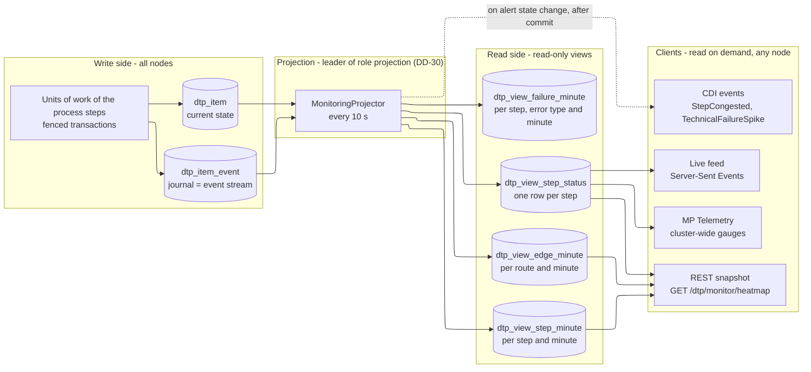
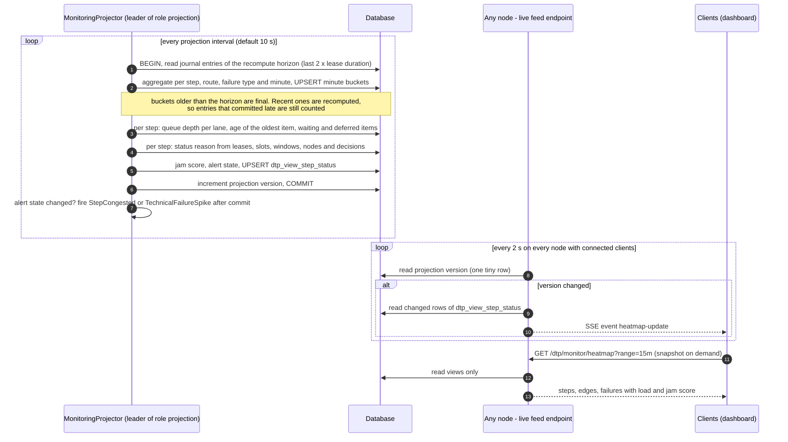
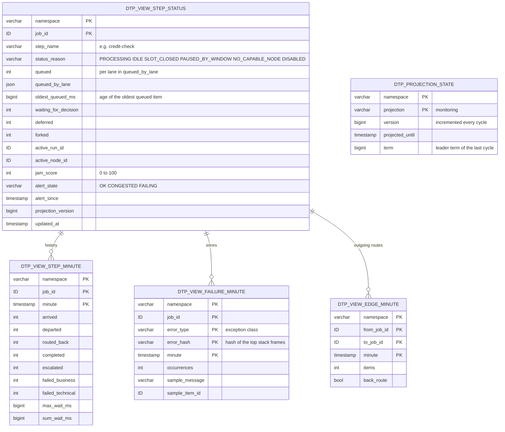
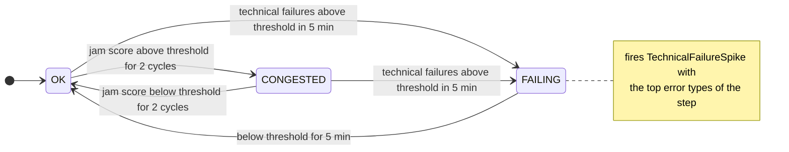
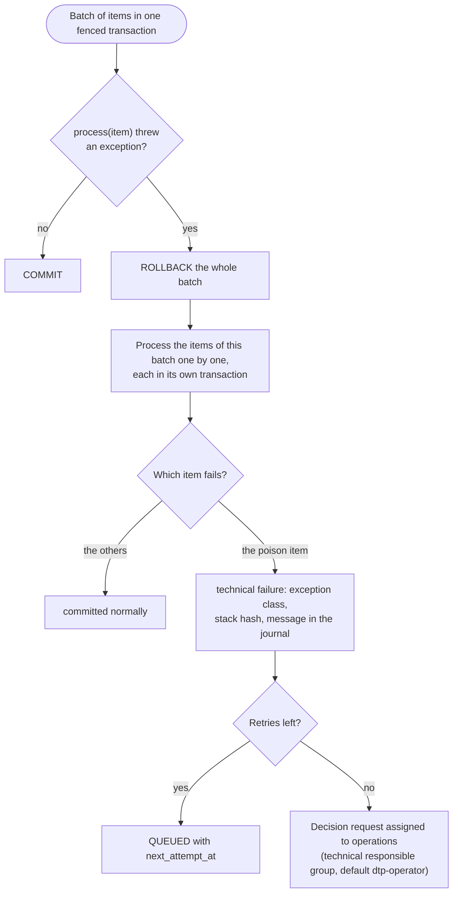
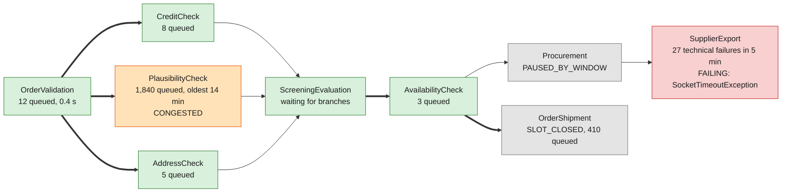
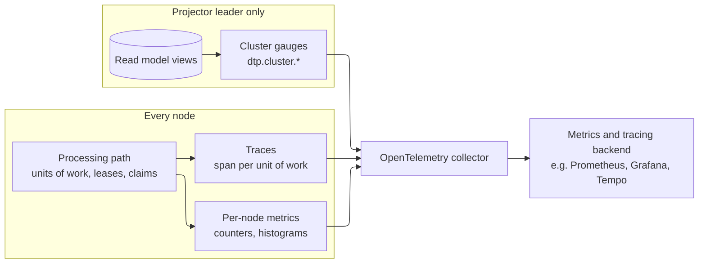
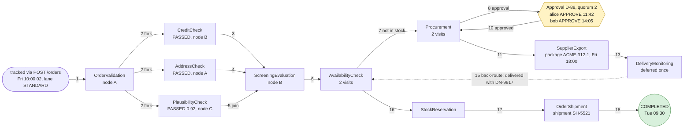
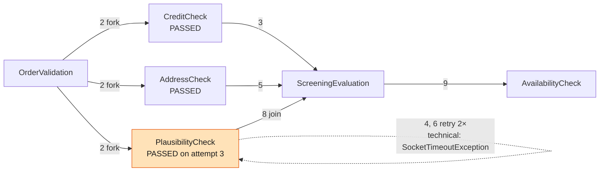

# 9. Monitoring – Heat Map and Live Feed (CQRS Read Model)

> **Draft (WIP):** first draft generated by Claude (AI). A detailed review will follow soon. See the [README](../../README.md).

Goal: a **heat map of the workflow** and a **live feed** that show at a glance where items jam and where unexpected
(technical) exceptions pile up, cluster-wide and without load on the processing tables. For a single item, a
**journey diagram** shows only the steps that item passed (§9.9).

## 9.1 Idea: CQRS with the Leader as Projector

- **Write side**: unchanged. Every unit of work already writes the item's current state and an append-only journal
  entry (DD-8). The journal **is** the event stream, so there are no extra writes on the processing path.
- **Projector**: a separate leader role (`projection`, DD-3). It can run on a different node than the housekeeping
  leader, and the same takeover rules apply. All its writes are idempotent upserts, so a briefly duplicated
  projector does no harm.
- **Read side**: small, denormalized tables. Clients only read them, from any node, as often as they like. The
  processing tables are never queried by monitoring clients.
- Can be disabled (`dtp.monitoring.enabled=false`), and the projection port is pluggable (e.g. later a projection into
  an external time-series store).

## 9.2 Projection Cycle

**Why the recompute horizon is enough.** A journal entry is written with DB time inside its unit of work and becomes
visible when that unit commits. A unit of work that runs longer than its lease can't commit, because the fence check
fails. So every entry becomes visible within one lease duration after its timestamp. Recomputing the last two lease
durations in every cycle therefore counts every entry exactly once, and no checkpoint per entry is needed.

## 9.3 Read Model Tables

- The views are **derived data**. They can be rebuilt from the journal at any time, and they have their own retention
  (default: minute buckets for 48 h, then hourly rollups). The journal itself keeps everything (D26).
- The projector reads the journal by `occurred_at`, which needs an index on `dtp_item_event (namespace, occurred_at)`
  (03 §3.5). On PostgreSQL, the monthly partitioning keeps this cheap.
- To compute `max_wait_ms` and `sum_wait_ms`, every departure event records how long the item waited in the inbox
  (`wait_ms` in the journal entry).

## 9.4 Jams vs. Expected Backlog

A queue alone isn't a jam. The projector derives a **status reason** for every step first. Only a step that should be
processing can be jammed:

| Status reason | Meaning | Counts as a jam? |
|---------------|---------|------------------|
| `PROCESSING` | A run is active and holds the lease | yes, if the thresholds are exceeded |
| `IDLE` | Nothing queued | no |
| `SLOT_CLOSED` | Outside the step's processing slot | no (shown as *waiting for slot*) |
| `PAUSED_BY_WINDOW` | Paused by an open collection window | no (shown as *paused*) |
| `DISABLED` | The job is disabled | no (shown as *disabled*) |
| `NO_CAPABLE_NODE` | Items are queued, but no active node has this step's handler (e.g. red/green mistake) | **always**: highest severity |

**Jam score (0–100)** for `PROCESSING` steps, from configurable thresholds in the job definition:
- age of the oldest queued item vs. `expected_max_queue_age` (e.g. `PT10M`),
- arrivals vs. departures over the last 5 minutes (a queue that keeps growing),
- no departures at all while items are queued (a stuck run).

**Alert states** are stored, so every transition fires exactly one CDI event, even across a change of the projector
leader:

As with decision requests, the framework never notifies people itself. The application observes `StepCongested`
and `TechnicalFailureSpike` and decides whom to inform. Jams don't change MP Health: a jam is no reason to restart
healthy pods.

## 9.5 Business vs. Technical Failures (DD-29)

The heat map needs to separate expected business outcomes from unexpected technical errors. This also defines what
happens when an `ItemProcessor` throws:

| | Business failure | Technical failure |
|---|---|---|
| Caused by | `item.fail(reason)`, a typed `FAILED` branch result | An exception thrown from `process(item)` / `execute(ctx)` |
| Journal | `FAILED`, `failure_kind = BUSINESS`, reason | `FAILED`, `failure_kind = TECHNICAL`, `error_type`, `error_hash`, message |
| Retries | Retry policy of the step | Retry policy of the step (separate counter) |
| When exhausted | Decision request for the **business** team | Decision request for **operations** (configurable group) |
| Heat map | `failed_business` | `failed_technical`, and the failure view per error type |

One bad item therefore never blocks its batch, and the other items continue.

## 9.6 What the Heat Map Shows (sample order flow)

Illustration with the steps of [08](08-sample-order-flow.md): node color = jam score or status, edge width = items per
minute.

Reading it: `PlausibilityCheck` is the bottleneck of the order screening (scoring is slower than the inflow).
`SupplierExport` fails technically (timeouts of the supplier gateway). `OrderShipment` has a large queue, but that's
expected: its slot is closed.

## 9.7 REST and Live Feed

| Endpoint | Content |
|----------|---------|
| `GET /dtp/monitor/heatmap?range=15m` | Snapshot: steps (status, queue, jam score, alert state), edges (items per minute, back-routes), failures per step |
| `GET /dtp/monitor/steps/{step}?range=24h` | Minute series of one step (arrivals, departures, waits, failures) |
| `GET /dtp/monitor/steps/{step}/failures?range=1h` | Top error types with a sample message and a sample item (link to its journey) |
| `GET /dtp/monitor/stream` | **Live feed** (Server-Sent Events, Jakarta REST `Sse`): `heatmap-update` with changed steps, `alert` on alert state changes |

All endpoints read only the views and require the role `dtp-viewer`. Sample messages and items may contain business
data, so the failure endpoints require `dtp-operator`.

## 9.8 Telemetry Metrics and Traces (MP Telemetry, DD-33)

The read model gives the **cluster-wide picture**, with a delay of one projection cycle. Telemetry metrics are the
**real-time signal** for dashboards and alerting in standard tools (OpenTelemetry collector, Prometheus, Grafana, …),
including percentiles that SQL views can't provide. Both are fed from the same events, so they tell the same story.

### Per-node metrics (emitted on the processing path, in memory, no DB access)

| Metric | Type | Attributes | Purpose |
|--------|------|------------|---------|
| `dtp.items.processed` | counter | `dtp.step`, `dtp.lane`, `dtp.result` (`routed`, `routed_back`, `completed`, `deferred`, `escalated`, `failed`), `dtp.failure.kind` | Throughput and failure rate per step |
| `dtp.item.wait_time` | histogram (s) | `dtp.step`, `dtp.lane` | Time in the inbox until processing starts. Real percentiles (p95, p99) per lane, e.g. "VIP orders wait < 30 s" |
| `dtp.unit_of_work.duration` | histogram (s) | `dtp.step` | Batch and package duration. Compare with the lease duration (DD-12) |
| `dtp.unit_of_work.rollbacks` | counter | `dtp.step`, `dtp.rollback.reason` (`exception`, `lease_lost`) | Rolled-back batches, incl. poison-item isolation (§9.5) |
| `dtp.failures.technical` | counter | `dtp.step`, `error.type` (exception class) | Technical failures per error type |
| `dtp.runs.finished` | counter | `dtp.step`, `dtp.run.outcome` | Run outcomes |
| `dtp.run.duration` | histogram (s) | `dtp.step` | Run durations (cycles for continuous steps) |
| `dtp.claim.duration` | histogram (s) | – | Time from `PENDING` to claimed (scheduling lag) |
| `dtp.claim.conflicts` | counter | – | Lost claim races (DD-13). Rising values point at too many nodes or too short poll intervals |
| `dtp.lease.renewals` / `dtp.lease.lost` / `dtp.lease.takeovers` | counter | `dtp.step` | Lease health. `lost` and `takeovers` should be close to 0 |
| `dtp.leader.elections` | counter | `dtp.leader.role` | Leader changes (housekeeping, projection) |
| `dtp.decisions.created` / `dtp.decisions.decided` | counter | `dtp.step`, `dtp.decision.kind`, `dtp.responsible.group` | Human-in-the-loop load per team |

### Cluster gauges (exported only by the projector leader, from the views)

| Metric | Attributes | Purpose |
|--------|------------|---------|
| `dtp.cluster.queue.depth` | `dtp.step`, `dtp.lane` | Queued items per step and lane |
| `dtp.cluster.queue.oldest_age` | `dtp.step` | Age of the oldest queued item (s), the primary jam signal |
| `dtp.cluster.step.jam_score` | `dtp.step`, `dtp.step.status_reason` | 0–100, as in the heat map |
| `dtp.cluster.step.alert_state` | `dtp.step` | 0 = OK, 1 = CONGESTED, 2 = FAILING |
| `dtp.cluster.items.waiting_for_decision` | `dtp.step`, `dtp.responsible.group` | Items waiting for people |
| `dtp.cluster.decisions.oldest_open_age` | `dtp.responsible.group` | Oldest open decision per team (s) |
| `dtp.cluster.nodes` | `dtp.node.color`, `dtp.node.state` | Cluster membership (red/green) |

Only the current projector leader reports these gauges, and a revoked leader stops reporting them immediately. The
series may therefore move between instances on a leader change, so dashboards aggregate without the instance
attribute (e.g. `max by (dtp_step)`). Every metric also carries `dtp.namespace` and the standard resource attributes
(service name, version, `dtp.node.color`).

### Rules
- **Bounded cardinality**: attributes are only steps, lanes, outcomes, kinds, groups and exception classes. Never item
  ids, business keys, run ids or messages: those belong in the journal and in traces.
- **Exemplars**: histograms carry exemplars, so a slow batch in Grafana links directly to its trace.
- **Application metrics** stay in the application (MP Telemetry API). The framework doesn't wrap them.

### Traces: an item's journey across asynchronous steps
- Every unit of work is a span (`dtp.step`, batch size, run id). Continuous runs don't get one endless span: each
  cycle and batch is its own span.
- When an item is tracked inside a traced request (e.g. `POST /orders`), the trace context (`traceparent`) is stored
  with the item. Spans of later steps **link** to it, so a tracing backend can follow one order from the REST call
  through all steps, even though they run asynchronously on different nodes and days.
- The journal entry stores the trace id of the unit of work, so it's possible to jump from the item journey to the
  trace and back.

## 9.9 Journey Diagram per Item (DD-34)

The heat map shows the whole flow. For a single item, users want the opposite: **only the steps this item passed**,
in order, with the reasons. The engine folds the item's journal entries (`dtp_item_event`, indexed by item) into a
graph and returns it as a diagram. It needs no projection and adds nothing to the processing path.

### Example: order O-4711 (the journey of [08 §8.7](08-sample-order-flow.md))

This is what `GET /dtp/items/order/O-4711/journey/diagram` returns (rendered here). Edge labels are the numbers of the
journal entries, so the diagram and the journey table refer to each other:

An item that isn't finished ends at its current step instead, highlighted and annotated with the status reason from
the monitoring read model, e.g. *"waiting since 14:12: SLOT_CLOSED, next slot Mon 06:00"* or *"WAITING_FOR_DECISION
D-91: 1 of 2 approvals"*.

### Folding rules
- **Nodes** are the steps the item visited, once each. Repeated visits (loops, back-routes) show as *n visits*, and
  the edges keep their journal numbers, so the order stays visible.
- **Branches** of a fork show as parallel edges from the forking step, with each branch's typed result, and join at
  the join step.
- **Decisions and approvals** are separate nodes, with the votes (who, what, when).
- **Packages** are shown at the step that sent them (e.g. the XML file name).
- **Back-routes** are dashed and carry their reason.
- **Retries** are shown at the step where they happened (see below).
- **Long journeys** collapse parallel edges between the same two steps into one edge (e.g. *"6, 15, 24 (3×)"*).

### Retries in the journey

Every attempt that leaves a trace in the journal is shown:

| Situation | Journal | Diagram |
|-----------|---------|---------|
| Business or technical failure with retries left | `FAILED` (kind, error type) + `RETRY_SCHEDULED` (next attempt) | Self-loop on the step: *"retry 2× (technical: SocketTimeoutException)"*, and the step shows *"succeeded on attempt 3"* |
| Retries exhausted | `FAILED` + `ESCALATED` | Decision node with the decided option, e.g. `RETRY` by an operator (the retry counter starts again) |
| Item reprocessed because its batch was rolled back (another item failed) | `REPROCESSED` (reason: batch rollback) | Annotation *"reprocessed once after a batch rollback"*. Not counted as a retry of this item |
| Work redone after a takeover | every entry carries the run attempt | Annotation *"processed in run attempt 2, after a takeover from node A"* |
| Package retries | attempts and rejections of the package | At the package: *"sent in attempt 2, attempt 1 rejected by the supplier"* |

Example: the plausibility scoring service timed out twice for order O-4802, and the third attempt passed:

The rule behind it: the journal only contains what was **committed**. Attempts whose transaction was rolled back can't
write anything. So the engine records afterwards what it knows: `REPROCESSED` when it re-runs the items of a
rolled-back batch, and the run attempt on every entry. A retry that happened is never hidden, and an attempt that
left no effects is described as such.

### Endpoint

| Request | Result |
|---------|--------|
| `GET /dtp/items/{itemType}/{businessKey}/journey/diagram` | Mermaid source (`text/plain`) of the item's journey |
| `GET /dtp/items/by-id/{itemId}/journey/diagram` | Same, by the internal item id |
| `…/journey/diagram?format=json` | The folded graph (nodes, edges, annotations) for custom UIs |
| `…/journey/diagram?detail=steps` | Steps only, without decisions, packages and annotations |
| `…/journey` | The journey as a table (all journal entries), as in 08 §8.7 |

- **Why Mermaid source instead of an image**: browsers render it with mermaid.js, and so do GitHub, GitLab, wiki tools
  and the Mermaid CLI. A user can paste it into a ticket. The framework needs no rendering library and stays without
  a UI (mission §3). A small viewer page could be added later.
- **Security**: the endpoint requires `dtp-viewer` for the namespace. Labels contain business text (reasons, comments),
  so the engine escapes and truncates them before embedding them in Mermaid. Clients render with Mermaid's strict
  security level. Technical details (error messages, node names) are only included for `dtp-operator`.
- **Links**: in the JSON format, nodes carry the ids of runs, decision requests, packages and traces, so a UI can link
  each step to its run, its decision and its trace (§9.8).
